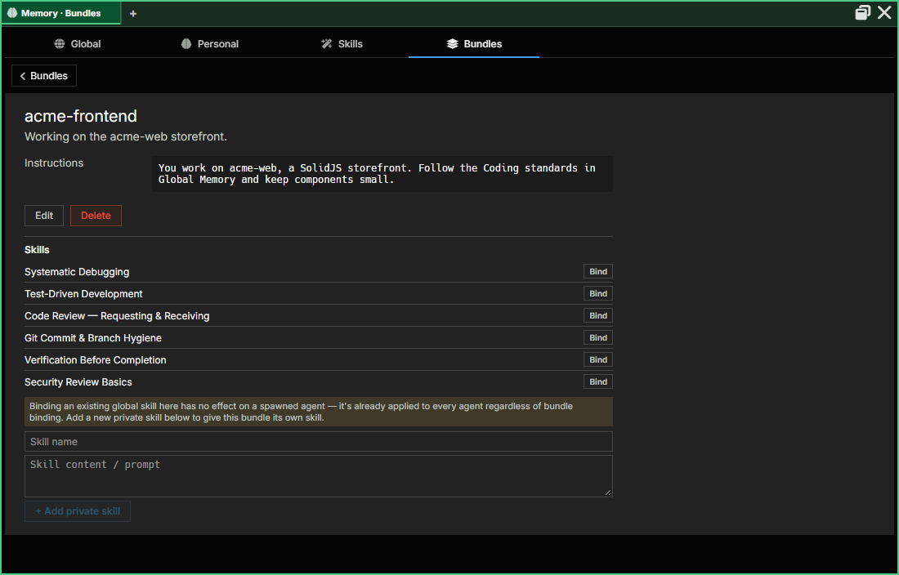
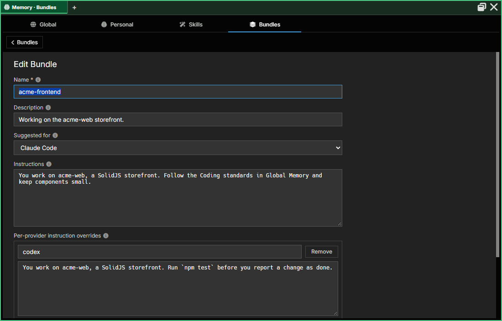

:::caution[Alpha Software]
AgentMux is **alpha software** and under heavy active development. Many features described in these docs may be incomplete, unstable, or not yet implemented. Expect breaking changes between releases. We welcome bug reports and feedback on [GitHub Issues](https://github.com/agentmuxai/agentmux/issues) or [Discord](https://discord.com/invite/96erama9Ar).
:::

A **Bundle** is a reusable set of what an agent starts with: instructions (a system prompt, the "Soul"), per-provider instruction overrides and skills. You manage bundles in [Memory → Bundles](/memory/#bundles). An agent takes [several, in order](#an-agents-bundles), picked when you create it and changed later from **Bundles…** in its **My Agents** panel or its pane's right-click menu. You can import a bundle from an [Agent Bundle Format (ABF)](/abf/) file.

## What goes in a bundle

The New/Edit Bundle form has Name, Description, an optional **Suggested for** (provider and vendor), Instructions and per-provider instruction overrides. After a bundle is saved, its detail view adds a **Skills** section. See [First Agent Setup → Bundles](/first-agent/#bundles) for the form, field by field.

| Field | Purpose | Editable in the UI today? |
|---|---|---|
| `instructions` | System prompt / Soul. Long-form text describing the agent's personality, priorities, and behavior, delivered through the provider's startup instructions file. | Yes |
| `instructions_by_provider` | Per-provider overrides that replace `instructions` when the bundle runs on that provider. | Yes |
| `provider` / `model` | **Suggested for**: the provider and vendor the bundle was made with in mind. A hint only; the agent's own provider decides which harness runs. Optional. | Yes |
| `context_files` | Array of `{path, content}` entries, such as an `AGENTS.md` or `CLAUDE.md` for a project. They travel in an [`.abf` file](/abf/); AgentMux doesn't deliver them to an agent at launch. | No, stored as JSON |
| `skills` | **Skill primitive IDs**: see [Memory → Skills](/memory/#skills). | Yes, after saving |

A bundle holds no MCP servers. Those are bound to agents in [Connectors](/connectors/#mcp-servers).

## An agent's bundles

An agent starts with an ordered list of the bundles you pick for it. With none, it runs the harness as it comes ("vanilla CLI"), plus [Global Memory](/memory/#global).

You pick bundles in these places, all with the same control: each picked bundle has **Move up**, **Move down** and **Remove**, and **Add a bundle…** lists the rest.

| Where | When it's saved |
|---|---|
| The new-agent panel's **Bundles** field | When you click **Create and start**. It starts empty. |
| **Bundles…** in the agent's **My Agents** panel, or in its pane's right-click menu | On each change. |

**At launch,** in list order:

- **Instructions:** each picked bundle with instructions becomes a section of the agent's startup file (`CLAUDE.md`, `AGENTS.md`, `GEMINI.md`, …), headed `# [Bundle] <name>`, after the Global Memory sections (`crates/srv/src/backend/storage/agent_bundles.rs`). The instructions are no longer sent as the agent's first message. A bundle deleted since it was picked is skipped.
- **Skills** from every bundle in the list are added to the agent's own. When two bundles name the same skill, the first one wins.
- **The provider** stays the agent's own. A picked bundle doesn't change which harness runs.

The list is kept per [channel](/glossary/#channel). Deleting a bundle takes it out of this channel's lists.

## Where bundles are managed

Bundles are managed **app-wide only**:

1. Click **Memory** in the widget bar, or run **Memory** from the command palette.
2. Switch to the **Bundles** section.





**Bundles…** (in an agent's **My Agents** panel, or in the right-click menu of its pane) picks which bundles that agent starts with, and links to **Memory → Bundles**, but doesn't edit bundles itself.

:::caution[Bundles are not Personal Memory]
The **Global** and **Personal** sections of [Memory](/memory/), and the **Personal memory** item in an agent pane's right-click menu, do **not** open the Bundle editor described on this page. They open **Global Memory** and **Personal Memory**, different primitives covered on the [Memory](/memory/#personal) page.
:::

## Native memory

Personal Memory, the notes an agent keeps about itself (stored as "native memory"), is not a bundle. It's covered on the [Memory](/memory/#personal) page, with the memory record that makes it follow an agent across accounts and channels.

## Launch flow

The new agent's fields, in the panel that opens under a template card in the agent picker:

```
┌────────────────────────────────────────────────┐
│ New Claude Code agent                           │
│  Name:      [my-agent_________]                 │
│  Runtime:   [▼ Native (runs on this computer) ] │
│  Model:     [▼ opus ]                           │
│  Bundles:   Reviewer                 ↑ ↓ ✕      │
│             [▼ Add another bundle… ]            │
│                                                 │
│  [Cancel]                [Create and start]     │
└────────────────────────────────────────────────┘
```

It has no account field: the agent takes the provider's first account, which you can change later from the login email in its composer strip.

## Persistence

Bundles live in the `db_bundles` table of the shared store. A row has a name, a description, the suggested `provider` and `model`, `instructions`, `instructions_by_provider` and `context_files` (both JSON), the `skills` it references, a `sort_order`, and the flags `is_blank` (the "vanilla CLI session" bundle), `is_global` (a [Global Memory](/memory/#global) entry) and `is_system`. The table is defined in `crates/srv/src/backend/storage/migrations.rs`.

An agent's picked bundles are rows of the per-channel `db_agent_bundles` table (`agent_id`, `bundle_id`, `position`).

## Bundles and per-instance overrides

A bundle is the **definition** — reusable across many agent instances, edited in [Memory → Bundles](/memory/#bundles).

When you launch an agent, AgentMux composes the bundle's settings with whatever overrides the running pane has accumulated, then spawns the provider's CLI with the resulting `launchArgs` and env. Two agents using the same bundle but different overrides land on different actual configs at launch.

## See also

- [Memory](/memory/) — where Bundles, Global Memory, Personal Memory and Skills are managed
- [Connectors](/connectors/) — accounts and MCP servers
- [Agent Bundle Format (ABF)](/abf/) — the bundle file format
- [Identity & Accounts](/identity/) — the other half of agent composition
- [First Agent Setup](/first-agent/) — provider login flows
- [Pane Types](/pane-types/) — where Bundles and Personal Memory surface in the UI
