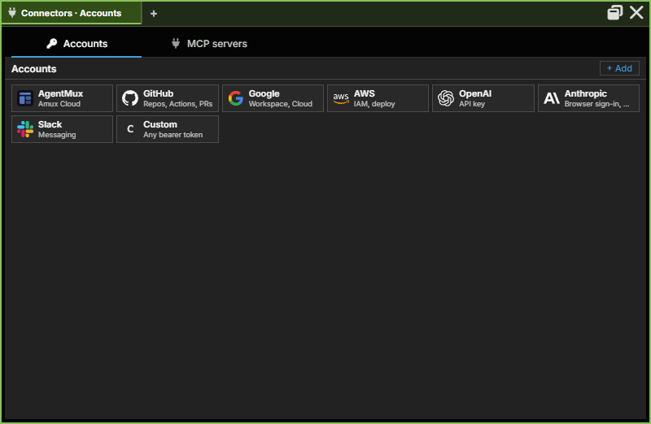
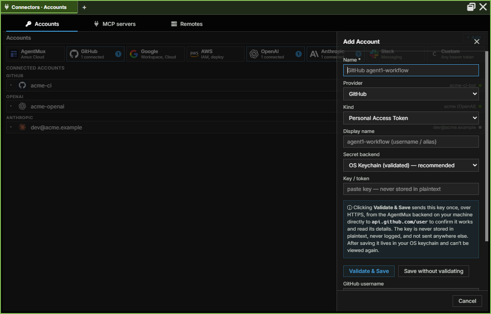
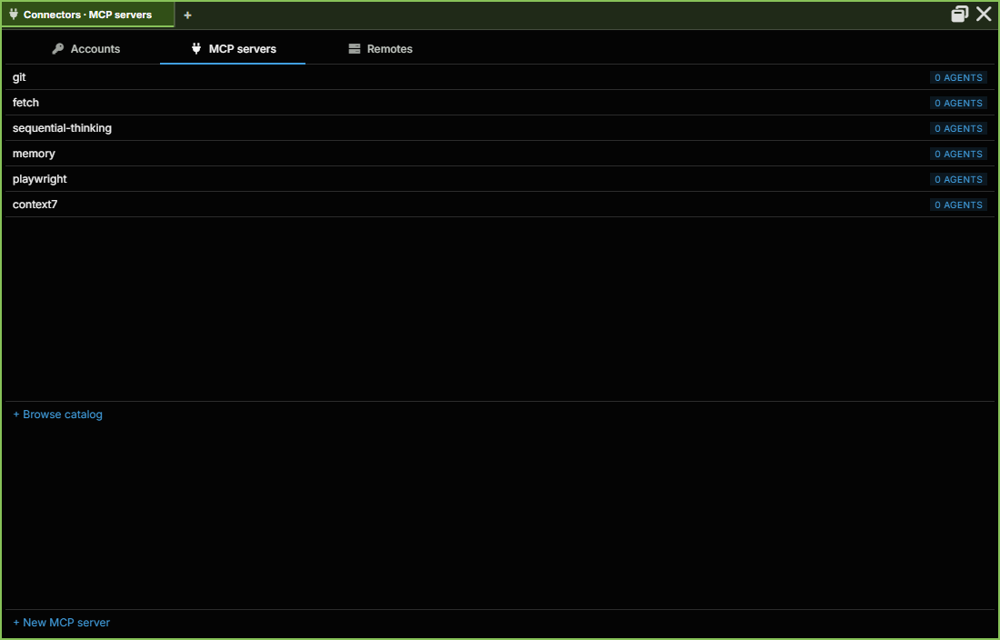
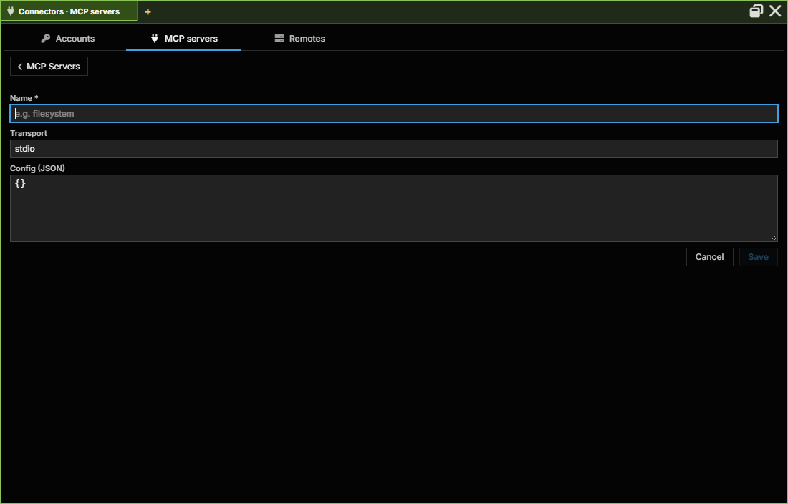
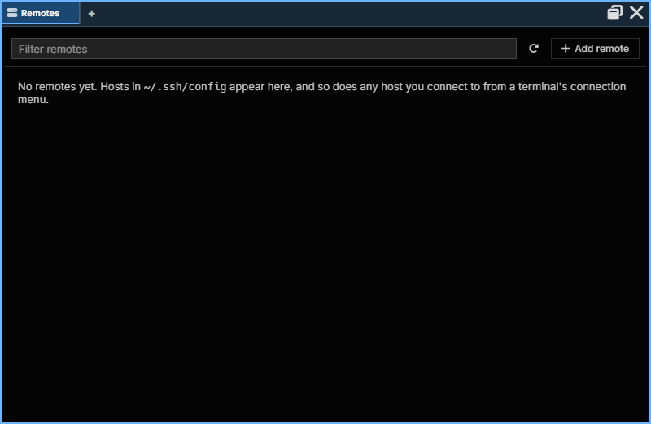

:::caution[Alpha Software]
AgentMux is **alpha software** and under heavy active development. Many features described in these docs may be incomplete, unstable, or not yet implemented. Expect breaking changes between releases. We welcome bug reports and feedback on [GitHub Issues](https://github.com/agentmuxai/agentmux/issues) or [Discord](https://discord.com/invite/96erama9Ar).
:::

**Connectors** is the app-wide pane for what agents connect to outside AgentMux: the accounts they sign in with, the MCP servers they use, and the remote hosts they run on. Its companion pane, [Memory](/memory/), holds what agents know and carry: Global and Personal Memory, Skills and Bundles.

Connectors is a regular pane (icon: `plug`), opened from the widget bar like any other. It has three sections, as tabs along the top of the pane (`frontend/app/view/connectors/connectors.tsx`):

| Section | What it manages |
|---|---|
| **Accounts** | Sign-ins to providers and services: Claude, Codex, GitHub, Google (Gmail, Calendar and Drive), AWS, OpenAI, Anthropic, Slack, AgentMux Cloud and a custom bearer token. Each account card says how many agents use it. |
| **MCP servers** | The MCP server catalog: global servers plus any agent-private ones |
| **Remotes** | The SSH hosts and WSL distributions AgentMux can open terminals, files and agents on. See [Remotes](#remotes). |

Connectors opens on **Accounts**. The pane title names the section, for example "Connectors · Accounts". In a narrow pane the tabs show only their icons; in a wide one they stop growing and sit at the left. `Ctrl` + mouse wheel zooms the pane.

The agents that use an account or a server are listed on its card or page here. An agent's own account is changed from its composer strip: see [Changing which account an agent uses](#changing-which-account-an-agent-uses).

## Opening Connectors

- **Widget bar:** click **Connectors**. It is pinned by default. If a Connectors pane is already open in the tab, the click focuses it instead of opening another.
- **Command palette:** run **Connectors**. Searching for "accounts", "mcp" or "remotes" also finds it.
- **macOS app menu:** **Connectors…**.

Links elsewhere in the app open Connectors on the right section:

- An agent pane that can't sign in shows **Connectors → Accounts** in its error row, and **Accounts (switch / upgrade)** when a usage limit is reached. See [First Agent Setup → Sign in](/first-agent/#sign-in).

AgentMux moves panes saved under an earlier name, once, the first time it starts after updating: an Armory pane (the earlier pane that held both Connectors and Memory) becomes Connectors for Accounts and MCP servers and Memory for the rest, and a Remotes pane becomes **Connectors → Remotes**. A layout file that uses the old names opens the same way.

## Accounts

The Accounts section shows every service AgentMux can connect to. Each entry displays the service logo, connection status, and the active credential type.

### Connecting a service

Click any service tile to connect or manage credentials:

- **OAuth providers** (Claude, Codex, Gemini, GitHub Copilot) — clicking **Connect** opens a PKCE or Device Flow browser login. The resulting token is stored in a per-account credential dir under `~/.agentmux/shared/identities/<account_id>/<provider>/` (never plaintext via AgentMux). Tokens are validated against the live service on load — an expired token shows a ⚠ badge.
- **GitHub** — **Connect GitHub** needs an **AgentMux Cloud sign-in**. It uses AgentMux's own GitHub App through AgentMux Cloud, which is where the GitHub tokens your agents use come from. Without a sign-in, the Connect button is replaced by **Sign in to AgentMux Cloud to connect GitHub**, a note that GitHub tokens for your agents come from AgentMux Cloud, and the sign-in choices: **Continue with Google**, **Continue with Apple** or email (the same sign-in as the **AgentMux** tile and Settings). When you are signed in, the status turns connected and **Connect** comes back. If you save an OAuth app of your own for GitHub in the tile's form, Connect uses that instead and needs no sign-in. See [A connected GitHub account](#a-connected-github-account).
- **Google** — a PKCE browser login with an OAuth client of your own. See [Google: Calendar, Drive and Gmail](#google-calendar-drive-and-gmail).
- **API key providers** — clicking **Connect** opens an inline key entry field. The key is validated against the service before it's saved and stored in the provider's auth-config dir with restricted permissions.

**+ Add** opens the Add Account form instead: a name, the provider and kind, a display name, where the secret is kept (the OS keychain is recommended), and **Validate & Save** or **Save without validating**.

See [Auth flows](/auth/) for the full per-provider table and credential storage model.

### A connected GitHub account

Open the account's details to see its **GitHub sign-in**: **Connected as** `@login (id …)`, the **Client**, and what GitHub **Allowed**. A GitHub account connected through AgentMux Cloud refreshes its token on its own, and AgentMux ends the grant when you remove the account. If you revoke AgentMux on GitHub, the account shows **Reconnect needed** and a **Reconnect** button; AgentMux notices when you open the details. An account made with an OAuth app of your own, or while signed out of AgentMux Cloud, uses GitHub's device flow, and its token isn't refreshed: it asks you to connect again when it expires.

With GitHub connected, agents push and open pull requests on the repositories where the AgentMux GitHub App is installed, as the App's bot, with a short-lived token for that one repository. Their pushes go through a secret scan that `git push --no-verify` can't skip, their commits name you as co-author and carry an `Agent:` trailer, and their pull requests carry your GitHub id. Changing CI workflow files needs a per-agent opt-in.

### Google: Calendar, Drive and Gmail

Click the **Google** tile and **Connect with OAuth**. The sign-in runs in your browser with an OAuth client you make once in the Google Cloud console: an OAuth client ID of type **Desktop app**, with the consent screen set to External, or Internal for your Workspace organization. Paste its client ID and secret into the form. AgentMux keeps them in your OS keychain, so you do this once, and the form shows **Using your saved client** afterwards, with **Use a different client** and **Forget this client**. The form's **Client type** is **Your own client** or **Workspace internal**. If your organization blocks the app, the account says **Blocked by your organization**.

The account's details list its **Services**. Each one is **On**, **Partly granted** or **Off**, and **Turn on** asks Google for that service's permissions only:

| Service | What agents you allow can do |
|---|---|
| **Calendar** | Read your calendars, events and free/busy times. |
| **Drive** | Read the files you pick for them in Google's file picker (**Give agents files from Drive…**) and the files AgentMux makes. Never the rest of your Drive. |
| **Gmail** | Search and read your mail: threads, messages and labels. Attachments are listed by name, type and size, never downloaded. |

Gmail needs your own client, or your organization's internal one: Google reviews apps that read mail, and AgentMux's own client hasn't been through that. Under Gmail, **Drafts, labels and sending** is a separate consent (**Allow drafts, labels and sending**) that lets agents you allow to write draft mail, put labels on threads and take them off. They can't send or delete on their own: to **send** a draft, or to **move a thread to the trash**, the agent has to ask, and a window shows you the mail as it will go. Nothing happens until you approve it. The request waits up to two minutes, and fails if you say no, don't answer, or the draft changes after you approve.

Under **Agents** the details list the agents bound to the account, with a control for each service: **Off**, **Read**, and for Gmail **Read and write**. An agent sees a `Calendar`, `Drive` or `Gmail` tool only for a service you gave it. Mail, events and file text are written by other people, so the tools mark them as untrusted and the agent is told never to follow instructions found in them. **Activity** at the bottom lists what each agent did with the account: the action and the thread, draft or event ids, never the mail.

### Changing which account an agent uses

Connectors doesn't bind accounts to agents. An agent's account is changed from the agent: click the login email in its composer strip and choose an account, or **Sign in with another account…**. The menu lists every signed-in account of the agent's provider, with its quota state. See [Identity & Accounts → Changing an agent's account](/identity/#changing-an-agents-account).

What Connectors shows is the other direction. A card reads "Used by N agents", and an open account lists those agents by name. Accounts that share a provider and an email are numbered (`user@example.com ·2`) so they can be told apart here and in the agent's menu.

Right-click an account card for **Copy account ID**, **Fail over to this account** and **Delete account…**. **Fail over to this account** is ticked unless you have marked the account "never fail over to this": an agent that hits its usage limit is never moved onto a marked account by itself. See [Identity & Accounts → When an agent hits its usage limit](/identity/#when-an-agent-hits-its-usage-limit). The item is offered for accounts of the providers that run agents.

### Failing over to another account

When an agent reaches its usage limit, AgentMux moves it after its turn to another signed-in account of the same provider that has quota, and tells the agent and its lead (`agent:accountfailover`, on by default). It never picks a signed-out account. To keep an account out of this, right-click it and clear **Fail over to this account**. The item shows only for an account that agents run on.

### Credential storage

Ambient provider credentials (used by agents with no Account explicitly bound) are stored account-wide under `~/.agentmux/shared/providers/<provider>/` — always global, unconditionally shared across every channel and version. Credentials for an explicitly-connected or bound **Account** are shared by every channel too, unless `AGENTMUX_ISOLATED_AUTH=1` gives one channel its own, empty account list for testing. See [Auth flows → Isolated auth by channel](/auth/#isolated-auth-by-channel).

### Relationship to Identities

The Accounts section is the **credential store**. To see which agents use an account, open its card. See [Identity & Accounts](/identity/) for how agents and accounts are linked.

## MCP servers

The catalog of MCP Server primitives available to agents:

- **Global servers** — visible to and bindable by any agent. Created/edited here via the catalog (`mcp.catalog.upsert`/`mcp.catalog.delete`).
- **Private servers** — created by a specific agent (`mcp.upsert`), visible only to that agent until bound elsewhere.

Open a server to see who gets it. **All agents** gives it to every agent at launch, and **Containers too** extends that to container agents. **Bound to** lists the agents it is bound to, each with **Unbind**, and **Bind to agent** binds another. A server reaches an agent when that agent next starts. A [bundle](/bundles/) can also include MCP servers. See [MuxAPI](/internals/muxapi/#mcp) for the full RPC reference.

## Remotes

The hosts AgentMux can open terminals, file browsers and agents on: the SSH hosts in your `~/.ssh/config`, hosts you've connected to, and on Windows your WSL distributions (`frontend/app/view/remotes/remotes-view.tsx`). Besides the Connectors tab, it's reached from **Manage remotes…** in a pane's connection picker and in the Places sidebar of the Files pane, and from **Remote settings…** in the header menu of a pane running on a remote, which opens it with that host's row expanded.

- **Toolbar:** **Filter remotes**, **Refresh** and **+ Add remote**. Add remote takes the destination as you'd type it after `ssh` (`user@host:port`, the port optional); **Advanced** sets a **Name**, an **Identity file** and a host to **Connect through**. Writing a new host into your ssh config waits for you to confirm it in a separate AgentMux window.
- **Sections:** **Pinned**, **SSH hosts**, **Recent**, **WSL** and **Hidden**, each collapsible. With none yet, it reads "No remotes yet. Hosts in `~/.ssh/config` appear here…".
- **A row** shows the host's colour and connection status, its nickname, platform and helper state, how many sessions and agents use it, and buttons for **New terminal** and **Browse files**. Right-click a row for the same actions as a menu.
- **Click a row** to expand it: **Connect** / **Disconnect**, **Sessions…** (the host's durable terminal sessions), **Pin**, **Hide**, **Forget**, **Remove helper**, **Test connection** and **Edit in ssh config**; settings for **Nickname**, **Colour**, **Keep sessions alive** and **Install the helper**; and the agents **always allowed here (as you, with your SSH keys)**, each with **Revoke**.

### SSH terminals that survive a dropped link

An SSH terminal can be **durable**: its shell keeps running on the host, inside AgentMux's small helper there, so a dropped link, your computer sleeping or an AgentMux restart reconnects to the same shell instead of ending it.

Durable terminals need the helper on the host. The first terminal you open on a host without it asks first, in a separate AgentMux window: **Install AgentMux's helper on *host*?** The helper is about 500 KB, goes in `~/.agentmux-remote` on that machine and needs no root. It also lets [Files](/pane-types/#files) browse the host's files.

- **Install** installs it, and the terminal is durable.
- **Not now** opens a plain SSH terminal, as before. AgentMux doesn't ask again for that host until it restarts.
- Tick **Don't ask again for *host*** to make the answer stick: with Install it becomes **Always** for that host, with Not now **Never**.

All the terminals waiting on the same host share one question, so a restart with several of them open asks once. If the helper is later removed from the host, the next terminal asks again. A first terminal on a host it can't reach (a mistyped name, a host that's down) becomes a plain terminal showing ssh's error after a few tries, instead of reconnecting for ever. An install that an agent's pane needs is always asked about, whatever the settings say.

To remove the helper, expand the host's row here and choose **Remove helper**. **Sessions…** lists the host's durable terminal sessions.

The settings:

| Where | Setting | Choices |
|---|---|---|
| Settings ▸ Terminal ▸ **Keep SSH sessions alive** (`term:durable`) | Whether SSH terminals are durable | **On, else a plain terminal** (the default: durable where the helper is or gets installed), **Always (needs the helper)**, **Never** |
| Settings ▸ Terminal ▸ **Install the helper on new hosts** (`conn:helper`) | Whether to ask before installing the helper | **Ask first** (the default), **Always**, **Never** |
| A host's row here: **Keep sessions alive** and **Install the helper** | The same two, for that host only | They override the settings above |

### Remote terminals in the tab strip

A terminal on a remote machine names the remote in its pane tab: the nickname you gave it here, or else the host name, with the remote's icon. A Sysinfo pane on a remote reads "CPU · *host*". The CPU and memory badge of an SSH or WSL terminal shows the remote shell's own figures, measured on that machine.

## See also

- [Memory](/memory/) — Global and Personal Memory, Skills and Bundles
- [Auth flows](/auth/) — per-provider OAuth flows, API key storage, and credential storage model
- [Identity & Accounts](/identity/) — how agents and accounts are linked
- [MuxAPI](/internals/muxapi/) — `mcp.*` and `identity.*` RPC catalogs
- [First Agent Setup](/first-agent/) — connecting your first provider
