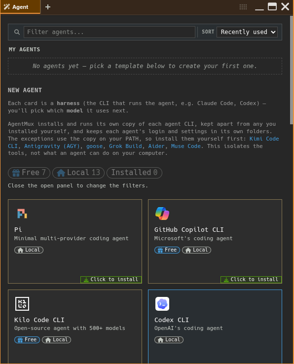
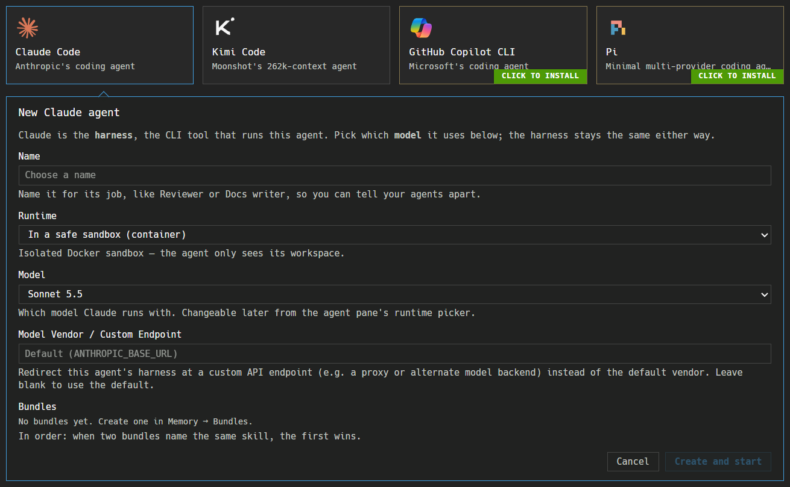
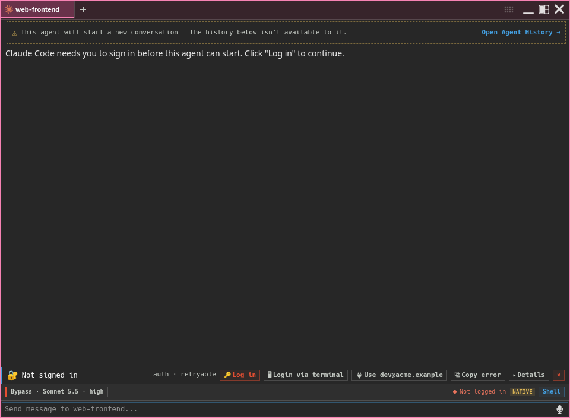
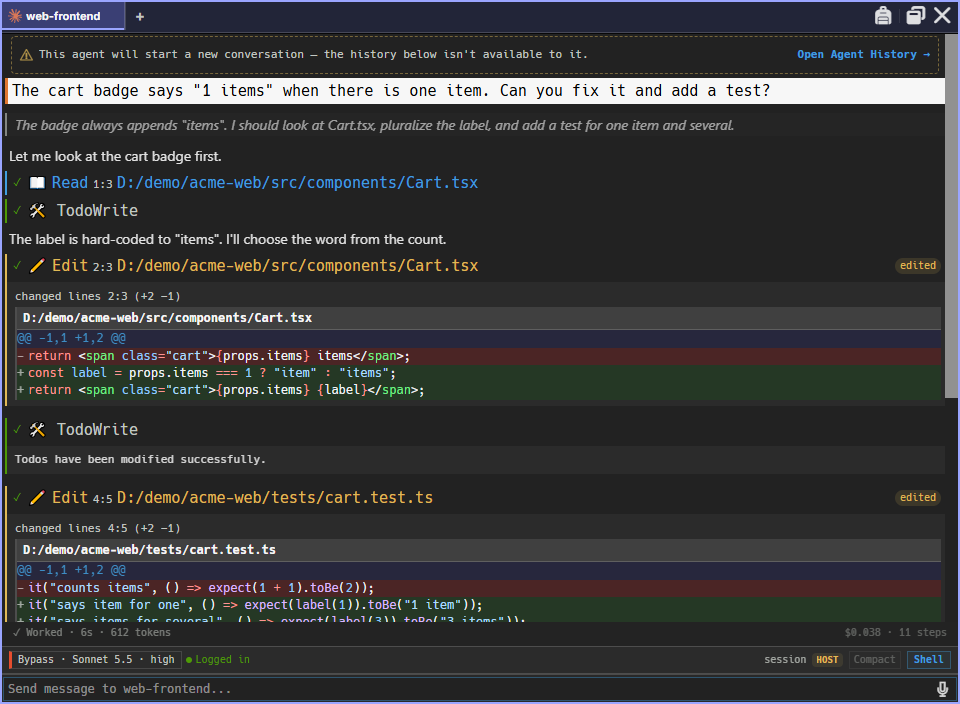
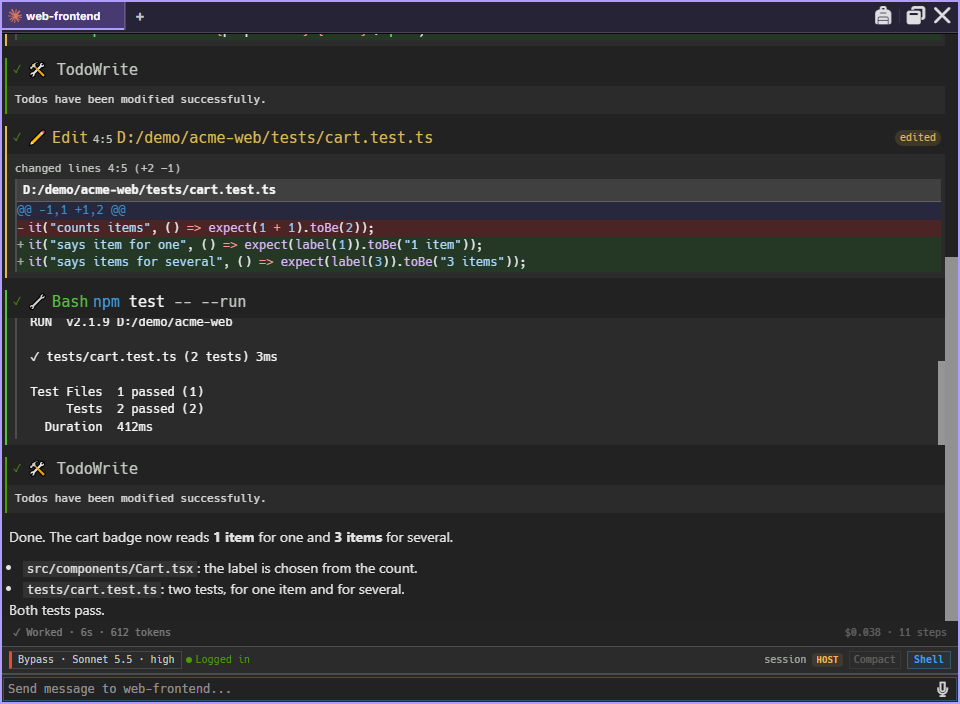
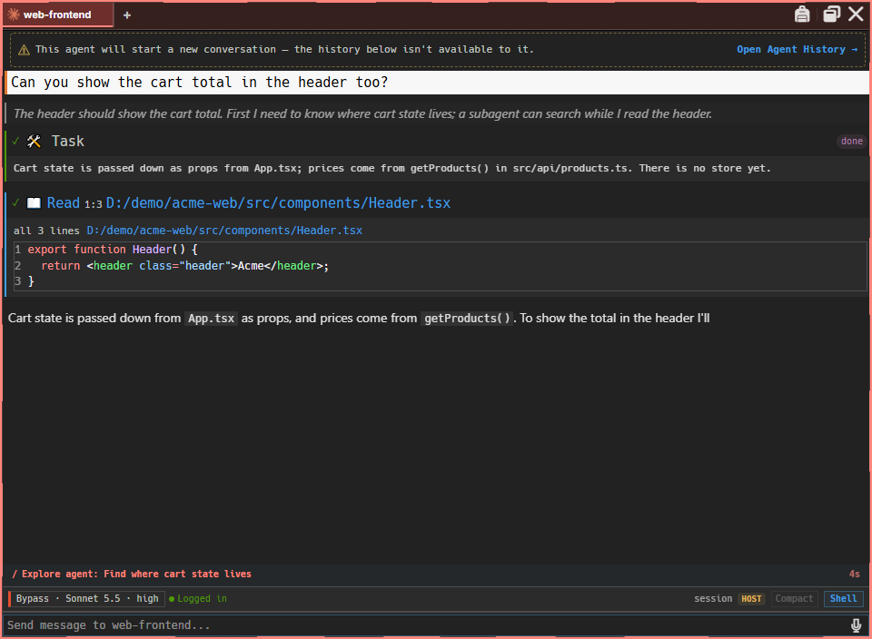
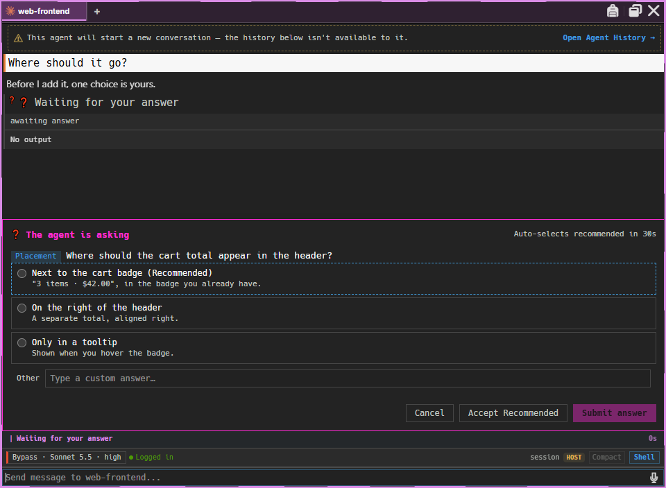

:::caution[Alpha Software]
AgentMux is **alpha software** and under heavy active development. Many features described in these docs may be incomplete, unstable, or not yet implemented. Expect breaking changes between releases. We welcome bug reports and feedback on [GitHub Issues](https://github.com/agentmuxai/agentmux/issues) or [Discord](https://discord.com/invite/96erama9Ar).
:::

This guide walks through creating and running an agent. In AgentMux an agent is not a terminal wrapper: each one gets its own structured pane, with an identity, optional memory, a streaming parser and a lifecycle.

## Harnesses and providers

A **harness** is the CLI tool that runs an agent, such as Claude Code or Codex CLI. The UI and the code mostly call it a "provider". A harness is distinct from the **model vendor**, the LLM backend that actually serves its responses.

AgentMux knows nineteen providers: Claude Code, Codex CLI, Mux Code, Gemini CLI, Qwen Code, Kimi Code CLI, OpenClaw, Pi, GitHub Copilot CLI, Antigravity (AGY), Kilo Code CLI, Cline CLI, OpenCode, goose, Grok Build, DeepSeek Harness, Aider, Crush and Muse Code. They're defined in `frontend/app/view/agent/providers/catalog.ts` (`PROVIDERS`) and `crates/srv/src/backend/providers.rs`. The agent picker has a template for seventeen of them. Mux Code and Qwen Code don't have one yet.

Most harnesses run in the agent pane: AgentMux reads the CLI's structured output and shows the conversation, tool calls and edits itself. Aider, Crush and Muse Code have no interface AgentMux can read that way yet. They run in the **terminal tier**: the card opens a terminal pane running the CLI's own UI in the agent's folder. AgentMux still writes the agent's startup file and points the CLI at its config folder, but it shows no transcript, token count or resume for them. The CLI's own UI does that.

| Provider | How AgentMux runs it | Installed from | Sign-in |
|---|---|---|---|
| **Claude Code** | `claude --input-format stream-json --output-format stream-json …`, one long-running process. Container agents run `claude -p …` once per turn instead. | npm `@anthropic-ai/claude-code` | OAuth |
| **Codex CLI** | `codex exec --json --dangerously-bypass-approvals-and-sandbox -`, once per turn | npm `@openai/codex` | OAuth |
| **Mux Code** | `muxcode run -p`, once per turn | npm `@agentmuxai/muxcode` | API key or local model |
| **Gemini CLI** | `gemini --output-format stream-json --yolo -p ""`, once per turn | npm `@google/gemini-cli` | OAuth |
| **Qwen Code** | `qwen --output-format stream-json --include-partial-messages --yolo -p ""`, once per turn | npm `@qwen-code/qwen-code` | API key |
| **Kimi Code CLI** | `kimi --print --output-format stream-json --yolo`, once per turn, with the prompt on stdin | You install it: `pip install kimi-cli` | API key |
| **OpenClaw** | `openclaw acp`, the Agent Client Protocol (ACP) over stdio. It needs OpenClaw's own Gateway daemon running. | npm `openclaw` | OAuth |
| **GitHub Copilot CLI** | `copilot --acp` (ACP) | npm `@github/copilot` | OAuth |
| **Pi** | `pi-acp` (ACP), an adapter that runs the `pi` CLI installed beside it | npm `pi-acp` and `@earendil-works/pi-coding-agent` | The CLI's own sign-in |
| **Antigravity (AGY)** | `agy --output-format stream-json --dangerously-skip-permissions -p <prompt>`, once per turn | You install it: Google's installer | The CLI's own sign-in (Google, once per machine) |
| **Kilo Code CLI** | `kilo acp` (ACP) | npm `@kilocode/cli` | The CLI's own sign-in (`kilo auth login`). It runs signed out on Kilo's free models. |
| **Cline CLI** | `cline --acp` (ACP) | npm `cline` | The CLI's own sign-in (`cline auth`) |
| **OpenCode** | `opencode acp` (ACP) | npm `opencode-ai` | The CLI's own sign-in (`opencode auth login`). It runs signed out on OpenCode's free models. |
| **goose** | `goose acp` (ACP) | You install it: goose's installer (a GitHub release) | A model provider and key, set once with `goose configure` |
| **Grok Build** | `grok agent stdio` (ACP) | You install it: xAI's installer | The CLI's own sign-in (`grok login`), or `XAI_API_KEY` |
| **DeepSeek Harness** (preview) | `dsh --profile acp` (ACP) | npm `@deepseek-ai/dsh` (a prerelease) | A DeepSeek API key, set in its web UI (`dsh web`) or as `DEEPSEEK_API_KEY` |
| **Aider** | `aider --read AGENTS.md --analytics-disable …` in a terminal pane | You install it: Aider's installer (Python, through uv) | Your model provider's key in the environment, such as `OPENAI_API_KEY` or `ANTHROPIC_API_KEY` |
| **Crush** | `crush` in a terminal pane | npm `@charmland/crush` | The CLI's own sign-in (`crush login`), or a key set in its UI |
| **Muse Code** | `muse --trust-workspace` in a terminal pane | You install it: Meta's installer | The CLI's own sign-in (`muse login`, a Meta account), or `META_API_KEY` |

DeepSeek Harness is marked **preview**: upstream ships only prereleases and says to expect breaking changes. Its ACP mode can't replay an earlier session, so resuming one reopens it without its history.

For the nine newest harnesses, AgentMux turns off telemetry, self-update and other data defaults where the CLI lets it. See [Data sovereignty](/security/data-sovereignty/#harness-defaults-agentmux-changes) for the list.

See [Auth flows](/auth/) for each provider's login command and credential location.

## You don't need to preinstall the agent CLIs

AgentMux manages its own agent CLIs. It installs every npm-based CLI itself: it runs `npm install <package>@<version>` (never a global install), at the version it was tested with, into `~/.agentmux/shared/cli/<provider>/<version>/`. Every AgentMux version and channel on the machine shares that folder, so a CLI is installed again only when an AgentMux update changes its pinned version. AgentMux always uses that copy, never a CLI you installed globally, and it keeps each agent's login and settings in its own folders rather than in your `~/.claude`, `~/.codex` and similar.

This isolates the tools, not what an agent can do: a host agent still runs on your computer, with your files, your `HOME` and your `PATH`.

When a harness's CLI isn't installed, its card shows **Click to install**, and the panel that opens under the card starts with the install. It shows plain steps (**Check requirements**, **Download packages**, **Set up files**, **Run setup scripts**, **Check &lt;harness&gt; is installed**); the raw npm output sits under **Details**, which opens by itself if the install fails. Click **Install now**; the agent's fields follow when it finishes. If it fails, click **Retry**. The install needs an internet connection. Closing the panel doesn't stop it: the card shows **Installing…**, and a notification says when it has finished. **Cancel install** stops it.

Six harnesses aren't on npm, so you install them yourself with the vendor's own installer. These are the vendors' full installers, not isolated by AgentMux: each installs into your user account and puts the CLI on your `PATH`, and a login you make with it is the CLI's own. The Toolchain pane (the widget bar's **more** → **Toolchain**) marks such a copy **your install**. AgentMux then finds the CLI on your `PATH`. For all of them but Kimi Code CLI it also looks in the folder the installer uses, so you don't need to restart AgentMux after installing. If it can't find the CLI, its card shows **Click to install**, and the panel under it shows the install command for your system, with **Copy**, a link to the vendor's instructions, and **Check again**:

| Harness | Windows (PowerShell) | macOS and Linux |
|---|---|---|
| Kimi Code CLI | `pip install kimi-cli` | `pip install kimi-cli` |
| Antigravity (AGY) | `irm https://antigravity.google/cli/install.ps1 \| iex` | `curl -fsSL https://antigravity.google/cli/install.sh \| bash` |
| goose | `irm https://github.com/aaif-goose/goose/releases/download/stable/download_cli.ps1 \| iex` | `curl -fsSL https://github.com/aaif-goose/goose/releases/download/stable/download_cli.sh \| CONFIGURE=false bash` |
| Grok Build | `irm https://x.ai/cli/install.ps1 \| iex` | `curl -fsSL https://x.ai/cli/install.sh \| bash` |
| Aider | `irm https://aider.chat/install.ps1 \| iex` | `curl -LsSf https://aider.chat/install.sh \| sh` |
| Muse Code | `irm https://dev.meta.ai/install.ps1 \| iex` | `curl -fsSL https://dev.meta.ai/install.sh \| sh` |

AgentMux runs whatever version of these you have installed. It turns off their self-update where the CLI allows it (Grok Build and Muse Code), so a working version doesn't change under a running agent. For Muse Code on Windows, AgentMux runs the native binary the installer downloaded, not its launcher script.

### System prerequisites

The npm-based CLIs need **Node.js** and **npm**. Some need a recent Node.js: Gemini CLI 20 or later, Claude Code and Qwen Code 22, Pi and DeepSeek Harness 22.19, OpenClaw 24.16, and Mux Code 24.18.1. Claude Code and OpenClaw also need **Git**. The harnesses you install yourself bring what they need, except Kimi Code CLI, which needs Python. If one of these is missing when you pick a harness, AgentMux lists it with an install link, and for Git, Node.js, npm and Python a one-click install. The one-click install uses winget on Windows or Homebrew on macOS (if you have them), or your distribution's package manager on Linux. They show as the first step of the panel under the card; click **Check again** once the tool is installed. A tool installed with one click may show "installed, restart AgentMux to use it" until you restart AgentMux. If the tool is installed somewhere AgentMux can't see on `PATH`, **Continue anyway** moves on. The Toolchain pane (the widget bar's **more** → **Toolchain**, or **Open Toolchain** in the command palette) shows the same information for all tools at any time.

## Create an agent

Open an Agent pane. The starter layout already has one; you can also click **Agent** in the widget bar, or run **Open Agent** from the command palette (`Ctrl + P`). An empty Agent pane shows the **agent picker**:

- A filter bar and sort control.
- **My Agents**: agents you've already created. Click one to relaunch it and continue its current conversation. If it's already open in another pane, choose **Open new session** (forks the conversation into a new agent) or **Switch to existing**. Each row's menu has **Rename**, **Duplicate**, **View History**, **Seat…** (see [Seats](#seats)) and **Delete**.
- **New Agent**: one card per harness. Each card is a template.



Clicking a card opens a panel under it, pushing the cards below it down; click the card again, or press `Esc`, to close it. The panel shows only the steps that apply: the prerequisites and the install above, then the new agent's fields. It makes a new, independent agent and leaves the template unchanged, and what you type is kept if you open another card and come back. Fields, top to bottom:

1. **Name**: required, and empty to start with. Name it for its job, like Reviewer or Docs writer. Names must be unique among your agents (ignoring case).
2. **Runtime**: **On this computer (host)** or **In a safe sandbox (container)**. See [Host and container agents](#host-and-container-agents).
3. **Model**: shown only for Claude Code and Codex CLI, the harnesses AgentMux passes a `--model` flag to. You can change it later from the pane's runtime picker.
4. **Model Vendor / Custom Endpoint**: shown only for Claude Code. It redirects the harness to another API endpoint through `ANTHROPIC_BASE_URL`. Leave it blank to use the default.
5. **Bundles**: the [bundles](#bundles) the agent starts with, in order. It starts empty. **Add a bundle…** adds one; each has **Move up**, **Move down** and **Remove**. The order matters: when two bundles name the same skill, the first wins.

There's no account field. The agent takes the provider's first account from [Connectors → Accounts](/connectors/#accounts), and you can change it later from the agent's **Stash → Accounts**. If you have none, a provider that needs an account (see [Sign in](#sign-in)) asks you to sign in when the agent starts.



Click **Create and start** (or press `Enter`). The agent is created and launched in the pane.

The model lists are built into AgentMux. For Claude Code only, AgentMux also asks Anthropic's models API for the current models at startup and updates the list. It needs a token for that: a Claude Code login in the shared folder `~/.agentmux/shared/providers/claude/`, or the `CLAUDE_CODE_OAUTH_TOKEN` environment variable. A login saved as an account in Connectors → Accounts isn't used for this. Without a token, the built-in list stays.

## Sign in

Claude Code, Codex CLI, Gemini CLI, GitHub Copilot CLI and OpenClaw need an account bound to the agent (see [Connectors → Accounts](/connectors/#accounts)). AgentMux refuses to start them without one; it doesn't fall back to a login in a shared folder. The other providers use AgentMux's shared login for that provider.

When an agent pane launches, AgentMux runs the CLI's own auth check. If the CLI isn't signed in, the pane shows **Not signed in**. If the provider needs an account and none is bound, it shows **No account linked**. Both rows have these actions:

- **Log in**: runs the provider's own login command. AgentMux opens the login link in your browser and shows it in the pane, with a box to paste an authorization code into if the CLI asks for one. If the CLI prints no link, a terminal window opens for the login instead.
- **Login via terminal**: runs the login in a terminal window straight away.
- **Connectors → Accounts**: opens the Connectors pane on its Accounts section. If you already have signed-in accounts for this provider, this action is replaced by **Bind: &lt;account&gt;** (one account) or **Bind account** (several), which links an existing account to this agent.



For the five providers above, a successful login is saved as an account in Connectors → Accounts and bound to the agent. For the other providers, the login lands in AgentMux's shared folder for that provider. Aider is the exception: it has no login and no config-folder variable, so it reads model keys from the environment and keeps its own state in `~/.aider`. [Auth flows](/auth/) explains where credentials are kept.

The nine newest harnesses have no status command AgentMux can rely on, so it can't tell before launch whether they're signed in. If one isn't, the CLI says so in the pane (for example "Authentication required"). Their logins are interactive, so AgentMux runs them in a terminal window.

## Bundles

A **bundle** is a reusable set of instructions and tools that you give to agents. Bundles are optional: an agent with none runs the harness as it comes. Create bundles in [Memory](/memory/#bundles): **Memory → Bundles → + New Bundle**.

| Field | Description |
|-------|-------------|
| **Name** | Required. |
| **Description** | Optional. |
| **Suggested for** | Optional: the provider the bundle was made with in mind. A hint only. |
| **Suggested vendor** | Optional, and shown only when that provider supports more than one vendor. |
| **Instructions** | Text AgentMux delivers through the provider's startup instructions file, such as `CLAUDE.md`, `AGENTS.md` or `GEMINI.md`. All nine newest harnesses use `AGENTS.md`. Aider doesn't read it by itself, so AgentMux passes it with `--read AGENTS.md`. Grok Build and Muse Code read project rules only in a trusted folder, so AgentMux trusts the agent's own folder for them. Kimi Code CLI reads no such file, so instructions don't reach it. |
| **Per-provider instruction overrides** | Alternative instructions for particular providers. |

Click **Save**. After saving, a bundle's detail view also links **MCP servers** and **skills** from the catalogs in Connectors and Memory, or adds servers private to the bundle. AgentMux writes an agent's MCP servers, plus its own `agentmux` server, to `.mcp.json` in the agent's working directory, the file Claude Code reads. If you launch an agent in your own project and it already has a `.mcp.json`, AgentMux merges its servers into that file instead of replacing it. Your own entries and other top-level keys are kept, and on a name clash AgentMux's entry wins. On each launch AgentMux replaces only the entries it wrote itself, so a server you unbind disappears from the file. A `.mcp.json` that isn't valid JSON is left untouched. Harnesses that run over ACP get the same servers from AgentMux when their session starts, so they don't need to read the file. The terminal-tier harnesses (Aider, Crush, Muse Code) don't get them from AgentMux. The file holds the agent's message-signing key, so on Linux and macOS it's written readable only by your user account (mode 0600). Consider adding it to your project's `.gitignore` (`crates/srv/src/backend/agent_config.rs`, `write_mcp_json_respecting_user_servers`).

A bundle works with any agent: the agent's own provider decides which harness it launches with, and an agent's provider is fixed once it's created (fork the agent to run it on another). A bundle's instructions go into the agent's startup file after Global Memory; its MCP servers are added when the agent is opened through MuxAPI, but the Launch button doesn't add them yet. See [Bundles](/bundles/) for the full configuration surface.

## The agent pane

The agent pane shows:

- **Streaming output**, as the agent generates it.
- **Tool calls**, each with a status icon and a one-line summary of its arguments.
- **File edits** as unified diffs.
- **Working status**: a row above the message box while a turn runs, with a timer and what the agent is doing ("Working…", or the current step, such as a subagent's task).
- A **Disconnected from stream** banner with a **Reconnect** button, if the pane loses its stream while a turn is running.







To give the agent files (screenshots, PDFs, Office documents, code), drop them anywhere on the pane or paste them into the message box; they're attached to your next message. See [Attaching files](/pane-types/#attaching-files).

The pane header shows the agent as a tab, with its name and its provider's logo. Double-click the tab to rename the agent. Closing the last agent tab in a pane returns the pane to **My Agents** instead of closing it.

### Ending an agent

Type `/quit` (or `/exit`) in the message box to end the agent gracefully. AgentMux releases the agent's work claims, stops the shells it started and closes its tab. The conversation is kept: pick the agent in **My Agents** to resume it.

Closing an agent pane, with its close button or a shortcut, ends its agents the same way. The pane stays on screen with a "Shutting down…" log of what it stops (the turn, the agent and each process), then closes. If something can't be stopped, the pane stays open with **Try again** and **Keep open** (`frontend/app/view/agent/shutdown/`). Terminal, editor and browser panes close at once.

An agent can also end itself, through AgentMux's `Stop` tool (action `self`). It's meant for when you ask it to quit. If your own message started the current turn and the agent quotes it, the agent shuts down without delay. Otherwise the pane shows a banner saying who asked to shut the agent down, and why, with a countdown ("Closing in 15 s") and a **Keep running** button. A chime plays when the banner appears and again with 5 seconds left. The same 15-second window applies when another agent closes this agent's pane or stops it with `Stop` `pane` or `Stop` `agents`. Click **Keep running** to cancel the shutdown (`crates/srv/src/sagas/pending_shutdown.rs`).

### Running a shell command

Start a message with `!` to run it as a shell command in the agent's working directory instead of sending it to the model:

```
!git status
!ls -la dist/
```

The pane's Shell drawer opens below the message box, and the command's output appears there when it finishes. The **Shell** button in the status strip above the message box also shows and hides the drawer. Commands time out after 5 minutes. They run with `sh -c`; on Windows that is Git for Windows' `sh`, which AgentMux finds even when Git Bash isn't on your `PATH` (set `AGENTMUX_BASH` to the path of a `bash` or `sh` to use a different one). A message with files attached is sent to the agent, not run (`crates/srv/src/backend/posix_shell.rs`).

### When the agent asks you a question

Some agents can stop and ask you a question. The panel ("The agent is asking") appears above the message box, with **Cancel**, **Accept Recommended** and **Submit answer**. If you don't answer, it picks the recommended answers after 30 seconds (the `agent:askquestiontimeoutms` setting). Hovering over the panel or pressing a key in it pauses the countdown for 15 seconds, after which it starts again from the full timeout. For Claude Code, if the agent produces no output within 4 seconds of your answer, AgentMux re-sends the answer as a follow-up message.



## When an agent fails

AgentMux classifies each failure (`crates/srv/src/agents/failure.rs`) and shows a row with the actions that fit it (`frontend/app/view/agent/failure/failure-accessory.ts`):

| Failure | Actions |
|---|---|
| Not signed in, no account linked, or credentials rejected | **Log in** (**Login Again** after a turn has run), **Login via terminal**, **Connectors → Accounts** or **Bind** |
| Rate limited, API overloaded, network error | Retries automatically after about 5, 15, 30, 60 and then 120 seconds, then waits for you. **Retry now** at any time. |
| Usage limit reached | **Accounts (switch / upgrade)**, which opens Connectors → Accounts. Retrying won't help until the limit resets. |
| Context window exceeded | **New session** |
| Hit the turn limit | **Continue** |
| CLI couldn't start | **Provider setup** |
| Process killed, no output, or other error | **Retry** |
| Agent was deleted | No retry |
| Running in another AgentMux instance | **Take over**, then **Confirm take over**. This stops the agent in the other instance and runs it here. |

Rows with an explanation or captured CLI output also have **Details**, and every row has a dismiss button.

## Host and container agents

**Host agents** run the CLI directly on your machine, with access to your files, environment and credentials.

**Container agents** run each turn inside a Docker container that only sees the agent's workspace. Only Claude Code has a container image today (`ghcr.io/agentmuxai/agent-claude:latest`); every other harness is host-only. The container option needs Docker installed and its daemon running. If it's greyed out as "Docker not detected", start Docker Desktop; the panel notices within a few seconds.

The Claude template suggests the container runtime, so when Docker is running, its new-agent panel preselects it. Choose **On this computer (host)** if you want a host agent.

## Skills

Skills are reusable instructions an agent can call. Manage them app-wide in [Memory → Skills](/memory/#skills) (**+ New skill**), or for one agent from the **Stash** button in its pane header, on the **Skills** tab. There are two kinds:

| Kind | Description |
|------|-------------|
| **Slash command (/trigger)** | A prompt the agent runs when you type its trigger |
| **Agent Skill (SKILL.md)** | A skill in the SKILL.md format (beta) |

**Memory → Skills** lists the app-wide skills, including the ones AgentMux comes with:


AgentMux writes skills into the agent's working directory as Claude Code slash commands (`.claude/commands/`) and skills (`.claude/skills/`), so they take effect for Claude Code agents (`crates/srv/src/backend/agent_config.rs`, `build_config_files`).

## Seats

An agent's **seat** says where it sits in your team: what kind of agent it is, whom it reports to and what it owns. It has four parts:

| Part | What it is |
|---|---|
| **Role** | **Leader**, **Worker**, **Specialist**, **Platform tester** or **Analyst**. Required. |
| **Qualifier** | Optional, up to 40 characters, shown after the role: "Leader · product". |
| **Reports to** | The agent's **lead**: another agent on this computer, or the operator (you). An agent can't be its own lead, and following the leads up must end at you. |
| **Area** | Optional, one line of up to 120 characters: what the agent owns, such as "user docs, changelog". |

Seats are labels. Setting or changing one never renames an agent and never moves its memory or keys, and nothing is allowed or refused because of a seat: the Kanban doesn't refuse a task outside an agent's area, and a lead gets no say over its reports. AgentMux doesn't add the seat to the agent's startup instructions either; agents read seats with the `Agents` tool (see [Where seats show](#where-seats-show)).

### Setting a seat

Only you set a seat. Agents can read seats but can't set one, their own or another agent's (`crates/srv/src/server/agent_handlers/seat.rs`). There are two ways in:

- In the agent's pane: **Stash** → **Seat**.
- In **My Agents**: the row's menu → **Seat…**. It opens the same editor over the picker, so the agent doesn't have to be open.

Choose a **Role**, fill in the other fields if you want them, and click **Save**. **Clear** removes the seat.

The seat is kept on the agent's shared definition, so every AgentMux channel and version on this computer shows the same one. An agent that exists only in one channel, with no shared definition, can't have a seat; the tab says so.

### Importing a roster

To seat several agents at once, click **Import roster…** at the bottom of the Seat tab and paste a JSON object that maps each agent, by name or uid, to its seat:

```json
{
  "Planner": { "role": "leader", "qualifier": "product", "lead": null, "area": "roadmap, specs" },
  "Reviewer": { "role": "specialist", "qualifier": "review", "lead": "Planner", "area": "pull request reviews" },
  "Docs writer": { "role": "worker", "lead": "Planner", "area": "user docs, changelog" }
}
```

`role` is one of `leader`, `worker`, `specialist`, `platform_tester` and `analyst`. A `lead` of `null` or `"operator"` means you. A list of objects, each naming its agent in an `agent` field, works too.

Click **Preview**. Each agent, and each lead, is matched by uid or by exact name. **Will set** lists the seat each agent will get. **Not resolved (left alone)** lists the lines that don't match exactly one agent, or that aren't valid, each with the reason; nothing is guessed. **Apply** (**Apply 3 seats** for the example) sets the resolved seats, leads before their reports, and shows how each one went (`frontend/app/view/agent/seat-roster.ts`).

### Where seats show

- **My Agents**: a role badge next to the agent's name ("Worker" for the Docs writer above), and a line under its account: "reports to Planner · user docs, changelog".
- **The pane header**: hovering over an agent's tab shows its seat in the tooltip: "Leader · product — reports to the operator — roadmap, specs".
- **[Swarm](/subagent-watcher/)**: the role badge after each agent's name. Once an agent there has a seat, a **Group by** control appears above the list, with **None** and **Lead**. With **Lead**, the agents that report to you are listed under **The operator**, each followed by its own reports, one step in. Agents whose lead has no pane open are grouped under that lead's name, agents with no seat under **No seat**, and the agents of other AgentMux instances under **Other instances**, because Swarm doesn't get their seats yet. Each Swarm pane remembers its choice (`frontend/app/view/swarm/swarm-seat-groups.ts`).
- **[Kanban](/kanban/)**: hovering over a card's owner shows the owner's seat. Once an agent has a seat, the toolbar has a **Reports to** filter: anyone, the operator, or one lead. It keeps the tasks whose owner (the agent holding the task, or else the one it waits for) reports to that lead. The lead's own tasks aren't included (`frontend/app/view/warden-kanban/kanban-seats.tsx`).
- **MuxAPI**: in the `Agents` tool's `list`, each entry in `host.agents` has a `seat`: `{role, qualifier, lead: {id, name}, area}`, or `null` when it has none. A `lead` of `null` means the agent reports to you. Agents on LAN peers have theirs in the `lan` entry's `agent_seats`. This is how a leader finds out who reports to it. See [MuxAPI → Agents](/internals/muxapi/#agents).

### Spawned workers

An agent can open a worker, a new agent it coaches, with the `Agents` tool's `spawn`. A worker with no seat of its own is shown with one anyway: **Worker · spawned**, reporting to the agent that spawned it. That seat is worked out each time it's read and never stored (`crates/srv/src/backend/agent_seat.rs`, `effective_seat`). The worker's Seat tab marks it "From spawn"; save a seat there to give the worker one of its own, which then wins. Clearing it brings the spawned seat back.

### Agents on other computers

Each computer keeps the seats of its own agents, so set an agent's seat on the computer it runs on. A lead must be an agent on the same computer. Agents you reach only through MuxBus Cloud show no seat.

## Next Steps

- [Auth flows](/auth/): sign-in and credential storage per provider
- [Bundles](/bundles/): the full bundle reference
- [Pane Types](/pane-types/): all pane types, including agent panes
- [Configuration](/config/): global and per-agent settings
