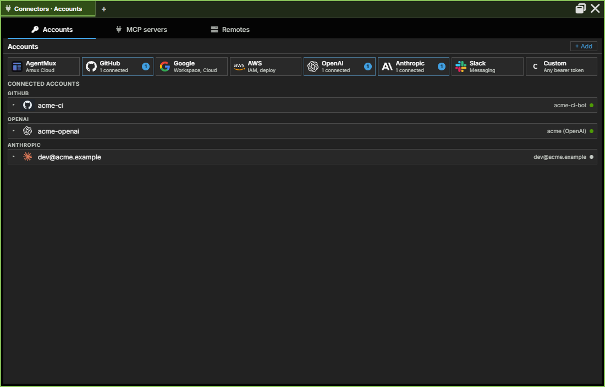

:::caution[Alpha Software]
AgentMux is **alpha software** and under heavy active development. Many features described in these docs may be incomplete, unstable, or not yet implemented. Expect breaking changes between releases. We welcome bug reports and feedback on [GitHub Issues](https://github.com/agentmuxai/agentmux/issues) or [Discord](https://discord.com/invite/96erama9Ar).
:::

An agent binds **directly** to Accounts, at most one per provider (`agent → account`, enforced at resolve time). An agent's **Identity** is *its set of directly-bound accounts* — a derived view, not a stored object. This decouples *what an agent does* (configured by the agent's [bundles](/bundles/) and provider) from *who it acts as* (its bound Accounts).

## What an Account is

An **Account** is a single credential pointer — one provider, one kind, one secret reference:

| Provider class | Credential kind | Examples |
|---|---|---|
| `github` | Personal access token | repo scopes, gh CLI auth |
| `aws` | Profile name (referenced from `~/.aws/`) | dev, qa, prod |
| `anthropic` | API key or OAuth | Claude API access |
| `openai`, `google`, `slack` | API key or OAuth | provider-specific |
| `custom` | Free-form key/value | Any provider-specific token |

`AccountProvider` is `"github" | "openai" | "aws" | "anthropic" | "google" | "slack" | "custom" | "agentmux"` today, with `custom` covering anything that doesn't fit a named slot. An agent can bind **at most one Account per provider** — a conflict (e.g. trying to bind a second `github` account) is a surfaced validation error at resolve time, not a silent pick.

**Connectors → Accounts** lists them, grouped by service:

## OAuth credentials as Accounts

OAuth logins are Accounts, not a separate concept. Each Claude / Codex / Copilot OAuth login lives in its own auth-config directory, referenced by the Account's `SecretRef` (`oauth_config_dir` backend — see [Identity & credential storage](/security/identity-credential-storage/)). Two Accounts for the same provider hold genuinely distinct OAuth sessions (work vs. personal, etc.), each with a **status** field (`valid` / `expired` / `invalid` / `unknown` / `checking`) surfaced in [Connectors → Accounts](/connectors/#accounts) so credential health is visible without launching an agent.

The OAuth invariant: a successful OAuth flow **always** lands bound to an Account — the CLI's own `OAuthConfigDir` belongs to that Account directly, so there's no intermediate grouping object to provision (log in → Account → bind to an agent).

## How Identity is reached

Identity is **not a widget-bar entry** and an agent pane has no accounts tab. Two places show it:

- **Connectors → Accounts** is the app-wide manager. Click **Connectors** in the widget bar (pinned by default), or run **Connectors** from the command palette. The pane opens on its **Accounts** section, where you create, edit and delete accounts. Each account card says "Used by N agents", and an open account lists those agents by name. There is no standalone "Identities" section: Connectors is scoped to shared, reusable resources.
- **The composer strip** of each agent pane shows the account that agent uses, as a login email, and changes it. See [Changing an agent's account](#changing-an-agents-account).

An account row's right-click menu has **Copy account ID**, **Fail over to this account** (see [below](#when-an-agent-hits-its-usage-limit)) and, after a separator, **Delete account…**. There is no menu item that binds an account to an agent: you change an agent's account from the agent.

The view registration (`view: "identity"`) and `IdentityPaneViewModel` exist for `pane.open` RPC and right-click menu paths, but nothing in the app opens that view.

## Changing an agent's account

A new agent takes its provider's first account, and signing in from the agent pane (**Log in**) saves the login as an account and links it. See [At launch](#at-launch). After that, an agent's account is changed from its composer strip, whether or not an account is linked yet.

1. Click the login email in the strip (**Account** or **Not logged in** when there is none). The menu lists every signed-in account of the agent's provider, with the current one checked and, beside an account that is out of quota, "out of quota until …" or "needs you to sign in again".
2. Choose an account. A signed-out agent's menu also has **Log in**, and a Claude agent's menu has **Sign in with another account…**, which signs a new account in and then moves the agent to it.

If the agent is idle, it moves at once: its pane restarts on the new account and resumes the session. If a turn is running, the switch waits for the turn to end, and the chip shows `current → new` meanwhile. Choosing the account the agent is already on cancels a queued switch. A notice says what happened ("Switching to *name* after this turn").

Several accounts can share a provider and an email, for example two Claude logins. They are numbered in the menu, the cards and the pane: `user@example.com ·2`. The number stays with the account for its life, so deleting `·1` leaves `·2` as it is.

The same switch is available to agents through the `Identity` tool's `switch` action (see [MuxAPI → Identity](/internals/muxapi/#identity)). A container agent's strip has the same menu.

Other places that change an account use the same switch: the failure row's **Use account…** (or **Use *name*** when there is one candidate), and the Swarm's strip for an account whose agents ran out of quota, which moves them together.

## When an agent hits its usage limit

When an agent's turn fails on its usage limit, AgentMux moves it to another signed-in account of the same provider that has quota, once its turn is over. It tells the agent and its lead in one note. It never picks:

- an account that is signed out, or that another agent has just found out of quota;
- an account marked **never fail over**: right-click the account in Connectors → Accounts and untick **Fail over to this account**. The mark is kept per account and can be set for accounts of the providers that run agents;
- an account of another provider.

If no account qualifies, the agent stays on its account, the pane shows the usage-limit row, and a message sent to it is held and delivered once the limit resets. Set `agent:accountfailover` to `false` in [settings](/settings/#agent-settings) to turn automatic moves off. It is on by default.

## At launch

The new-agent panel under a harness card in the agent picker has no account field. A new agent takes its provider's first account from [Connectors → Accounts](/connectors/#accounts). If the provider needs an account and none is bound, the pane shows **Not signed in** or **No account linked** when the agent starts, with **Log in** and **Use account…** actions (see [First Agent Setup → Sign in](/first-agent/#sign-in)).

Each time the agent's process is spawned, AgentMux:

1. Reads the agent's `(agent_id, provider) → account_id` links from `db_agent_identity_links`.
2. Resolves each Account's `SecretRef`.
3. Computes the per-provider env vars (`GH_TOKEN`, `AWS_PROFILE`, …) the agent's CLI needs.
4. Spawns the agent process with those env vars set.

To change an agent's account later, click the login email in its composer strip and pick another (see [Changing an agent's account](#changing-an-agents-account)).

Earlier versions had a Launch Agent dialog with one account dropdown per provider and an inline [Pre-Launch Auth panel](/auth/#pre-launch-oauth-panel). Nothing in the current agent picker opens it.

## Persistence

Accounts and their agent bindings live in two SQLite tables (not the per-channel `objects.db` — see [Persistence](/internals/persistence/) and [Data layout](/internals/data-layout/) for the full split between per-channel and shared databases), but as of `SPEC_IDENTITY_STORE_SPLIT_2026_08_17.md` **the two tables no longer live in the same physical store**:

| Table | Owns | Where it lives |
|---|---|---|
| `db_accounts` | The credential record: id, name, provider, kind, display_name, `secret_ref`, context, status | The **account store** — account-wide `store.db` under `~/.agentmux/shared/`, used by every channel; with `AGENTMUX_ISOLATED_AUTH=1` a channel gets its own (see [Auth flows → Isolated auth by channel](/auth/#isolated-auth-by-channel)). That applies to the connectable-account *list* in Connectors → Accounts, not to a link once created (next row). |
| `db_agent_identity_links` | Direct binding: `(agent_id, provider) → account_id`, one row per agent+provider | A separate, **permanently-global identity store** — never redirected by channel or by the isolated-auth setting, regardless of which channel created the link. |

**Why this split matters:** a link an agent already has to an Account survives a channel or version switch even though the underlying account *list* in Connectors → Accounts can be empty on a channel isolated with `AGENTMUX_ISOLATED_AUTH=1` (see [Auth flows](/auth/#isolated-auth-by-channel)) — don't conflate the two. To keep an existing link resolvable even when its target account row isn't present in the current channel's (possibly-isolated) account store, the account row is also mirrored into the always-global identity store at the moment a link is created; resolving a binding at agent-spawn time falls back to that mirror copy if the channel-local account store doesn't have it. This is what makes "my agent still launches with the right account after I switch channels" hold even though "the account list itself" doesn't.

`db_agent_identity_links` is a direct junction between an agent definition and `db_accounts` — there is no intermediate grouping table. See `docs/specs/SPEC_IDENTITY_STORE_SPLIT_2026_08_17.md` in the main repo for the store split described above.

## What Identity is not

- **Not where your own secrets go.** An Account is a pointer: the credential still lives wherever the provider's CLI or secret store puts it. Your own secrets (ID numbers, cards, API keys, logins) go in the [Vault](/vault/), which agents use without seeing a value.
- **Not a grouping object.** There is no bundle/collection layer between an agent and its Accounts — bindings are direct, one Account per provider.
- **Not a top-level pane.** No widget-bar entry. See [Pane types](/pane-types/) for the full pane catalog.

## See also

- [Bundles](/bundles/) — the other half of agent composition (instructions + context files)
- [First Agent Setup](/first-agent/) — provider login flows
- [Auth flows](/auth/) — per-provider auth-dir isolation, and the conditional isolated-auth-by-channel default
- [Connectors](/connectors/#accounts) — the Accounts section, where you add, edit and delete accounts
- [Pane Types](/pane-types/) — where Identity surfaces in the UI
