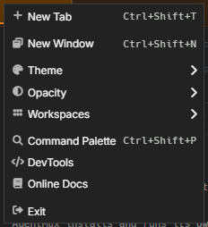
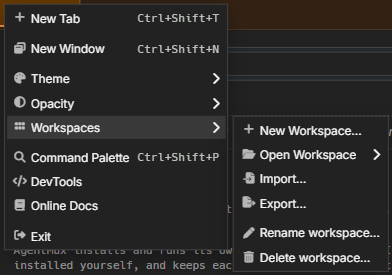
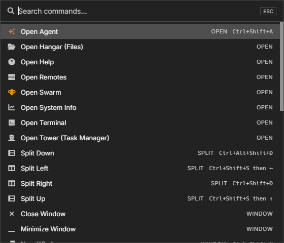
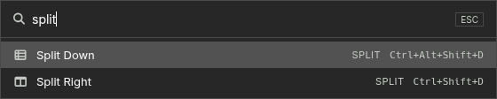

AgentMux groups global actions into two surfaces:

- The **hamburger menu** (≡) at the start of the top tab bar — mouse-friendly, organized by category.
- The **command palette** (`Ctrl+Shift+P` / `⇧⌘P`) — keyboard-driven, searchable list of every registered command.

## Hamburger menu (≡)

Click the three-line icon at the start of the tab bar. Items, top to bottom:

| Item | Shortcut | What it does |
|------|---------|--------------|
| **New Tab** | `Ctrl+Shift+T` / `⌘T` | Adds a new tab to the current window. |
| **New Window** | `Ctrl+Shift+N` / `⇧⌘N` | Opens another AgentMux window in the open [workspace](/workspaces/), with its own tabs and the starting panes. It starts with this window's theme and opacity. |
| **Theme** | — | Submenu listing the available color themes. It changes only this window, and the choice is saved with the window. Settings ▸ Appearance sets the default for windows without their own. See [Window appearance](/window-appearance/). |
| **Opacity** | — | Submenu of preset levels (35% – 100%). It changes only this window, on Windows, macOS and Linux. It is the same value as this window's slider in the status bar's Instance Panel, so each follows the other. See [Window appearance](/window-appearance/). |
| **Workspaces** | — | Submenu: **New Workspace…**, **Open Workspace** › (every workspace, the open one checked), **Import…**, **Export…**, **Rename workspace…** and **Delete workspace…**. A workspace is the set of windows you work in, saved as you go; opening another one closes this one first. **Export…** writes it to a `*.agentmux-workspace.json` file; **Import…** opens one, or a `*.agentmux-layout.json` file from **Save layout…** in earlier versions, as a new workspace. See [Workspaces](/workspaces/). |
| **Command Palette** | `Ctrl+Shift+P` / `⇧⌘P` | Opens the command palette (see below). |
| **DevTools** | — | Toggles Chromium DevTools. It appears only while [Dev mode](/settings/#app-settings) is on (`app:devmode`; **Toggle Dev Mode** in the command palette switches it). |
| **Online Docs** | — | Opens this documentation site (docs.agentmux.ai) in your default browser. |
| **Exit** | — | Closes the current window. Other windows stay open, and this one stays in the workspace as a closed window you can reopen from the status bar's instance panel. Closing the last window quits AgentMux. Its agents keep running; it asks first only when closing would stop a working agent (the last window, or `agents:always_available` turned off). See [Closing a window keeps it](/workspaces/#closing-a-window-keeps-it). |

**New Window** appears only where AgentMux can open several windows, and **Opacity** only where windows can be see-through (`frontend/app/window/hamburger-menu.tsx`).

Settings, Connectors, Memory and Toolchain aren't in this menu. Open them from the widget bar (Settings, Connectors and Memory are pinned by default; Toolchain is under **more**) or from the command palette (**Settings**, **Connectors**, **Memory**, **Open Toolchain**). Settings also opens with `Ctrl+,` / `⌘,`. See [Settings reference](/settings/), [Connectors](/connectors/) and [Memory](/memory/).

The Theme and Opacity submenus check-mark this window's current value, so you can see at a glance what you're on. A submenu opens when you hover its row.

## Reopening your windows at the next launch

Quitting AgentMux doesn't close its windows: the next launch opens every window that was open, with its tabs and split panes, and agent panes resume their conversations. The open workspace is saved as you work, not only when you quit, so the same is true after a crash. There's nothing to turn on. See [Workspaces](/workspaces/).

## Command palette (Ctrl+Shift+P / ⇧⌘P)

Press `Ctrl+Shift+P` (Windows/Linux) or `⇧⌘P` (macOS) from anywhere to open the palette; `Ctrl+P` / `⌘P` also work outside a terminal, where `Ctrl+P` is the shell's history key. Each command shows its category and shortcut. Type to filter, arrow keys to navigate, Enter to run.

Registered commands are grouped by category:

| Category | Commands |
|----------|----------|
| **Open** | Open Terminal, Open Agent, Open System Info, Open Tower (Task Manager), Open Kanban, Open Vault, Open History, Open Audit, Open Jobs, Open Help, Open Swarm, Open Files, Open Remotes, Open Toolchain. Open Tower, Kanban, Vault, History, Audit, Jobs, Help and Swarm bring back the pane that is already open; New Tower, New Kanban, New Help and New Swarm always open another. |
| **Split** | Split Right, Split Down |
| **Window** | New Window, Close Window, Minimize Window, Toggle Maximize, Reload Window (Free Memory), Hibernate Hidden Browser Panes, Wake Sleeping Browser Panes, Restart Backend, Open Settings File |
| **Workspace** | New Workspace…, Open Workspace…, Rename Workspace…, Delete Workspace…, Export Workspace…, Import Workspace… |
| **Tab** | New Tab, Close Tab, Next Tab, Previous Tab |
| **Pane** | Close Pane, Toggle Magnify, Back to Previous Pane, Forward to Next Pane, Focus Pane Right / Left / Up / Down, Redock floating pane |
| **View** | Command Palette, Toggle Status Bar, Toggle Dev Mode, Zoom In, Zoom Out, Actual Size |
| **App** | Connectors, Memory, Settings, Pause all agent browsing, Resume agent browsing (only the one that applies shows) |
| **Dev** | Toggle DevTools (only while Dev mode is on) |
| **Help** | Online Docs |

After the commands the palette lists your agents, found by name, seat or state. Choosing one brings its pane forward, in whichever tab or window it is, or opens it if it has none.

Searching for "accounts", "mcp" or "remotes" also finds **Connectors**, and "skills" or "bundles" finds **Memory**. The older **Identity & Memory** command is gone; Connectors replaces it.

The palette is **not exhaustive** — most navigation shortcuts (Connect Remote, Focus Block N, raw tab-switching, etc.) are reachable only via [keybindings](/keybindings/), not from the palette.

## Why two surfaces?

The hamburger menu is the discoverable surface — open it once and you know what's in there. The command palette is the speed surface — once you know the command name, typing two or three letters and hitting Enter is faster than menu-and-mouse.

If you find yourself wanting an action from the palette that isn't there, [file an issue](/report-issues/) — the registry is small enough that adding new commands is straightforward.
