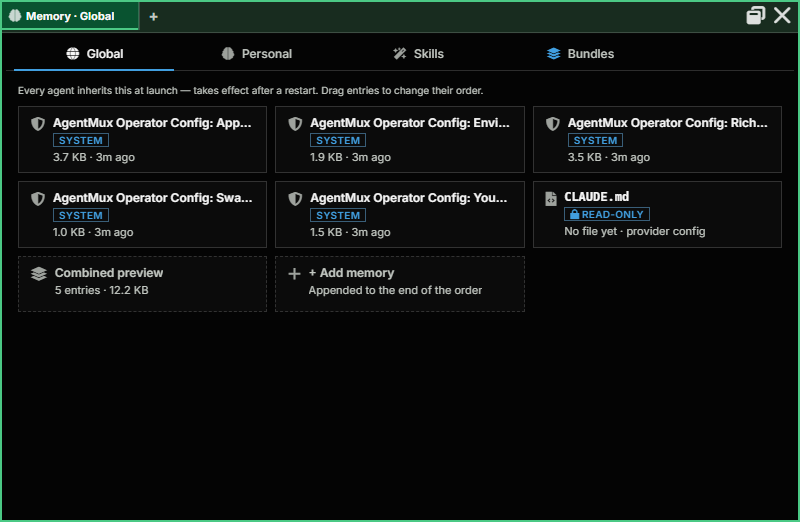
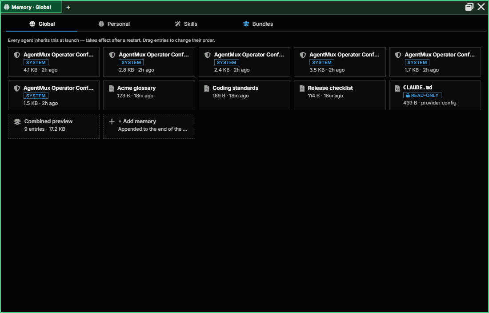
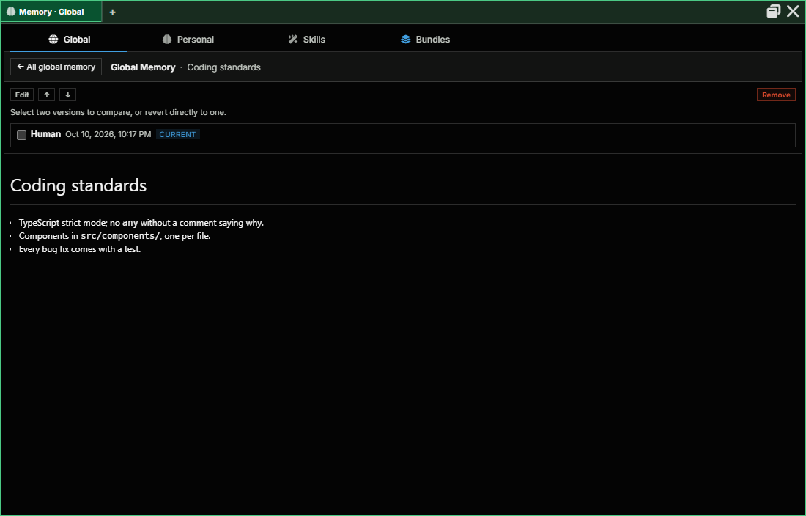
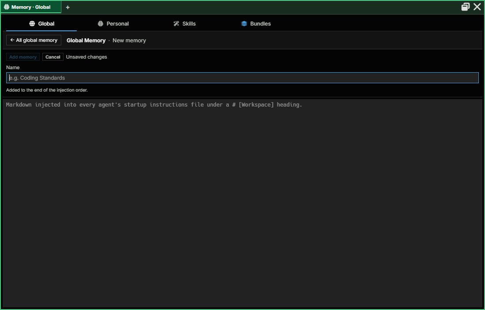
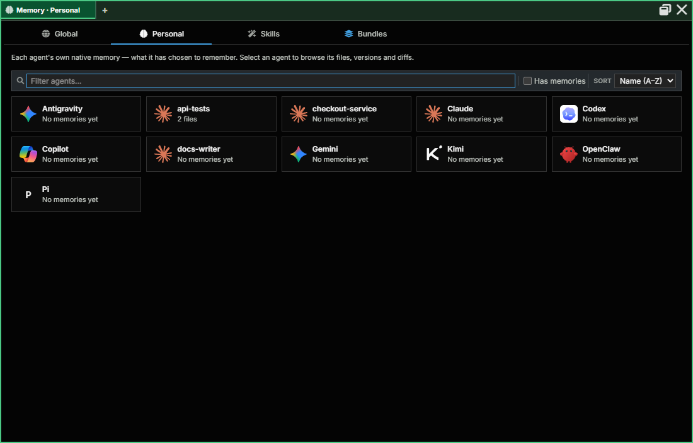
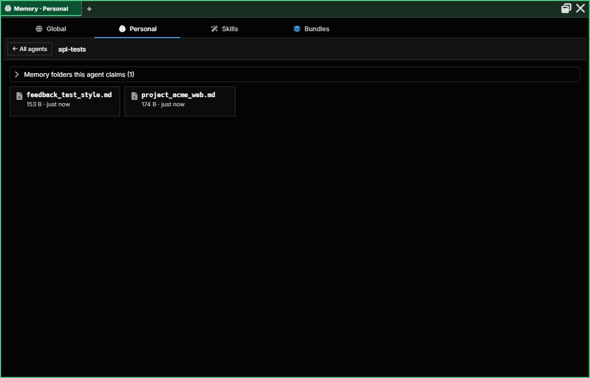
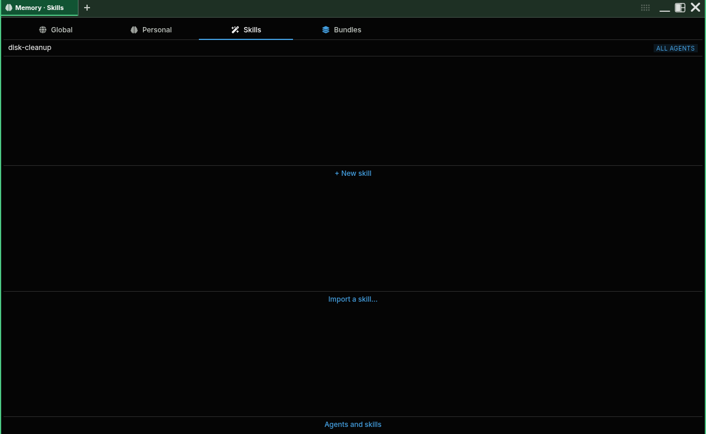
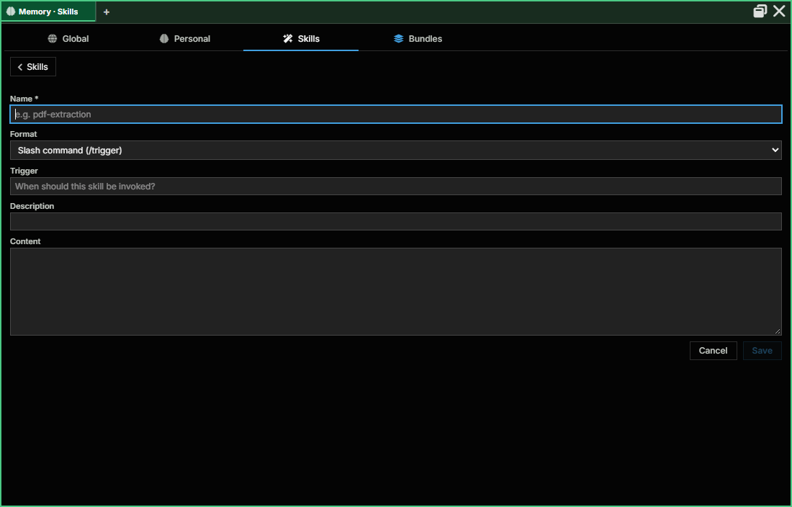
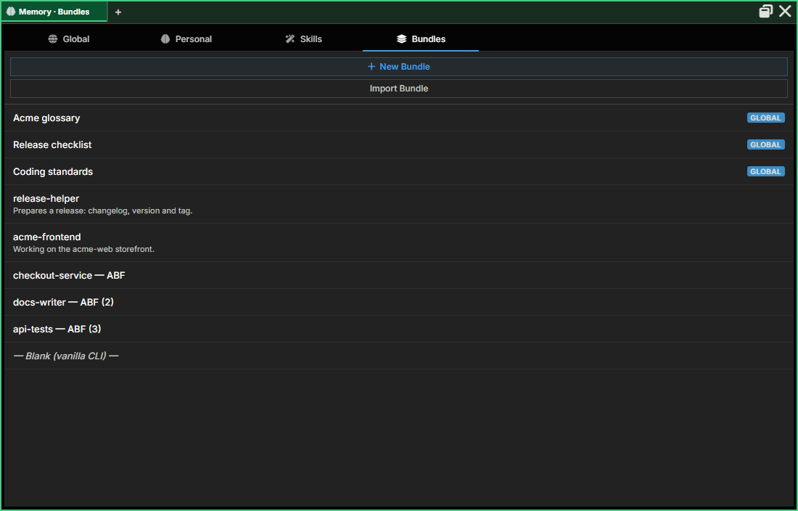

:::caution[Alpha Software]
AgentMux is **alpha software** and under heavy active development. Many features described in these docs may be incomplete, unstable, or not yet implemented. Expect breaking changes between releases. We welcome bug reports and feedback on [GitHub Issues](https://github.com/agentmuxai/agentmux/issues) or [Discord](https://discord.com/invite/96erama9Ar).
:::

**Memory** is the app-wide pane for what agents know and carry: the instructions every agent starts with, what each agent writes in its own memory, skills, and the bundles that package them. Its companion pane, [Connectors](/connectors/), holds what agents connect to outside AgentMux: accounts, MCP servers and remote hosts.

Memory is a regular pane (icon: `brain`), opened from the widget bar like any other. It has four sections, as tabs along the top of the pane (`frontend/app/view/memory/memory.tsx`):

| Section | What it manages |
|---|---|
| **Global** | Global Memory: instructions composed into every agent's startup file |
| **Personal** | Personal Memory: what each agent writes in its own memory files, with history |
| **Skills** | The skills you add, and which agents each one reaches |
| **Bundles** | Instructions, MCP servers, memory and skills packaged to give to agents; imports [ABF](/abf/) (`.abf`) files |

Memory opens on **Global**. The pane title names the section, for example "Memory · Skills". In a narrow pane the tabs show only their icons; in a wide one they stop growing and sit at the left. `Ctrl` + mouse wheel zooms the pane.

:::note[Earlier names]
This pane was called **Knowledge**, and before that its sections were tabs of the **Armory**. AgentMux moves panes, widget-bar pins and keybindings saved under either name here, once, the first time it starts after updating. Layout files that use them still open here, and links to `/knowledge/` redirect.
:::

## Opening Memory

- **Widget bar:** click **Memory**. It is pinned by default. If a Memory pane is already open in the tab, the click focuses it instead of opening another.
- **Command palette:** run **Memory**. Searching for "skills" or "bundles" also finds it.
- **macOS app menu:** **Memory…**.
- **Keybinding:** bind `app:memory`. A binding to the old `app:knowledge` is changed to `app:memory` the first time it starts after updating.

Links elsewhere in the app open Memory on the right section:

- An agent pane's right-click menu has **Personal memory**, which opens **Personal** on that agent. Its **Bundles…** dialog links to **Memory → Bundles**.

An Armory pane (the earlier pane that held both Connectors and Memory) is moved to the matching new pane: Memory, Skills and Bundles to Memory, the rest to Connectors.

## Global

**Global Memory** is a set of entries that every agent inherits at launch (`frontend/app/view/global-bundle/global-bundle-manager.tsx`). The section reads "Every agent inherits this at launch — takes effect after a restart. Drag entries to change their order." It shows a tile per entry, a read-only `CLAUDE.md` tile, a **Combined preview** of what agents receive, and **+ Add memory**. Click a tile to open the entry with its history, a diff view and revert.

Claude Code agents also get their memory again whenever Claude Code starts a new session, including after `/clear` and after a compaction, but not when a session is resumed. AgentMux delivers it through Claude Code's `SessionStart` hook: Global Memory, AgentMux's Operator Config entries and the agent's Personal Memory, split into up to eight parts of at most 9,000 characters each (`crates/bashwrap/src/sessionstart.rs`, `crates/srv/src/backend/memory_delivery.rs`). If the hook doesn't deliver, for example when AgentMux had to start a fresh session because the previous one couldn't be resumed, AgentMux sends the same memory as a hidden message instead.

Each delivery shows in the agent pane as a card, such as "Given to the agent · new session · 6 items" or "Memory re-delivered after compaction · 3 items", with one row per item: its name, whether it is an AgentMux system entry, a Workspace entry or Personal Memory, and its size. On a new session the card also lists the files Claude Code read by itself at startup, such as `CLAUDE.md` files and the skills list; when one of them already carries the Global Memory, the hook doesn't send it again, and those entries say "in startup file". One delivery carries at most 72,000 characters. Global Memory comes first and then Personal Memory, so what doesn't fit is cut off the end, and the last part says how much was left out. On the card, an entry that went out in part is marked "cut" and one that didn't go out at all "not sent". When Personal Memory grows large for the agent's context window, the card suggests consolidating it. The card lists what the agent was given, not the text itself (`frontend/app/view/agent/components/ContextDeliveryCard.tsx`). It's a [context delivery](/glossary/#context-delivery), not a message you sent.

Every change to Global Memory is also written to a Global Memory record that keeps each entry's versions and the order of entries (`crates/srv/src/backend/global_memory_record.rs`). Channels that share your main accounts share one Global Memory; an isolated channel (for example a development build) keeps its own.

On an isolated channel, the Global section shows a banner when another scope has entries this channel doesn't: "This channel keeps its own Global Memory. … has N entries it doesn't: …". **Bring them here** copies them in (an entry whose name is already taken is renamed); agents get them at their next launch. Nothing is shared without this click (`frontend/app/view/global-bundle/GlobalMemoryImportBanner.tsx`).

Everything in Global Memory is delivered whole, to every agent, every time. For instructions an agent needs only now and then, use a [skill](#skills) instead.

Agents can read and change Global Memory with the `Memory` MCP tool and `scope: "global"`, using its `list`, `read`, `write`, `reach`, `remove`, `history`, `diff` and `revert` actions.

### Global Memory across machines

Each entry has a **reach**: `fleet` or `machine`. A `fleet` entry is sent to every other machine on your network that this one has proven (see [LAN discovery](/lan-discovery/#remote-operations)) and kept in step; a `machine` entry stays here. A new entry is `fleet`, whether you add it in this pane or an agent writes it. The entries that existed before reach was added are `machine`, because they may differ between your machines on purpose; an agent can flip one with the `Memory` tool's `reach` action. This pane doesn't show an entry's reach; `Memory` `list` does.

- **Last write wins.** The machine that saves an entry stamps the time, and every machine keeps that time, so they all agree on it. The newer write wins; on a tie the one with the larger content hash does. Each machine keeps its own history of the entry (**Memory → Global**, an entry's versions), so an overwritten version can be reverted.
- **A removal is a write too.** An entry removed on one machine and edited later on another comes back.
- **A machine that was offline catches up** the next time it is found: peers compare what they hold and send what the other lacks or has older. A peer is also compared again every ten minutes, to heal a lost send.
- **What travels:** the entry's name, description and instructions (including the per-provider instructions) and its context files. Skills, provider, model, position in the list and MCP servers belong to a machine and stay put.
- **What doesn't:** AgentMux's own system entries never leave or enter. A fleet write for an entry that is `machine` here is skipped, so a machine keeps what its owner kept.
- **Needs a trusted machine.** Fleet sync uses [remote operations](/internals/muxapi/#acting-on-another-machine): both machines need LAN discovery on, and the receiving one must trust the sender's install. Setting `"network:remote_ops": false` on a machine stops it taking part.

## Personal

**Personal Memory** is the set of free-form `.md` files an agent reads and writes about itself: notes, running context, anything it wants to keep between turns. It is a different thing from a [bundle](/bundles/): a bundle is a reusable *definition* you give an agent; Personal Memory is a scratchpad an already-running agent keeps for itself. ("Native memory" is the name of its storage in the code; earlier releases labelled it "Brain".)

This section is the app-wide view of every agent's Personal Memory. Pick an agent, then a file, to see its content, history and diffs, and to revert to an earlier version. From an agent's pane, right-click and choose **Personal memory** to open this section on that agent.

Above an agent's files, two collapsible panels (`frontend/app/view/native-memory/`):

- **Earlier memory found under N other account(s)** appears when the agent has memory folders from accounts it used before, or files held back because their content matches another agent's memory. Tick the folders and choose **Adopt selected…**.
- **Memory folders this agent claims (N)** lists the folders the agent holds, when each was claimed, and whether other agents also use it. **Release…** gives a folder up, so another agent that uses it can sync its memory there; if the agent still uses it, its next launch claims it again.

Adopting and releasing are confirmed in a separate AgentMux window ("Adopt earlier memory into *agent*?" with **Cancel** / **Adopt**; "Release *agent*'s claim on this folder?" with **Cancel** / **Release**), not in the pane, so an agent driving the UI can't confirm them for you. A request left unanswered expires after 10 minutes (`crates/cef/src/memory_adoption.rs`). Adopted files appear in the agent's folder at its next launch.

An **Unverified folder** badge next to the agent's name means AgentMux found the folder from the agent's settings rather than from the agent's own launch; it is read-only until the agent launches.

On an agent's files, **New file** asks for a **File name** (letters, numbers, `-` and `_`; `.md` is added) and creates an empty file; it won't overwrite one that exists. **Create MEMORY.md** appears when the folder has no `MEMORY.md` index and starts one ("Starts the index Claude loads every session"). Both wait, with a note, until the agent has launched if its folder is still unverified.

This section and an agent acting on itself go through the same primitive:

| Surface | Commands |
|---|---|
| MuxAPI | `memory.list`, `memory.read`, `memory.write` |
| MCP tool (agent-callable) | `Memory` (scope `personal`, the default): `list`, `read`, `write`, `history`, `diff`, `revert` |

See [MuxAPI](/internals/muxapi/#memory-native-memory--brain) for the full parameter reference.

### The memory record: memory follows the agent

A provider keeps an agent's memory files in a folder tied to its account and working directory (for Claude Code, `$CLAUDE_CONFIG_DIR/projects/<cwd>/memory`), so switching account, working directory or channel used to leave them behind. AgentMux keeps its own **memory record** for each agent, keyed by the agent's ID rather than by account, folder or channel, and treats it as the source of truth (`crates/srv/src/backend/memory_record.rs`). The record keeps every version of every file, which is what the history, diff and revert views show.

- **At each launch**, before the provider CLI starts, AgentMux reconciles the agent's memory folder with the record: files missing from the folder are written back, and changes found on disk are recorded (`crates/srv/src/backend/memory_reconcile.rs`). If a file changed on both sides, the disk version wins and the other is kept beside it as a `<name>__conflict_<id>.md` file. This is how memory follows an agent into a new account, working directory or channel.
- **While the agent runs**, AgentMux watches its memory folder and records a file Claude writes once it has been unchanged for about 2 seconds, with a periodic sweep as a backup (`crates/srv/src/backend/native_memory_drift.rs`).
- **AgentMux's own writes** — `Memory` `write`, edits in Memory → Personal, revert — go into the record first, then to the file.
- **Shared folders:** two agents can end up with the same memory folder (same account and working directory, for example). AgentMux only syncs the record with a folder it can show belongs to this agent alone; a shared folder is left as it is (`crates/srv/src/backend/memory_dir_claims.rs`). The first time an agent's record meets a folder, a file whose content another agent's record already has is held for you to review instead of being taken over; it shows up in the adoption panel above.

The older `db_agent_native_memory` mirror is still written through on list, read and write, but it is no longer the main mechanism. See `docs/specs/SPEC_MEMORY_FOLLOWS_THE_AGENT_2026_09_24.md` in the main repo for the design.

## Skills

A **skill** is a reusable procedure an agent follows when it is relevant: "write release notes from the merged pull requests", "pull the tables out of a PDF". Only the skill's **name and description** are in the agent's context all the time. Its full text is read when the agent uses the skill. That is why a skill is the right place for instructions an agent needs only now and then, where [Global Memory](#global) puts everything in front of every agent in every session.

### A skill or Global Memory?

| | Global Memory | Skill |
|---|---|---|
| What the agent gets | The whole entry, in its startup instructions at every launch, and again after a new session, `/clear` or a compaction | Its name and description; the text only when the skill is used |
| Which agents | Every agent | Only the agents it is bound to |
| Cost | Context in every session, relevant or not | Almost nothing until used |
| Use it for | Rules that always apply: how the agent talks to you, repository rules, what it must never do | Procedures needed occasionally: a release checklist, a review routine, how to use a tool |

A rule that only matters for one kind of task belongs in a skill. A rule that must hold even when the agent would never think to look it up belongs in Global Memory.

### Which agents a skill reaches

**AgentMux comes with one skill**, `disk-cleanup`: measure what AgentMux and builds leave on the disk first, say what is safe to remove, and ask before deleting anything. It is added once, reaches every agent, and is never overwritten: your edits stay, and a delete is final. You can switch off its reach as for any skill, below. The starter skills that earlier versions added are removed, unless you edited, renamed or bound one.

**A global skill reaches the agents it is bound to**, directly or through a [bundle](/bundles/) that includes it, and the agents its **reach** covers. A skill bound to nobody, with no reach, reaches nobody: it stays in the catalog and no agent sees it. Binding or unbinding takes effect at the agent's next launch.

**Reach** is set per skill, under the skill's name in **Memory → Skills**, with two switches: **Every agent gets it (the ones to come too)** gives the skill to every agent without a bind, and **New agents get it** gives it only to the agents created from then on. A skill you add starts with **New agents get it** on. An agent can opt out of a skill that reaches every agent or new agents (below) without losing it for the others. AgentMux then writes the skills the agent is bound to into its files: for a Claude Code agent a slash command (`.claude/commands/<trigger>.md`) or an Agent Skill (`.claude/skills/<name>/SKILL.md`), for the other providers a list in the startup file. An agent can also keep skills of its own that only it sees.

### Add your own

1. Open **Memory → Skills** and click **+ New skill**.
2. Fill in **Name** (required), **Format**, **Trigger** (slash commands only), **Description** and **Content**. The two formats are **Slash command (/trigger)**, which you or the agent run by typing the trigger, and **Agent Skill (SKILL.md)**, a beta format the agent picks up by its description, with no trigger. Write the description as *when to use the skill*: it is all the agent sees until it uses it.
3. **Bind it**, or no agent will have it. Open the skill, choose an agent under **Bind to agent** and click **Bind**. Or add the skill to a [bundle](/bundles/) and give the bundle to the agents that should have it.

A skill's page says "Used by N agents" and lists them, each with **Unbind**.

### Agents and skills

**Agents and skills** at the top of **Memory → Skills** opens a grid with one row per agent and one column per skill. Each cell says how that agent gets that skill:

| Cell | Meaning | Click |
|---|---|---|
| **Bound** | You bound the skill to the agent. | **Unbind** |
| **Via bundle** | One of the agent's bundles includes it. | Change it in the bundle. |
| **Every agent** or **New agents** | The skill's reach covers the agent. | **Opt out**: the agent no longer gets it. Other agents keep it. |
| **Opted out** | The agent opted out of a skill that reaches it. | **Opt back in** |
| empty | The agent doesn't get the skill. | **Bind** |

A change reaches an agent's files at its next launch. An agent whose skills can't be read is left out of the grid.

### Import a skill

To bring in a skill someone else wrote, click **Import a skill…** at the top of **Memory → Skills**. Choose where it is under **From**:

- **A folder on this computer**: a folder with a `SKILL.md`, or a folder of skills.
- **A git repository (https)**: an `https://` address such as `https://github.com/owner/skills.git`, and optionally a branch or tag (the default branch if empty).
- **A SKILL.md at an https address**: one file.

Click **Read**. Reading a source writes nothing. AgentMux lists every skill it found, with its name, its description and its **whole text**, so you read what an agent would be told to follow before anything is added. Each shows **New**, **Differs from the catalog** (with a diff of what would change) or **Already up to date**. Tick the ones to bring in and click **Import**.

- **An imported skill starts bound to nobody.** It isn't given to any agent, including new ones, until you [bind it](#add-your-own).
- **Only https.** A `file://` or other kind of git address is refused, symlinks aren't followed, a file over 256 KB is left out, and a source yields at most 100 skills. A note on the list says what was left out.
- **Check for changes** on an imported skill, under its text, reads its source again and shows a diff against what you have. Nothing changes until you approve it.

To bring in a whole set of skills at once, use **Memory → Bundles → Import Bundle** with an [ABF](/abf/) file. The review before the import shows **each skill's full text**, so you can read what an agent would be told to follow. A skill too long to show in full is marked "Not fully shown" and starts unticked: tick it to import the whole skill. An imported skill is bound only to the bundle it came in, so it reaches only the agents that take that bundle.

Agents manage skills with the `skill.*` commands; see [MuxAPI](/internals/muxapi/#skill) for the RPC reference.

## Bundles

The app-wide view of all bundles. A bundle packages instructions, MCP servers, memory and skills; an agent takes several, in order. **+ New Bundle** creates one; **Import Bundle** brings in an `.abf` file (its review shows each skill's full text before anything is imported), and any bundle can be exported as one. See [Bundles](/bundles/) for the full reference, including how an agent's bundles are picked, and [Agent Bundle Format (ABF)](/abf/) for the file format.

Bundles are created and edited here only. An agent's **Bundles…** dialog (in its **My Agents** row menu or its pane's right-click menu) picks which bundles that agent starts with; it doesn't create or edit them.

## Per agent

Memory is app-wide, and each of its sections has a way in for one agent:

- **Personal Memory**: right-click an agent's pane and choose **Personal memory**. Memory opens on **Personal** with that agent selected.
- **Skills** and **Bundles**: **Bundles…**, in an agent's **My Agents** row menu or its pane's right-click menu, picks the bundles it starts with. A skill's page lists the agents it is bound to, each with **Unbind**, and binds another with **Bind to agent**, as an MCP server's page in [Connectors](/connectors/#mcp-servers) does.

## Portable bundles (beta spec)

**[Agent Bundle Format (ABF)](/abf/)** is a beta specification for packaging a bundle's instructions, skills, MCP servers, and credential requirements into one portable, versioned directory — composing existing standards (Agent Skills/SKILL.md, MCP server.json, AGENTS.md) rather than inventing new ones. The Bundles section has an **Import Bundle** button for bringing in an ABF bundle. See the [rollout plan](/abf/#rollout-plan) for what's built vs. planned.

## See also

- [Connectors](/connectors/) — Accounts, MCP servers and Remotes
- [Bundles](/bundles/) — full bundle reference, and how an agent's bundles are picked
- [Agent Bundle Format (ABF)](/abf/) — beta spec for portable, exportable bundles
- [MuxAPI](/internals/muxapi/) — `skill.*`, `bundle.*` and `memory.*` RPC catalogs
- `docs/specs/SPEC_MEMORY_FOLLOWS_THE_AGENT_2026_09_24.md` in the main repo — the memory record, adoption and folder claims
