:::caution[Alpha Software]
AgentMux is **alpha software** and under heavy active development. Many features described in these docs may be incomplete, unstable, or not yet implemented. Expect breaking changes between releases. We welcome bug reports and feedback on [GitHub Issues](https://github.com/agentmuxai/agentmux/issues) or [Discord](https://discord.com/invite/96erama9Ar).
:::

AgentMux organizes your workspace into panes — individual views that can be split, rearranged, and magnified. A pane isn't locked to one type, though: it holds an ordered list of tabs, and any tab can be any widget type — see [Pane tabs](#pane-tabs) below for how that works and how it differs from a pane *split*.

## Available Pane Types

By default the widget bar pins **Agent**, **Swarm**, **Memory**, **Connectors**, **Files**, **Browser**, **Settings** and **Help**, in that order; Kanban, Terminal, Editor, Messengers, Sysinfo, Drone, Vault, History, Toolchain, Tower and Audit are under **more** (Remotes, once a widget of its own, is now a section of [Connectors](/connectors/#remotes), and Media is now part of the [Editor](#media)). The Vault, History and Audit were sections of the Warden pane before it was split up (see [Warden](/warden/)). See [Sections](/widgets/#sections) to give any section a button. These are the defaults for a widget bar you haven't customised; one you have keeps its pins, and **Reset widget bar** (below) brings back the defaults. If you had customised the bar and pinned the Armory (the pane Connectors and Memory replaced), Knowledge (Memory's earlier name) or Remotes, AgentMux replaces those pins with the new panes the first time it starts after updating. A saved Media pin shows as the Editor (`frontend/app/window/action-widgets-config.ts:191-194`). Right-click a widget to pin or unpin it. As the title bar gets narrower, the bar first drops its labels and then moves widgets that no longer fit under **more** (`crates/srv/src/config/widgets.json`, `frontend/app/window/action-widgets.tsx`). The `widget:icononly` setting drops the labels at any width.

### Pin, keep in More, or hide

Every entry the widget bar knows about is in one of three states:

- **Pinned:** an icon on the bar.
- **More:** only in the **more** menu.
- **Hidden:** on neither, and not in a pane's **+** menu either.

Set them in **Settings ▸ Widgets ▸ Widget bar**, which lists every entry with a **Pinned / More / Hidden** switch and arrows to move a pinned one left or right on the bar. A widget inside a group, such as one messenger under **Messengers**, has **In group / Pinned / Hidden** instead. **Show icons only** and **Reset widget bar** (back to the default pins, with nothing hidden) are there too. The bar, Settings and an open **+** menu all update together.

On the bar itself, right-click a widget for **Pin to bar** or **Unpin from bar**, and for **Hide from widget bar**. Hiding shows a notice for a few seconds with **Undo**; after that, bring the widget back from Settings ▸ Widgets. Settings can't be hidden, so you can always get back to it. Right-clicking an empty part of the title bar shows **Pin Widgets**, a checklist of everything that can be pinned.

Widgets from installed [widget packages](/widgets/) can be pinned too, from the bar's right-click menu or from Settings ▸ Widgets, and keep their place when you reorder the bar. The pins are saved as `widget:pinned` and the hidden entries as `widget:hidden` in `settings.json`; see the [settings reference](/settings/#widget-bar-settings).

To see what each one looks like, see the [widget gallery](/widget-gallery/).

| Pane | Icon | View ID | Description |
|------|------|---------|-------------|
| **Agent** | sparkles | `agent` | AI agent session with streaming output. Hosts Identity and Memory subsections via the cog → settings panel. |
| **Browser** | globe | `browser` | A real Chromium browser in a pane, with profiles, Incognito tabs, downloads and controls over agents that drive it — see [Browser pane](/browser-pane/) |
| **Terminal** | square-terminal | `term` | Full terminal with real PTY via xterm.js |
| **Sysinfo** | chart-line | `sysinfo` | Live system metrics graphs |
| **Connectors** | plug | `connectors` | Accounts (sign-ins to providers and services), MCP servers and Remotes — see [Connectors](/connectors/) |
| **Files** | folder-open | `files` | File browser with places, drives, remote hosts, previews and drag and drop — see [Files](#files) |
| **Memory** | brain | `memory` | Global and Personal Memory, Skills and Bundles — see [Memory](/memory/). Formerly Knowledge |
| **Editor** | file-code | `editor` | CodeMirror 6 editor with syntax highlighting + LSP diagnostics (TypeScript / JavaScript) + a file-tree explorer rooted at $HOME (with drives and mounts), and viewers for images, PDFs, audio and video — see [Editor](#editor) and [Media](#media) |
| **Swarm** | bee | `swarm` | Live tree of your agents, with or without a pane, with their subagents, todos and background commands, the agents of other instances, a fleet toolbar and the Supervisor — see [Swarm](/subagent-watcher/) |
| **Drone** | diagram-project | `drone` | Visual DAG-of-blocks automation engine (Agent / API / Condition / Variables / Response blocks) |
| **Help** | circle-question | `help` | Built-in documentation |
| **History** | clock-rotate-left | `history` | Every agent's kept conversation, what was typed to each agent, and where the history is stored — see [History](/history/) |
| **Audit** | list-check | `audit` | Messages between agents, fleet and pane actions, agent registrations, and what agents did with your secrets — see [Audit](/audit/) |
| **Kanban** | table-columns | `kanban` | The tasks agents are working on, what waits for them and what needs you — see [Kanban](/kanban/) |
| **Vault** | lock | `vault` | Your secrets, which agents use by name without seeing them — see [The Vault](/vault/) |
| **Tower** | tower-observation | `tower` | Read-only task manager: the CPU and memory each agent and everything it started uses, and every process on the machine — see [Tower](/tower/) |
| **Toolchain** | wrench | `toolchain` | The CLIs and system tools AgentMux uses, with their versions, where they're installed and how to install what's missing — see [First Agent Setup](/first-agent/#system-prerequisites) |
| **Settings** | cog | `settings` | The settings UI — see [Settings reference](/settings/) |

### Not pane types

These views exist in the codebase but are **not** opened directly from the widget bar:

| Surface | How it's reached |
|---|---|
| **Identity** | App-wide: **Connectors** → **Accounts**. An agent's own account is the login email in its composer strip (see [Composer strip](#composer-strip)). View registration (`view: "identity"`) and `IdentityPaneViewModel` exist for `pane.open` RPC and right-click menu paths. |
| **Global and Personal Memory** | App-wide: **Memory** → **Global** and **Personal**. For one agent, right-click its pane and choose **Personal memory** to open Memory → Personal on that agent. These are notes, not the Bundle editor. |
| **Bundles** | App-wide: **Memory** → **Bundles**. Per agent, **Bundles…** (in its My Agents row menu or its pane's right-click menu) picks which bundles it starts with, in order; it doesn't edit bundles. |
| **MCP Servers** | App-wide: **Connectors** → **MCP servers**, where each server lists the agents it is bound to. |
| **Skills** | App-wide: **Memory** → **Skills**, where each skill lists the agents it is bound to. |
| **Media** | No longer a pane of its own. Images, audio and video open in the Editor, and `media` opens an Editor (`frontend/app/view/editor/editor.tsx:16`) — see [Media](#media). |
| **DevTools** | Hamburger menu (≡) in the top tab bar → Dev Tools. Toggles Chromium DevTools — does not open a pane. Was a widget-bar entry until PR #936. |

The agent pane's header has no button for these. What belongs to one agent is reached from [Subsections](#subsections) below.

## Terminal

The terminal pane provides authentic terminal emulation powered by xterm.js and portable-pty on the backend.

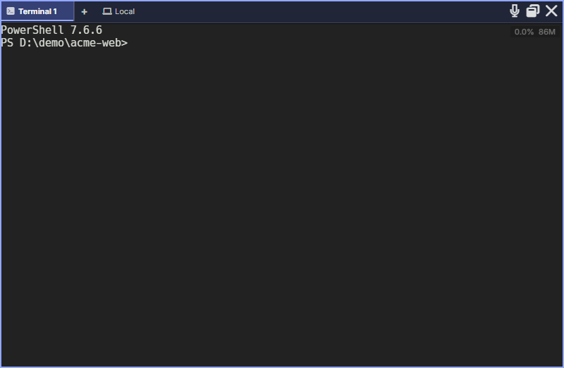

Features:

- Real PTY with full ANSI support
- Configurable font family and size
- Per-pane zoom level (`Ctrl+/-` and `Ctrl+Scroll`) that keeps the text under the pointer where it is; see [Zoom system](/internals/zoom/)
- Shell-integration env block (`AGENTMUX_BLOCKID`, `AGENTMUX_LOG_DIR`, `AGENTMUX_AGENT_ID`, …) with helper functions like `muxlog`
- Remote connections (SSH)
- [Voice input](#voice-input) — dictate commands into the PTY via the mic button in the pane header

Open a terminal: `⌘N` / `` Ctrl+Shift+` `` or click the **Terminal** icon in the top bar.

The shell-integration scripts deployed to `~/.agentmux/shell/` set the env vars and define helpers; see [Multi-instance & dev mode](/multi-instance/#whats-shared) for the `muxlog` helper.

### Default shell

A new local terminal opens with the shell chosen in **Settings ▸ Terminal ▸ Default shell**. See [Default shell](/settings/#default-shell). Terminals on an SSH host or a WSL distribution open that machine's own login shell.

### CPU and memory badge

The badge in the top-right corner of a terminal shows the CPU and memory used by the pane's shell and everything started in it. Hover it for a panel that explains each figure:

- **CPU**, as a share of one core (above 100% is more than one core);
- **Memory**, in RAM now; **Private** and **Committed**, where the system reports them; and **Peak**, the highest Memory has been;
- **Renderer**: whether the terminal draws with **WebGL (GPU)** or **DOM (software)**, and why, for example when the graphics context was lost and it switched to DOM.

The title of the panel says which processes it counts and when the shell started. Local figures update every second.

For an SSH or WSL terminal, the figures are measured on that machine, every 2 seconds while the pane is visible, with figures for the whole host where it reports them. If the remote machine can't tell the pane's processes from the rest, the panel says so and shows the machine's totals.

Turn the badge off with **Settings ▸ Terminal ▸ Show CPU/mem badge** (`term:showstatsbadge`). While no badge is showing, AgentMux scans the panes' processes only every 30 seconds instead of every second.

### Predictive echo

Characters appear locally the moment you type — before the PTY round-trip completes. The server echo is still authoritative; if it disagrees the local glyph is corrected instantly, so the visible buffer always matches what the shell actually received.

Password prompts and TUI apps (vim, less, htop) are safe: the predictor observes echo state and disarms automatically when it detects echo is off or a full-screen app takes over.

To disable: set `term:predictiveecho = false` in your settings. See [Settings Reference](/settings/).

### Dropping files

Dropping files from your file manager onto a terminal pane **copies** them into the terminal's working directory; it doesn't type their paths. See [Dropping files onto panes](#dropping-files-onto-panes).

## Browser

The browser pane embeds a native [CefBrowserView](https://bitbucket.org/chromiumembedded/cef/) at the OS-window level. It is **not** an iframe — the pane HWND sits as a child window of the AgentMux frame, which is why links, popups, and DRM content all work like a regular Chromium tab. The [Browser pane](/browser-pane/) page covers what you see and use: the toolbar, profiles and Incognito, downloads, zoom, and what you can allow or stop when an agent drives a page.

| Control | Action |
|---|---|
| ← / → / ↻ | Back / Forward / Reload (↻ becomes ✕, **Stop loading**, while a page loads) |
| Address bar | Enter URL or search query — defaults to a search if it doesn't parse as a URL; `Enter` loads it |

Header state syncs from the backend's `browser-pane-nav-state` event:

- **Title** — updates as the page loads
- **Favicon** — fetched from the page; a generic `globe` icon stands in when the site has none or its icon fails to load
- **History** — back/forward enabled state, per-pane

When you click inside the pane, the host fires `browser-pane-clicked` over the JS bridge, which the [reducer stack](/internals/reducer-stack/) routes through `refocusNode(blockId)` so keyboard shortcuts and split commands target the clicked pane. (DOM clicks don't bubble out of the embedded HWND, so the explicit IPC is necessary — this is the same pattern the [debugging](/internals/debugging/#reducer-dispatch-ring) page describes.)

### IPC commands

The host exposes the browser pane's lifecycle via these CEF commands (invoked through `invokeCommand` from the renderer):

- `browser_pane_create` — instantiate the CefBrowserView; called on first mount
- `browser_pane_navigate` — load a URL
- `browser_pane_resize` — propagate Solid layout changes to the HWND
- `browser_pane_reload` — reload the current page
- `browser_pane_focus` — explicit focus handoff after a click
- `browser_pane_close` — tear down on pane close

If you need to drive the browser pane from an agent or saga, those are the commands. The frontend [BrowserViewModel](https://github.com/agentmuxai/agentmux/blob/main/frontend/app/view/browser/browser-model.ts) shows the canonical sequencing.

### Default URL

A new browser pane opens its configured URL, otherwise your Home page, otherwise `https://agentmux.ai`. To get a literally blank pane, pass `meta.url = "about:blank"` explicitly. (Spec: `SPEC_BROWSER_PANE_DEFAULT_URL_AND_POPUP_2026_04_21.md`.)

### Address-bar focus + click handoff

The address bar and the embedded CEF pane each compete for keyboard focus across **two independent axes**:

1. **DOM focus** — `document.activeElement` in the main webview. Owned by Chromium, updated on every focus/blur. The "DOM is the source of truth for where typing goes" rule from the [browser-pane state catalog](https://github.com/agentmuxai/agentmux/blob/main/docs/specs/browser-pane-state-catalog.md) applies to this axis only.
2. **Win32 OS focus** — which HWND receives keystrokes. Owned by the OS, set by `SetFocus`/`SetForegroundWindow`. The pane HWND is a child of the main window; clicking the pane intercepts the click at WndProc level *before* the renderer's DOM ever sees it.

When these two axes disagree, you get the classic "click X, type, characters land in Y" bug. Two specific paths matter:

**Click into the page (e.g. google search):** The pane HWND captures the click via WndProc, `SetFocus`s itself, and emits `browser-pane-clicked` over IPC. The renderer's `BrowserViewModel` handler explicitly **blurs whatever main-window input held DOM focus** before calling `refocusNode(blockId)` — otherwise the subsequent `giveFocus()` flow sees the address bar's stale `activeElement` and tells the host to bounce OS focus back to the main window. (Diag log: `[browser-pane:diag] pane-click blur active=input.browser-address-bar`.)

**Click into the address bar:** The `<input>` `onMouseDown` handler fires `main_window_focus` IPC *before* the focus event, so OS keyboard focus moves to the main webview HWND at click-start. Without this, the address bar's `onFocus` fires too late — DOM focus moves but OS focus stays on the pane HWND, and keystrokes still route to Chromium. Buttons in the same nav bar happen to work without an explicit IPC because CEF/Chromium internally calls `SetFocus(parent)` for native `<button>` controls; `<input>` doesn't get the same treatment when the parent webview lacks focus.

`onMouseDown` (not `onMouseEnter`) is the click-to-focus trigger on both sides — hover-focus loops were the original failure mode the design corrects.

## Editor

The editor pane is a [CodeMirror 6](https://codemirror.net/) workspace with a file-tree explorer down the left side. It covers quick edits, file viewing, and diffing inside a pane — it is not a standalone IDE; deep editing happens in your agent's terminal or via agent tool calls.

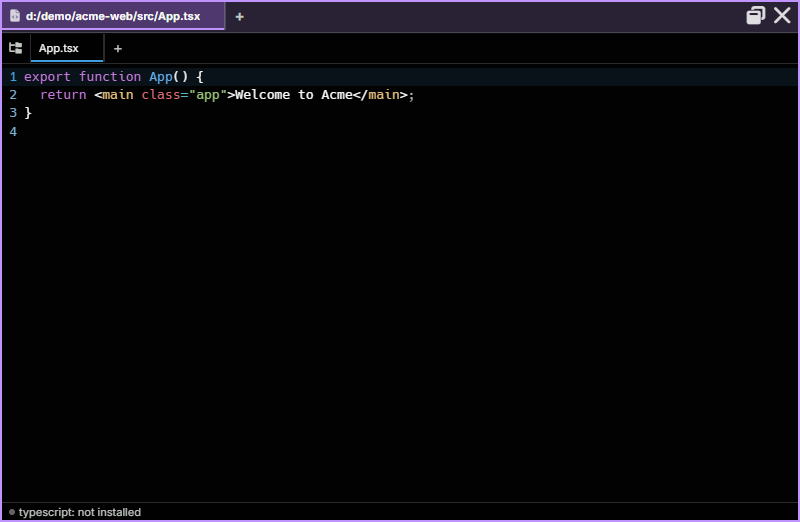

Languages currently get syntax highlighting via lazy-loaded extensions: TypeScript / JavaScript, Python, Rust, HTML, CSS, JSON, Markdown. Other extensions fall back to plain text.

`Ctrl+S` / `Cmd+S` saves the current file. When **no file is open** (scratch buffer mode), `Ctrl+S` opens an inline **Save As** path entry at the bottom of the editor — type an absolute path and press Enter to write the buffer to disk. Unsaved changes mark the pane title with `*`.

### File tree

The tree column appears on the left with three "roots" — your `$HOME` (auto-expanded so you don't have to drill in) plus every other drive (Windows) or mount (macOS `/Volumes`, Linux `/mnt` and `/media`, plus `/` itself). The drive that hosts `$HOME` is de-duplicated so it doesn't appear twice — UNIX `/` is the exception, always shown so you can reach `/etc`, `/opt`, etc.

| Interaction | Behavior |
|---|---|
| Click a folder row | Expand if collapsed, collapse if expanded (lazy-loaded on first expand; cached after) |
| Click a file row | Loads it into the editor. The active file's row carries a `circle-dot` icon and a highlight |
| **F2** on a file or folder row | Inline rename — edit the name in place and press Enter to confirm, Escape to cancel. A confirmation dialog appears for non-empty directory renames. |
| Right-click a folder row | Context menu: **Rename** (same as F2), **Collapse Folder** (collapses that subtree only) |
| Hover the divider between tree and editor | Cursor flips to col-resize; drag to resize the tree column |
| Symlinked rows | Followed automatically (matches VS Code), marked with a `↗` overlay |

An Editor **opened on a file starts with its tree collapsed**, however you opened it (from the Files pane, a link, an agent, the command palette) and whatever the file is: code, Markdown, an image or a PDF. An Editor opened with no file keeps the tree open, so you can pick one. Open or hide the tree yourself and the pane keeps your choice; a pane that began with no file stays open when you open a file in it later. A split of an Editor opens empty, with the tree setting of the pane you split. An Editor on an SSH host has no tree.

The tree column **width is persisted per pane** in pane metadata (`editor:tree_width`, default 240 px, range 150–600). The full tree's expand state is in-memory (collapsing a folder keeps its children cached so re-expand is instant).

### Hiding and showing the tree

The tree's toolbar has a **Hide file tree** button (the double-left arrows) that gives CodeMirror the full pane width. While the tree is hidden, a **Show file tree** button leads the document tabs at the top of the pane. The choice is **per pane** — `editor:tree_expanded` in block meta — so two editor panes in the same window can keep independent layouts (one tree-open for browsing, one full-width for diffs). `Ctrl+Shift+E` (`⇧⌘E`) moves between the tree and the editor.

The pane **title shows the complete file path**, not just the basename, with a trailing `*` for unsaved changes. When several editor panes are open on similarly-named files (e.g. two `index.ts` in different directories), the title makes it unambiguous which one you're actually editing.

### Toolbar

Small square buttons at the top of the tree, each with a tooltip that shows 40 ms after the pointer rests on it (at once when you move along the row from one to the next):

| Button | Type | Behavior |
|---|---|---|
| « | action | **Hide file tree** (see above) |
| 👁 / 👁‍🗨 | toggle | Show / hide hidden files. Off by default — dotfiles, `node_modules`, `.DS_Store`, `Thumbs.db`, `$RECYCLE.BIN` are filtered out. Persisted per pane as `editor:show_hidden` |
| ⊟ | action | Collapse all folders to the top-level roots |
| 🔄 | action | Re-fetch every currently expanded folder. Preserves expansion state. There's no background watcher; this is the explicit refresh path |

### Open by path

A path-input affordance lives at the bottom of the tree column when no file is open — handy when an LLM hands you an absolute path and you don't want to navigate the tree to find it. Once a file is open, the input is hidden to give the tree more vertical space.

You can also drop files from your file manager onto the editor pane: each opens in its own tab, in the viewer that fits it (`frontend/app/view/editor/editor-drop.ts`). See [Dropping files onto panes](#dropping-files-onto-panes).

### Encoding detection

The editor detects and handles non-UTF-8 files automatically — Windows-1252 `.ini` files, UTF-16 BOM, Shift_JIS, and similar encodings all load correctly. The detected encoding is shown in the status bar. Saves always write back in the file's original encoding unless you choose otherwise.

### Markdown preview

A Markdown file opens as a rendered preview. A **Preview / Source / Split** control above it switches between the preview, the editor and both side by side, and `Ctrl+Shift+V` (`Cmd+Shift+V`) toggles between preview and source. The preview re-renders on each save. The mode is kept per document tab.

### Find / Replace

Press `Ctrl+F` (`⌘F`) to open the find bar, which also does find-and-replace. It supports:

- **Regex** — toggle the `.*` button to switch between literal and regex search
- **Case-sensitive** — toggle `Aa`
- **Whole word** — toggle `\b`

Results highlight in the editor and the gutter shows match density. Press `Enter` / `Shift+Enter` to step through matches; press `Escape` to close.

### Language-server diagnostics (Phase 1)

The editor speaks the [Language Server Protocol](https://microsoft.github.io/language-server-protocol/) for real, type-aware diagnostics. Phase 1 (shipped) covers **TypeScript and JavaScript** via [`typescript-language-server`](https://github.com/typescript-language-server/typescript-language-server); completion, hover, go-to-definition, and additional languages land in follow-up phases — see [`SPEC_EDITOR_LSP_AND_THEMES_2026-05-26.md`](https://github.com/agentmuxai/agentmux/blob/main/docs/specs/SPEC_EDITOR_LSP_AND_THEMES_2026-05-26.md).

**Language servers are not bundled.** AgentMux follows the VS Code model: open a supported file, the editor looks for the server on your `PATH`, and either uses it or prompts you to install it.

#### Install banner

If the server binary isn't on `PATH` when you open a supported file, a yellow banner appears at the top of the editor pane with:

- the server's name (e.g. *"TypeScript language server isn't installed"*),
- the copy-paste install command (`npm install -g typescript-language-server typescript`),
- a **Copy** button for the command,
- a **Docs ↗** link to the upstream installation guide,
- a × dismiss button (per-session — the banner reappears next time you open a server-supported file).

Once you install the server and switch panes (or reopen the file), the banner is replaced by the running indicator.

#### Status chip

A small chip at the bottom of the editor shows the current server state — the chip colors track lifecycle:

| Color | State |
|---|---|
| 🟡 yellow | Starting / initializing — child process spawned, awaiting `initialize` response |
| 🟢 green | Ready — diagnostics streaming, `didChange` notifications going through |
| 🔴 red | Crashed — server exited unexpectedly or the transport broke. The chip flips to `error`; the full reason is in the host log (`muxlog host LSP`) |
| ⚪ dimmed | Missing — server binary not on `PATH` (the install banner is also visible) |

#### How it works

- One supervisor process per **(workspace root, language)** lives on the backend. Two panes open on the same project share the same server (refcounted) — opening a second `.ts` file from the same repo costs zero new server processes.
- The workspace root is detected by walking up the file's directory for `.git`, `Cargo.toml`, `package.json`, `go.mod`, `pyproject.toml`, `deno.json`, or `tsconfig.json` — whichever is closest wins. Files outside a project fall back to the parent directory.
- Diagnostics arrive as gutter markers and underline squiggles, identical to CodeMirror's built-in lint surface. Severity follows the LSP spec: error → red, warning → yellow, info / hint → blue.
- Edits debounce at **250 ms** before flowing to the server via `didChange`; that's deliberately conservative — most servers re-typecheck synchronously and a tighter window leaves the UI feeling laggy on big files.

#### Kill switch

Set `editor:lsp.enabled = false` in your settings to disable LSP across all editor panes. Useful if a misbehaving server is eating CPU and you want to roll back to syntax-only highlighting.

### What's not in the editor (yet)

The editor is intentionally scoped — see [`SPEC_EDITOR_FILE_TREE_2026-05-26.md`](https://github.com/agentmuxai/agentmux/blob/main/docs/specs/SPEC_EDITOR_FILE_TREE_2026-05-26.md) for the file-tree design and [`SPEC_EDITOR_LSP_AND_THEMES_2026-05-26.md`](https://github.com/agentmuxai/agentmux/blob/main/docs/specs/SPEC_EDITOR_LSP_AND_THEMES_2026-05-26.md) for the language-server roadmap. Not currently supported (each item listed there as future phases):

- File watching for live tree updates — use the 🔄 button when something changes outside the app
- Delete / new-file from the tree — happens in your agent or terminal (rename ships via F2 and the right-click context menu)
- Multi-root workspaces — single set of system roots is the only configuration
- LSP completion / hover / go-to-definition — Phase 2; only diagnostics ship today
- LSP for languages other than TypeScript and JavaScript — Phase 3 (rust-analyzer, pyright, gopls, clangd are pre-wired in the install-hint table, just not surfaced yet)
- Tree-wide search / filter (the tree is read-only browse for now)

10 MB file-size cap on read and write — over that, the editor refuses to load.

### Document tabs

The Editor keeps its open files, text or [media](#media), as **document tabs** in the pane header. The **+** at the end opens a new, empty tab.

- **Drag a tab** along the bar to reorder it.
- **Drop it on another Editor pane** to move it there. It keeps its unsaved changes and undo history.
- **Drop it near the edge of any pane** to open it in a new pane on that side.
- **Right-click a tab** and choose **Move to New Pane** to open it in a new pane to the right of its own.

A new pane made this way is an Editor on the same connection, holding just that tab. A tab that is being saved stays where it is.

#### Merging Editor panes

Two Editors can sit in one pane as [pane tabs](#pane-tabs), each with its own document tabs. When that happens, they merge into one Editor:

- When you drop an Editor's pane tab onto another pane that holds an Editor, the arriving Editor's document tabs join the destination's with their unsaved text, and its pane tab goes. Hold `Alt` while you drop to keep the two separate.
- Picking **Editor** from the **+** menu of a pane that already holds an Editor on this computer adds a new, empty document tab to that Editor instead of a second Editor.
- A pane that holds two Editors no drop reached (from a saved layout, or a move an agent made) has **Merge document tabs** in the right-click menu of its pane tab.

Only Editors on the same connection merge, since a path means nothing on another host. An Editor that can't merge, for example because one of its tabs is being saved, is left as it is, with a message when there is something to say.

## Files

The Files pane is a file browser (`frontend/app/view/files/files-view.tsx`). It opens on your home folder, or on the folder in its `files:path` setting, and on a remote host's files when you choose **Browse files** in [Connectors → Remotes](/connectors/#remotes). The pane title is the folder's name.

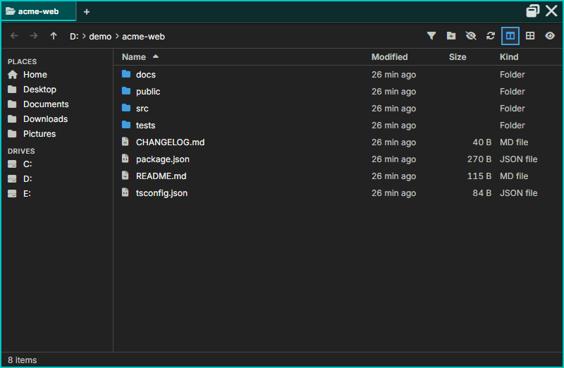

- **Toolbar:** Back, Forward and Up; a breadcrumb you can click, or double-click (or press `Ctrl+L`) to type a path; **Filter** (`Ctrl+F` or `/`); new folder; show or hide hidden files; refresh; and toggles for the Places sidebar, a list or thumbnail view, and the preview panel.
- **Places** (left): your home and common folders, drives, WSL distributions, remote hosts (with **Manage remotes…**), and your agents' folders, each in the agent's colour.
- **The list:** sortable Name, Modified, Size and Kind columns, or a thumbnail grid. On Windows, each file and folder shows the icon Windows Explorer shows for its type; set `files:icons` to `app` to keep AgentMux's own ([Files pane settings](/settings/#files-pane-settings)). In a git repository each row shows its status letter, and a dot marks a file an agent changed (its tooltip names the agent).
- **Preview** (`Space`, or the eye button): images, highlighted code, rendered Markdown, and cards for folders, audio, video and other files.
- **Right-click a row** to open it (here, in a new tab, in the Editor, or with the default app), open a terminal there, reveal it in your file manager, **Mention in agent** or **Attach to** an agent, cut, copy or copy its path, rename (`F2`), move it to the Trash or delete it permanently. Right-click empty space for a new folder or file, paste, and the folder's own actions.
- **Copying and moving:** cut, copy and paste, or drag files. When a name already exists, the Files pane asks: **Keep both**, **Skip**, **Replace** or stop, with **Do this for every conflict**.
- **Status line:** the item count and selection size, the repository's branch and changes, and messages such as an undo for the last change.

A Files pane that a [container agent](/container-agents/) opens on a folder of its workspace shows only that folder. It lists, navigates and previews files and opens them in the Editor, and changes nothing; a link in the folder that leads out of it is refused.

Keyboard shortcuts are listed in [Keybindings → Files](/keybindings/#files).

## Media

There is no separate Media pane any more. Images, audio and video open in the [Editor](#editor), as tabs like any other file. The Editor picks a viewer for each file from its content, and from its extension only where the content leaves it open (`frontend/app/view/editor/viewers/viewer-choice.ts`). PDFs get a PDF viewer, and other binary files a card with the file's details.

| Viewer | Files | What it does |
|---|---|---|
| **Image** | png, jpg, gif, webp, svg, avif, bmp, ico and other images | The wheel zooms about the cursor (`Ctrl`+wheel still zooms the pane). A click zooms in a step; `Alt`+click, or `Ctrl`+click except on macOS, zooms out. A drag pans. `+` and `-` zoom, `0` fits the image to the pane, `1` shows it at 100%, and `[` and `]` show the previous and next image in the folder. The toolbar has fit, 100% and a background choice, and shows the image's size and type (`frontend/app/view/editor/viewers/image/image-viewer.tsx`). |
| **Audio and video** | webm, mp4, mov and m4v video; wav, mp3, ogg, opus, flac, m4a and aac audio | The player's own controls. Nothing plays on its own, and a video stops when another tab comes to the front. A file that won't play says whether a codec is missing or the file is damaged (`frontend/app/view/editor/viewers/media/av-viewer.tsx`). |

**Zooming a PDF** (`Ctrl`+scroll, `Ctrl`+`+` / `-` / `0`) zooms the pages, not the whole pane: 100% is the width that fits the pane, the pages are drawn again at the new size so they stay sharp, and the point under the pointer stays under it. Each step makes the pages 25% larger or smaller, and a PDF zooms in to 1500% (other panes stop at 200%). The zoom is saved with the pane. The Editor's tabs, toolbar and file tree stay at the app's own zoom, and `Ctrl`+scroll over them zooms the app (see [Zoom system](/internals/zoom/)). In the text editor, zoom scales the whole pane, tabs and tree included.

A viewer reloads when its file changes on disk. To open one of these files, open it in the Editor as you would any file, or drop it on an Editor pane (see [Dropping files onto panes](#dropping-files-onto-panes)).

### Following a folder

The Media pane's job was watching a folder where something writes images or video, such as a local generation pipeline (a ComfyUI-style image or video workflow), and showing each new file as it lands. The Editor does this per tab. An image, audio or video tab has a **Follow newer files in this folder** button in its toolbar. While it is on, the Editor watches the file's folder for image, video and audio files, and a newer one replaces the tab's file (`frontend/app/view/editor/viewers/follow-folder.ts`, `crates/srv/src/backend/media_file_watcher.rs`). A file dropped with no path on disk can't follow its folder.

A saved Media pane opens as an Editor: each of its files becomes a tab that follows its folder (`frontend/app/view/editor/media-migration.ts`).

### Opening it programmatically

Agents use the `Pane` MCP tool (action `open`, view `media`, a `file`) to show a file next to the conversation, optionally as a split or a floating pane, without the person having to browse for it. It opens in the Editor with **Follow newer files in this folder** on, as a new tab in an Editor pane already open in the agent's own tab if there is one (`crates/mcp/src/tools/panes.rs:14-18`, `crates/srv/src/server/app_api/pane.rs:1113-1126`). Files on an SSH connection can't be shown this way yet. Useful for "here's the image or video I just generated" moments mid-turn.

## Agent

The agent pane is the first-class resident unit of AgentMux. Each agent gets a structured pane — not a terminal wrapper — with its own accounts and bundles, streaming parser, lifecycle management, and direct access to MuxAPI. It displays:

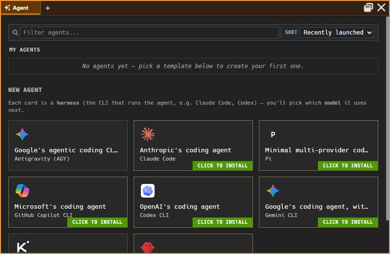

- **Streaming text** — Agent output in real time
- **Tool calls** — Name, arguments, and result of each tool invocation
- **File diffs** — Visual diff overlay when the agent writes files
- **Auto-scroll** — Follows output, with manual scroll override
- **[Voice input](#voice-input)** — dictate prompts into the composer via the mic button in the pane header
- **Enter animation** — New messages animate into view as they stream in; set `window:reducedmotion = true` to disable.
- **Disconnected banner** — if the WebSocket tore down mid-turn, a banner appears at the top of the pane with a single action to reconnect. Dismissing it lands you in an idle state with the partial turn preserved.

An agent that runs in a Docker container shows a **CONTAINER** tag by the model selector; see [Container agents](/container-agents/).

Agent panes are configured through [Bundles](/bundles/), picked when the agent is created; **Bundles…** changes them for an existing agent (see Subsections below).

### Activity indicator

While an agent is actively streaming or tool-calling, the host signals the OS that the app is busy — Windows lights up the taskbar entry, macOS bounces the dock icon, Linux raises an urgency hint. The indicator clears as soon as the agent goes idle. Useful when you've shifted focus to another app and want to know when the agent has finished without polling the window.

Activity is tracked per-pane and aggregated across panes, so the indicator reflects "at least one agent is busy" not "this specific agent". Implementation detail in `frontend/app/store/agentActivity.ts`.

### Rendering performance

The agent message list is **virtualized**: only ~50 visible rows + 5-row overscan are mounted in the DOM at any moment, regardless of session length. A 2000-message session no longer means a 2000-element layout tree.

The virtualization is **hybrid** — the trailing 50 rows (the streaming buffer) are always mounted in normal flex flow, never recycled. Older rows are virtualized via `@tanstack/solid-virtual` with absolute positioning and per-row `ResizeObserver` measurement. This split eliminates measurement lag during token streams, which would otherwise cause visible jitter as text grew.

See [internals/agent-pane-virtualization](/internals/agent-pane-virtualization/) for the architecture and the spec at `docs/specs/SPEC_AGENT_PANE_VIRTUALIZATION_REDESIGN.md` in the main repo.

Runtime limits for agent panes are controlled by the `term:agentmaxruntimehours` and `term:agentidletimeoutmins` settings — see the [Settings Reference](/settings/#terminal-settings).

### Scrolling past a preview

Some content in the agent pane sits in a capped box with its own scrollbar: a tool call's output, an incoming message, a context delivery card. When you scroll such a box to its top or bottom edge with the mouse wheel, the next 3 wheel notches are held there, and a line shows on that edge; only after that does the wheel scroll the whole pane. A trackpad swipe (or a high-resolution wheel) is held at the edge until the gesture pauses. This stops a box that slides under the pointer from being scrolled past by notches meant for it. Tool output that fits without a scrollbar holds the wheel the same way (`frontend/app/view/agent/components/scroll-handoff.ts`).

### Activity dock

Long-running shell commands started by the agent are pinned to a **dock at the top of the agent pane** — visible at a glance without scrolling to find the tool call. Click any docked activity row to expand its live log output. Three rows show at once; the rest fold under "▸ N more".

What gets a row (`frontend/app/view/agent/components/ActivityDock.tsx`, `frontend/app/view/agent/activity/tool-adapter.ts`):

- A Bash call that has been running for 30 seconds — the auto-detected "this is taking a while" case. A bare `sleep` gets a row straight away, with a "~Ns left" countdown.
- A command the agent launched in the background (`run_in_background`), **immediately**, including one a subagent started. A long-lived background process (a dev server, a watch task) is expected to keep running, so it shouldn't look like a stuck turn.
- Shells and subagents the agent started.

A running row shows a rotating slash to the left of the short phrase the agent gave the call (a Bash call's description; the command itself when it gave none). A finished row keeps its result mark.

#### Long commands go to the background

For a Claude agent, AgentMux sets the CLI's default Bash timeout to 30 seconds. A Bash call still running at 30 seconds is moved to the background: the tool result says so, the agent's turn ends and the agent is free to take your next message, and the command's end arrives later as a notice that starts a turn. A call that sets a longer `timeout` of its own is cut to 30 seconds by AgentMux's `PreToolUse` hook, so it goes to the background too. The CLI doesn't background a command it can't split into simple commands: one with `git` in it, a command or process substitution, or a brace or `$'…'` expansion is stopped at its timeout instead. When the agent sets none for such a call, the hook gives it five minutes, so a push or a clone can finish. A timeout the agent sets for such a call stands. A background call (`run_in_background`) is left alone, and so is an agent whose own environment sets `BASH_DEFAULT_TIMEOUT_MS`.

When a call with a description moves to the background, the pane says so in the conversation, in the agent's own phrase: "Moved to the background: *phrase*. The agent is free; it picks this up when it finishes." When it ends, a line says "Finished in the background: *phrase*." (or "Failed" or "Stopped"). Only a call that moved while you were watching gets these lines; one in a conversation you open later doesn't. A call with no description keeps the agent's own narration.

A row shows a glyph for its kind while it runs (`$` for a command), then ✓ (done), ✗ (failed) or ■ (stopped). A finished row leaves the dock after a few seconds: 8 s when done, 3 s when stopped, 15 s when failed. A failed row can be dismissed sooner with **×**. A background command's row ends when the agent is told it finished, or when Claude Code reports that it ended, which is what clears rows for commands a subagent started. The same background commands also appear in the [Swarm](/subagent-watcher/#background) pane.

### Agent History

Each agent pane keeps its working scrollback scoped to the agent's **current session** — after a fresh session starts, older conversation isn't shown inline (it's still fully retained, just out of the live view). To read the full multi-session history, open **Agent History**: a read-only tab on the agent pane (reachable via the **Earlier conversations** link row that appears at the top of the scrollback after a new session starts, or via the pane's right-click context menu) that shows the entire retained conversation across every session, with day separators and session-boundary dividers, and its own independent scroll/pagination back to the very first message. It's a separate tab, not a view that replaces your live conversation — switch back to the live tab at any time, and an in-progress composer draft survives the round trip.

### Send-now queue

The composer has a **send-now** mode for messages you want delivered the moment the agent's next tool call completes — useful for mid-turn corrections without interrupting the current operation. Type your message and use the send-now action to queue it; it holds at the tool-call boundary and fires the instant the tool returns. Press `↑` to recall the last queued message.

### AskUserQuestion

When an agent calls `AskUserQuestion` (part of the Agent SDK control protocol), an interactive question panel appears inline in the pane — above the composer, below the message thread. Submit your answer directly; the agent resumes without any further action. If the agent stalls after receiving the answer, AgentMux auto-resumes it after a short delay.

### Persistent shell

Agent panes can host a **persistent shell session** pinned alongside the conversation. Unlike tool-call shells (which run inline and close with the tool call), a persistent shell stays open between turns — the agent can issue commands to it across multiple turns, and you can interact with the same shell directly. Each persistent shell shows a stop button (⏹) in its header; the `Terminal` MCP tool lets the agent stop it programmatically (action `close`). Tree-kill on close ensures no orphaned child processes. The agent can also write to it (`type`) and check its state (`read`, or `wait` until it exits) — see [MuxAPI](/internals/muxapi/#terminal).

### Next-prompt suggestion (ghost text)

After each completed turn, if the composer is still empty, AgentMux may show a dimmed, model-predicted suggestion for your likely next message — displayed as the composer's placeholder text. Press **Tab** to accept it (inserted in full); typing anything else dismisses it immediately. It's powered by a small Haiku call and is always-on today (no settings toggle exists yet). This is AgentMux's own reimplementation of a feature Claude Code's own CLI can't surface here, since AgentMux always drives it in non-interactive mode.

### Composer strip

Mode, Model, and Effort (Claude panes only) render as pill-shaped **drop-up** controls in the composer strip — click one to open a small popup above it rather than a native dropdown; changes apply on the agent's next turn. The **Shell** button (formerly labeled "Log") toggles the resizable details drawer described below.

The strip also shows the account the agent uses, as its login email (shortened to 22 characters; hover for the whole address). Click it to change the agent's account. The menu lists every signed-in account of the agent's provider, with the current one checked and a note beside an account that is out of quota ("out of quota until Sun 7:00 PM"). Choose one to move the agent to it. A signed-out agent's menu also has **Log in**, and a Claude agent's has **Sign in with another account…**, which adds an account and moves the agent to it. Accounts that share a provider and an email are numbered (`user@example.com ·2`). A container agent's strip has the same menu, even before an account is linked.

If the agent is idle, it switches at once and restarts, keeping its session. If a turn is running, the switch waits: the chip reads `you@example.com → other@example.com`, and the agent moves when the turn ends. Choosing the account it is already on cancels a queued switch. See [Identity & Accounts](/identity/#changing-an-agents-account) (`frontend/app/view/agent/components/AgentComposerStrip.tsx`).

### Attaching files

You can attach any kind of file to a message: images, PDFs, Word, Excel and PowerPoint files, text, code, archives and more (`frontend/app/view/agent/attachments/`, `crates/srv/src/backend/attachments/`). To attach files:

- drop them anywhere on the agent pane (see [Dropping files onto panes](#dropping-files-onto-panes)); a dropped folder adds the files in it, skipping folders such as `node_modules`, `target`, `dist` and `.venv`;
- paste them with `Ctrl+V` (`Cmd+V`), for example a screenshot or files copied in your file manager;
- or right-click the message box and choose **Paste**.

Attached files appear above the message box as numbered tiles: a thumbnail for images, SVG and text, or a coloured icon with the file's extension for everything else (PDFs also show their page count). Click a tile to preview it; its **×** removes it, with a few seconds to undo. A header shows the count and total size, with a progress bar while files are being processed. A message can carry up to **128 files** and **1 GB** (`attachments:maxfiles`, `attachments:maxtotalmb`).

What the agent receives:

- **Every agent** gets a numbered list of the files with their paths on disk and a short note on each (type, PDF page count). Office documents and PDFs also get an extracted text version, and its path is listed too.
- **Claude agents** additionally see images inline, and read PDFs of up to 100 pages directly: up to 20 inline images per message (`attachments:claudeinlinemax`) and 50 MB of inline images per session (`attachments:claudesessioninlinemb`). Beyond those limits, files are listed by path for the agent to open.

Container agents can't take attachments yet: files dropped or pasted into their pane are copied into the agent's working folder instead, with an `@name` reference in the message box. Attachment files are kept for 30 days after they were last used, and files never sent are removed after 7 days (`attachments:retentiondays`).

### Side questions (`/btw`)

Type `/btw <question>` to ask the agent something without interrupting the turn it's running. The answer appears in a floating overlay (`Esc` closes it), and neither the question nor the answer is added to the conversation. It works on Claude, Codex and Gemini agents (`frontend/app/view/agent/commands/providers/btw.ts`).

### Coloured status words

Agents can colour a few words of a reply to mark status: passed, needs attention, failed, a note, de-emphasised, before/after, or a small badge. The colours come from your theme, and AgentMux tells agents how to use them through its Operator Config. Only the classes `am-ok`, `am-warn`, `am-error`, `am-info`, `am-muted`, `am-added`, `am-removed` and `am-badge` are kept; any other class, and any `style` attribute, is stripped (`frontend/app/element/markdown-semantic.ts`).

### Details drawer & embedded shell

Click **Shell** in the composer strip to open a resizable **details drawer** beneath the message thread, holding both the activity log and a real embedded terminal (xterm.js + PTY) for the pane. Drag the drawer's top edge to resize it (120–600 px); the height persists per-pane. The embedded terminal is a genuine, usable shell — though newer and lighter-weight than the standalone [Terminal pane](#terminal), so some edge cases (e.g. large pastes) aren't as polished yet.

### Pane and tab colors

Every agent has its own **automatically assigned display color** — a deterministic color derived from the agent's id, set the moment the agent is created (and backfilled for agents that existed before this shipped) and shown as the agent pane's border. It requires no action on your part; it's just how you can tell agents apart at a glance across panes.

This is separate from **manual** pane/tab coloring: right-click a **pane header** and open **Pane Color** for **Default** and 12 named colors (applies a `frame:hue` to that pane) — this works on every pane type, not just Agent panes, and overrides an agent's automatic color when set. Right-click a **window tab** for a separate 14-swatch palette (`tab:color`) to color the tab itself, with **Clear color** and **Rename**. These are two independent color systems (different storage, different swatch sets) by design.

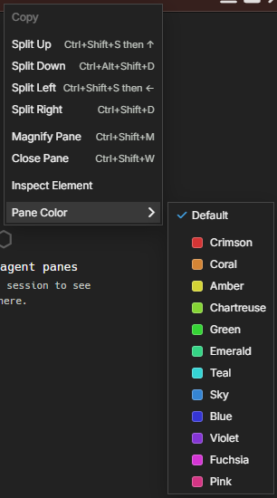

### Subsections

The agent pane has no drawer of its own. What belongs to one agent is reached from the agent's **My Agents** row and from the pane's right-click menu, and the rest lives in the app-wide panes.

**The pane's right-click menu** has **Agent History**, **Quick Fork** and **View…**. For an agent with a saved definition it adds **Seat…**, **Bundles…** and **Personal memory**, and a container agent also has **Container limits…**. A quick-launch pane, which has no saved agent, has none of these, and neither does an agent's History tab.

**My Agents** (the agent picker): each row's menu (the chevron at the right of the row) has **Rename**, **Duplicate**, **View History**, **Seat…**, **Bundles…**, **Environment…** and **Delete**. See [My Agents](/first-agent/#my-agents).

| What | Where |
|---|---|
| **Seat** (role, lead and area, and **Import roster…**) | **Seat…**, from the row menu or the pane's right-click menu. See [Seats](/first-agent/#seats). |
| **Bundles** the agent starts with, in order, its own bundle first | **Bundles…**, from either menu; saved on each change. See [An agent's bundles](/bundles/#an-agents-bundles). |
| **Environment** variables it starts with | **Environment…** in the row menu. See [Environment variables](/first-agent/#environment-variables). |
| **Personal Memory** | **Personal memory** in the pane's right-click menu opens [Memory → Personal](/memory/#personal) on this agent. There you can browse its files, see history and diffs, revert, and add a **New file** or **Create MEMORY.md**. |
| **Account** | The login email in the composer strip (see [Composer strip](#composer-strip)). Which agents use an account is in [Connectors → Accounts](/connectors/#accounts). |
| **MCP servers** and **Skills** | Each server's page in [Connectors → MCP servers](/connectors/#mcp-servers) and each skill's page in [Memory → Skills](/memory/#skills) list the agents it is bound to, each with **Unbind**, and bind another with **Bind to agent**. |
| **Message-delivery registration** | A badge on the agent's row in the [Swarm](/subagent-watcher/#registration-badge), only when something is wrong. |
| **Hiding an agent from paired devices** | **Settings ▸ Paired devices ▸ Hidden from devices**. See [Paired devices](/lan-discovery/#what-a-paired-device-can-see). |

Bundles themselves are edited only in [Memory → Bundles](/memory/#bundles). The `view: "identity"` registration exists so `pane.open` RPC and right-click menus can still reach that view, but nothing in the app opens it.

## Swarm

The Swarm pane lists every agent on this AgentMux instance, with or without a pane, as a tree. Under each agent you see its todo list, subagents, workflow runs, shells, cron jobs, long-running commands and background commands; a subagent's own background commands appear under that subagent. Agents that are stopped are listed too, with **Start** and **Open**, and below them come the agents of other AgentMux instances on this machine and your network. Click an agent to focus its pane. The pane has two sections, **Supervisor** and **Broadcast**, as tabs along its top; both show the same list and one selection, and a fleet toolbar sends one message to several agents, stops them or sets their Supervisor mode. Subagent activity expands inline in the tree rather than in a pane of its own. The work agents are doing is on the [Kanban](/kanban/), a pane of its own. See [Swarm](/subagent-watcher/). The model requests AgentMux makes on its own (session titles, names, prompt suggestions, narration), once counted in the toolbar's Stats panel, are in the token popover's **AgentMux internal** row (see [Warden](/warden/#the-token-pill)).

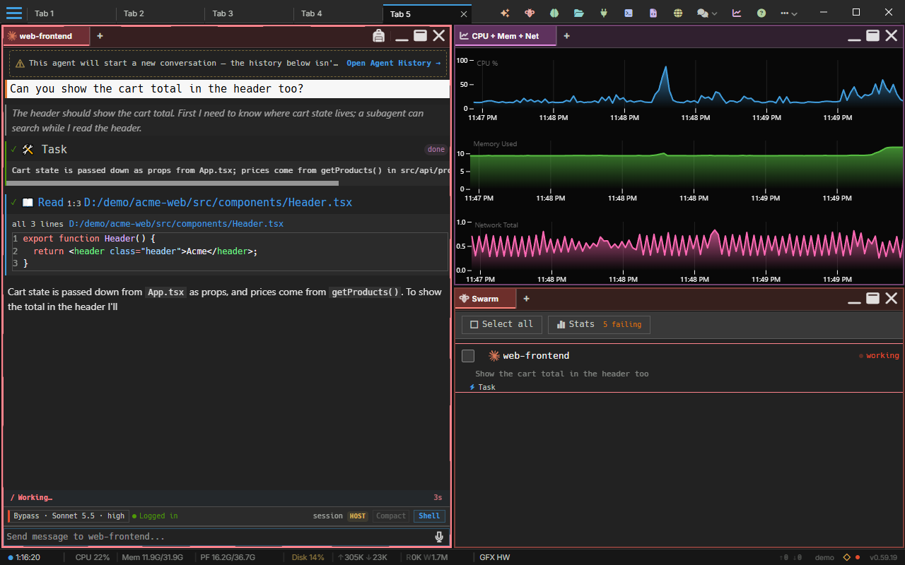

## Drone

The Drone pane is a visual **DAG-of-blocks** automation engine — compose a directed graph where each node is a reusable block, run it, and inspect results per block. Open it from the widget bar.

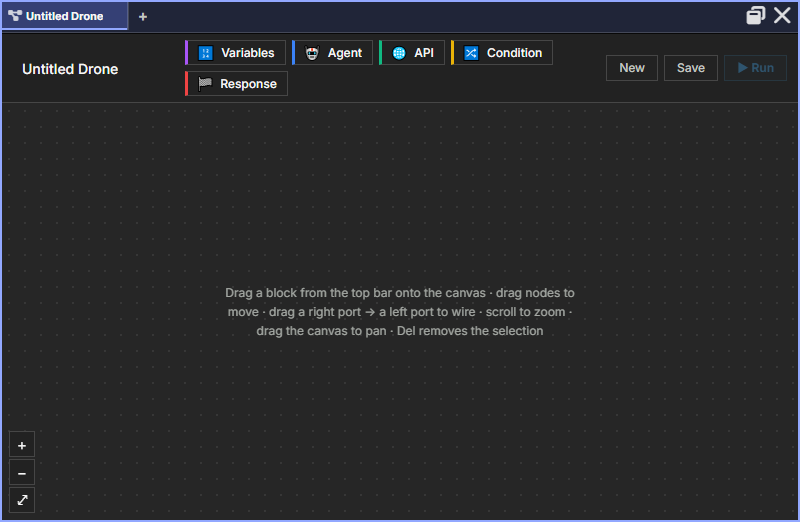

The name signals the pane's autonomous nature: a drone runs unattended on triggers, distinct from the interactive Agent pane.

### Block types

| Block | Purpose |
|---|---|
| **Variables** | Declare drone-scoped variables, read elsewhere via `{{var.name}}`. |
| **Agent** | Run an agent with a task prompt. Supports identity, memory, named-agent continuation, and working directory — the same controller the interactive Agent pane uses, invoked headlessly. |
| **API** | Make HTTP requests (GET/POST/PUT/PATCH/DELETE). URL and body support `{{...}}` interpolation. |
| **Condition** | Evaluate a boolean expression (e.g. `{{var.x}} > 10`); branches into true / false outputs. |
| **Response** | Terminal output block. Exactly one is required per drone — execution pauses until a Response is reached or an error occurs. |

### Authoring a drone

1. Click **New** to start a blank drone.
2. Click a block in the palette to add it to the canvas.
3. Shift-click a source node, then a target node, to connect them.
4. Click a node to open the inspector and configure its parameters.
5. **Save** to persist the drone to the backend.

### Running a drone

Click **Run**. The engine performs a topological sort over the DAG and executes blocks in dependency order, publishing `block_started` / `block_done` / `block_error` events on the `dronerun:<id>` SSE topic. The bottom **Runs** panel shows recent executions; the right-hand inspector shows the last result for whichever block is selected (for Agent blocks, the final response text and cost in USD if available).

### Known limitations

The Drone pane is on a Phase 2 roadmap that adds the following — they are **not** available yet:

- Drag-and-drop canvas (current canvas is click-to-add + Shift-click to connect)
- Triggers (cron / webhook / dependency / schedule)
- Subdrone invocation (one drone calling another)
- Function blocks (sandboxed JS via `quickjs-rs`)
- Streaming agent output live into the inspector (Phase 1.5 shows aggregated result only)
- Run cancellation / abort

## Sysinfo

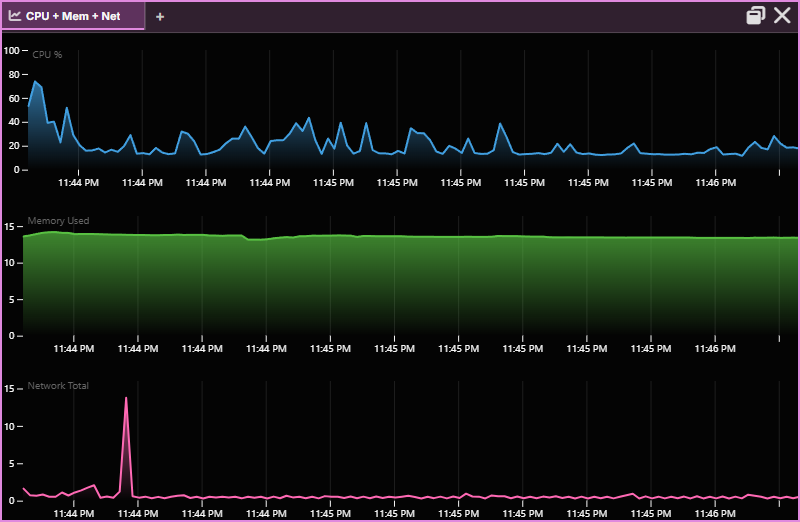

Live system metrics displayed as time-series line plots. Supports multiple plot types:

| Plot Type | Metrics |
|-----------|---------|
| CPU | Overall CPU usage % |
| Mem | Memory used (GB) |
| CPU + Mem | Both on one view |
| Net | Total network throughput (MB/s) |
| Net (Sent/Recv) | Sent and received separately |
| Disk I/O | Total disk throughput |
| Disk I/O (R/W) | Read and write separately |
| All CPU | Per-core CPU usage (up to 32 cores) |
| CPU + Mem + Net | All three combined |

Data streams via WebSocket events from the backend. Supports remote connections — view system metrics from SSH-connected hosts.

## Voice input

Speak into a pane instead of typing. Voice input is supported on **Terminal** and **Agent** panes; other pane types don't surface the mic button.

### How it works

Each supporting pane shows a microphone button in the **top-right of the pane header**, next to the maximize and close buttons. Click it to start dictating into that pane:

- **Terminal panes** — the recognized text is streamed character-by-character into the PTY, exactly as if typed
- **Agent panes** — the recognized text appends to the composer textarea (interim phrases preview as you speak; finalized phrases commit). You still press Enter to send

The mic button pulses while listening. Clicking the mic on a **different** pane retargets the voice stream to that pane — only one pane receives output at a time. Clicking the active pane's mic again stops listening.

### Keyboard shortcut

| Action | Shortcut |
|---|---|
| Toggle voice on the focused pane | `Ctrl+Shift+V` |

The shortcut does nothing on pane types without voice (Browser and so on). In an Editor it toggles the markdown preview instead, and in a Terminal it pastes.

### Settings

| Key | Type | Default | Effect |
|---|---|---|---|
| `voice:enabled` | bool | `true` | When `false`, hides the mic button across all panes |

Set in your [settings.json](/settings/) (the path varies by install vs dev mode — see the Settings page for the exact location). Useful if your browser blocks the Web Speech API or you don't want voice input enabled by default.

### Browser permission

Voice input uses the browser's built-in [Web Speech API](https://developer.mozilla.org/en-US/docs/Web/API/Web_Speech_API). The first time you click the mic, Chromium prompts for microphone permission. If you deny it (or revoke it later), AgentMux shows a notification — re-enable it in browser settings to recover.

The Web Speech API is currently Chromium-only. AgentMux is built on Chromium so this works for all users; in non-Chromium browsers the mic button would simply not appear (`voice.isAvailable()` returns false).

## Pane Management

### Creating Panes

- **Top bar widgets** — Click the icons on the right side of the top bar. A click on a management widget such as Swarm or Memory brings back the one you already have (see [Opening a widget again](#opening-a-widget-again))
- **A pane's +** — Adds a tab to that pane (see [Pane tabs](#pane-tabs))
- **Split** — Split a pane from its right-click menu or with the keys below; the new pane is a [Shortcuts pane](#the-shortcuts-pane) where you choose what it becomes (see [Splitting](#splitting))
- **Keyboard** — `⌘N` / `` Ctrl+Shift+` `` for a new pane, `⇧⌘A` / `Ctrl+Shift+A` for an agent pane

### Opening a widget again

A widget is either a **singleton**, where one pane is the point, or a widget you can have many of:

- **Brought back:** Swarm, Memory, Connectors, Settings, Vault, History, Audit, Tower, Kanban, Help, Toolchain and Drone. Clicking one in the widget bar, in **more**, in a group's flyout or in the command palette shows the pane you already have: it restores it if it was minimized, un-magnifies another pane that covered it, switches to its tab, and gives it focus. If there is none, it opens one.
- **Opened each time:** Agent, Terminal, Browser, Editor, Files and System info. Every click opens a new pane.

**Shift-click** an entry (or press Shift with it in the palette) to open a new pane even for a singleton. The command palette also lists a **New …** entry for each singleton (**New Tower (Task Manager)**, **New Kanban**, **New Help**, and so on). An installed [widget](/widgets/) says which it is with `singleton` on its pane (see [The package](/widget-api/#the-package)); the default is a new pane each time.

### Pane tabs

Every pane's own header doubles as its tab strip — one row, not a title bar
with a separate strip stacked under it. Click the **+** on any pane's strip
and pick a widget type; it's added as a new tab *in that same pane*, no new
split. This works for every widget type, not just more of the pane's own
kind — an agent pane can pick up a terminal tab and a browser tab right next
to it, all inside one pane.

When a pane has more tabs than fit, the mouse wheel over the strip scrolls it 10 px per notch, and selecting a pane scrolls its selected tab flush left, the way selecting the tab does.

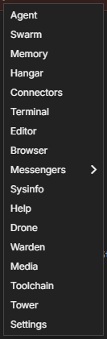

This is a different axis from the top-bar/`Cmd+N` actions above and from
[Splitting](#splitting) below: those create a **new pane**. A pane's own
`+` adds a **tab to the pane you're already looking at**. Use splits when
you want two things visible side by side; use tabs when you want to switch
between things in the same space.

Note this "tab" is scoped to the pane — a different concept from a window
[Tab tear-off](#tab-tear-off) below, which is about the browser-style strip
at the very top of the whole window, not a pane's own strip.

Inspired by [cmux](https://github.com/manaflow-ai/cmux)'s
`Workspace → Pane → Surface → Panel` model — see
[GitHub: SPEC_PANE_TABS_UNIVERSAL_CMUX_REDESIGN](https://github.com/agentmuxai/agentmux/blob/main/docs/specs/SPEC_PANE_TABS_UNIVERSAL_CMUX_REDESIGN_2026_09_17.md)
for the full design rationale.

A pane tab's own menu (right-click its pill, in a pane with more than one tab) has **Open in Its Own Pane**, which takes that tab out into a pane of its own beside this one, to the right of a row or below a column. A pane that holds two Editors has **Merge document tabs** there too (see [Document tabs](#document-tabs)).

### Splitting

| Action | macOS | Windows / Linux |
|--------|-------|-----------------|
| Split Right | `⌘D` | `Ctrl+Shift+D` |
| Split Below | `⇧⌘D` | `Ctrl+Alt+Shift+D` |
| Split in Direction | `Ctrl+Shift+S` + Arrow | Same |

A pane's right-click menu has the same splits, and the command palette has **Split Right** and **Split Down**. **Every split opens a Shortcuts pane** beside the pane it came from, for you to choose what the new pane should be. It does not copy the pane you split.

### The Shortcuts pane

A Shortcuts pane is a grid of tiles, one for every pane type and every installed widget you've approved: Agent, Terminal, Editor, Files, Browser, Swarm, Memory, Connectors and the rest, with their icons and labels. The ones you opened most recently come first (from anywhere: a tile here, the widget bar, the **+** menu, a shortcut); the rest keep the order of the widget bar. Widgets you hid in **Settings → Widgets** are left out.

- **Choose a tile** with a click, or with the arrow keys and **Enter**. The Shortcuts pane is replaced in place by that pane, at the same size and position. The **Agent** tile opens the agent picker.
- **Type to filter** the tiles by name. A group, such as Messengers, opens its own tiles; **Escape** goes back out.
- **Escape** clears what you typed first. With an empty box, **Escape** closes a Shortcuts pane that a split opened (it has nothing in it to lose, so nothing is asked, and its neighbour takes the space).
- **A Terminal or Files tile starts where you were.** It opens in the same folder and on the same connection as the pane you split.
- **It has no entry of its own.** It isn't in the widget bar, **+** or the palette; a split opens it. A Shortcuts pane left open comes back after a restart like any pane. If you set `app:defaultnewblock` to `shortcuts` ([Settings](/settings/)), a new pane opens as one too.

### The pane menu

Right-click a pane's header for its menu: **Copy** (and **Paste**, in a pane that takes typed input), **Split Down**, **Split Right**, **Magnify Pane**, **Minimize to Header** (when the tab has more than one pane), **Close Pane**, **Inspect Element** (opens DevTools on the pane; only with **Dev mode** on in **Settings ▸ Advanced**, on by default in a development build) and **Pane Color**. To split up or left, use the keys under [Splitting](#splitting).

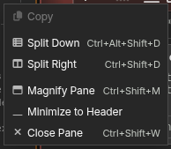

**Magnify Pane** (`⌘M` / `Ctrl+Shift+M`, the maximize button in the header, or a double-click on the header) enlarges the pane to fill the tab, hiding the others behind it, and the header's maximize button becomes **Restore**. Do it again, or click **Restore**, to put it back.

**Minimizing a pane merges its tabs into a neighbour.** When you minimize a pane in a split, its tabs join a minimized pane next to it, if there is one: the nearest one before it (above or to the left) with no expanded pane in between, else the nearest after it, with a landing animation on the tabs that arrive. In a row, minimized panes stacked over the same pane count as next to each other. If there is none, the tabs join the nearest expanded pane, after it (to the right or below) else before it, as background tabs; if that neighbour is itself a split, the pane nearest to the one you minimized takes them. Either way the minimized pane's own space goes to the others, and the pane you minimized is gone as a pane. Only your own minimize does this (the header button, the shortcut, the pane menu and the command palette), not an agent's, a layout loading or a restore, and not a locked pane, a floating pane or the last expanded one.

To get the old header chip instead, `Shift`+click **Minimize** or choose **Minimize to Header** in the pane menu: the pane shrinks to a chip the size of its header, stacked over its neighbour in a row. To get a merged tab back as its own pane, right-click its tab pill and choose **Open in Its Own Pane**, or drag the pill out; there is no undo for the merge itself. Minimized panes count as hidden, so a row of them costs little.

The header's buttons, from left to right, are **Minimize** (when the tab has more than one pane), **Maximize** and **Close**. Maximize is an outline window. Restore, on a maximized or a minimized pane, is a tiled layout: a frame with the pane's own tile filled in. Close is an X that turns red while you hover it. A maximized pane can be minimized directly. A click on the pill of a minimized pane's tab expands it; dragging pills between minimized panes doesn't.

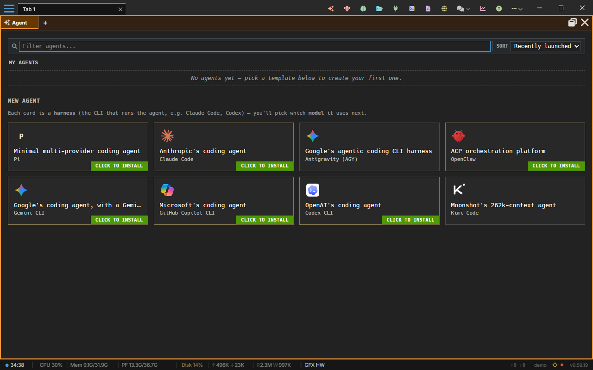

### Navigation

| Action | Shortcut |
|--------|----------|
| Navigate between panes | `Ctrl+Shift+Arrow` |
| Focus pane N | `Ctrl+Shift+1-9` |
| Next / previous pane | `F6` / `Shift+F6` |
| Swap with the pane in a direction | `Ctrl+Alt+Shift+Arrow` (`⌃⌥⇧Arrow`) |
| Resize: move a border | `Alt+Shift+Arrow` (`⌃⌥⌘Arrow`) |
| Close pane | `⌘W` / `Ctrl+Shift+W` |
| Magnify pane | `⌘M` / `Ctrl+Shift+M` |
| Previous / next selected pane | Mouse Back / Forward side buttons |

#### Pane selection history

Each window remembers the panes you selected, in any tab. The mouse's Back and Forward side buttons walk through that list: Back selects the pane you had selected before (switching to its tab, with its highlight and caret), Forward the one after. A pane you moved to another tab is found there. A press does nothing while a menu or dialog is open, or with `Shift`, `Alt` or the left button held. Over a browser pane, `Ctrl` + a side button is the page's own back or forward. The list is kept in memory, so it starts empty when AgentMux does. Turn the buttons off with **Settings ▸ Window & Panes ▸ Mouse side buttons select the previous / next pane** (`mouse:sidebuttons`); the page then keeps its own history on those buttons.

### Drag and Drop

Rearrange panes by dragging their headers. You can:

- Reorder panes within a tab
- Move panes across tabs
- Drag panes between windows (cross-window drag supported on all platforms)

Dragging a pane's **tab pill** works two ways, by where you hold it. Over another pane's **header**, the header glows at its edges in that pane's colour, and dropping adds the tab to that pane. Over a pane's **body** you get the same placement ghost as when dragging a whole pane, and dropping places the tab as a pane of its own there; the middle of the body adds it to that pane's tabs. A pane with two or more tabs can place one of its own tabs this way. Several selected tabs always join the pane under the pointer.

### Dropping files onto panes

Drag files from your file manager over AgentMux and it shows where they can go (`frontend/app/drag/file-drop.ts`, `frontend/app/drag/DropIndicator.tsx`):

- Every visible pane that would accept the files gets a faint dashed outline in the theme's accent colour.
- The pane under the cursor is tinted and shows what the drop will do, for example "Drop 2 files to attach" or "Copy 2 files to &lt;folder&gt;".
- A pane that takes files, but not these ones, shows why instead, for example "The editor opens text files".

Four pane types take file drops. Other panes (browser, Swarm, Drone and so on) show a "no drop" cursor.

| Pane | What a drop does |
|---|---|
| **Agent** | Attaches the files to the message you're writing (see [Attaching files](#attaching-files)). For a [container agent](/container-agents/), or with `attachments:enabled` off, it copies them into the agent's working folder instead and inserts an `@name` reference for each into the message box. |
| **Terminal** | Copies the files into the terminal's working directory. It doesn't type their paths. |
| **Editor** | Opens each file in its own tab, in the viewer that fits it: text, image, PDF, audio and video, or a card with the file's details (see [Media](#media)). An Editor on an SSH connection takes no drops: the files are on this computer, not on that host (`frontend/app/view/editor/editor-model.ts:518-537`). |
| **Files** | Copies the files into the folder it shows, or into the folder row you drop them on. A row dragged from a Files pane to a folder on the same drive is moved instead (`frontend/app/view/files/files-view.tsx:162-194`). Files with no path on disk can't be copied there. |

Copies land directly in the pane's working folder (`crates/common/src/copy_into_dir.rs`). A name that is already taken gets a numbered suffix: `report.pdf`, then `report_1.pdf`; `.env`, then `.env_1`. Folders are copied with everything in them, except symbolic links. Pasting files into a container agent's message box copies them the same way, with the same notices and `@name` references.

If the operating system doesn't give AgentMux a dropped file's path, the file's contents are used instead: they're copied into the working folder or attached. The Editor opens a text file as an untitled tab and shows anything else from its bytes, but such a tab can't follow its folder.

`dnd:enabled` turns off drops onto agent and terminal panes; see the [file drop settings](/settings/#file-drop-and-attachment-settings).

### Tab tear-off

Press `Esc` while dragging a window tab or a pane tab out of the window to cancel the drag, on Windows, macOS and Linux. To move a window tab into another AgentMux window instead, drop it on that window's tab strip: the tab joins that window. Dropped anywhere else, it tears off, as in Chrome.

Drag a tab below the tab bar to move it into a **new window** of its own, in a new workspace. The window runs in the same AgentMux processes as the one it came from (same backend, settings, agents and browser profile); it is not a separate instance. Supported on Windows, macOS (v0.40+), and Linux (v0.41+, Wayland). See [Multi-instance & dev mode](/multi-instance/#tearing-a-tab-into-its-own-window) for the full gesture.

### Floating panes

**Drag a pane header outside the window** to tear it off into a **floating window** — a detached window owned by the same AgentMux instance that shares the same backend sidecar. It is not a new instance; it's a standalone window holding the pane you tore off.

| Control | Behavior |
|---|---|
| Drag pane header outside the window | Tears the pane into a floating window at the same size as the original pane |
| Ctrl+click (Cmd+click on macOS) on a link, a widget, a palette entry or a file | Opens the pane that click opens as a floating window, instead of in the current tab |
| Drag the floating title bar | Move the floating window freely across monitors |
| Drag near a target window (slow to ≤400 px/s) | Dock indicator appears after 180 ms at that speed; release to dock |
| Maximize button in floater title bar | Expands the floater to the monitor work area; click again to restore |
| Tack button (thumbtack, "Always on top"), next to Maximize — **Windows only** | Keeps the floater above every AgentMux window. The button lights up in the theme colour while on. It applies only while AgentMux is the active app, so switching to another app lets that app cover it, and two tacked floaters behave normally toward each other. The tack survives a reload of the pane and is dropped when the pane is redocked (`frontend/app/block/floating-ontop.tsx`). |
| Close button in floater title bar | Closes the pane (same as closing a docked pane) |

#### Independent windows

Every floating window is **fully independent**. Each one carries its own backend workspace, tab, and block state, so closing one window — or closing a pane inside it — never closes another window or affects the panes living elsewhere. A floating window only auto-closes when **its own** last pane is removed (the empty window has nothing left to show, so it tidies itself up).

This independence is structural: each floater is an unowned top-level window rather than a child of the window it came from, so there's no cross-window cascade. Minimize, restore, and close are handled per source window explicitly, never propagated across separate floaters. See `crates/cef/src/floating_pane.rs` and [floating-pane-workspace.tsx](https://github.com/agentmuxai/agentmux/blob/main/frontend/app/workspace/floating-pane-workspace.tsx) for the lifecycle.

#### Tear off from any window

Tear-off works from **every** window, not just the first one you opened — the main window and any secondary window alike. Grab a pane's header and drag it out to spin it into a floating window. A torn-off pane keeps its identity, so you can keep moving it from window to window without it losing state.

#### Redock into any window

**Redock gesture:** drag the floating pane's title bar close to any open AgentMux window — including secondary windows — and a dock indicator appears once your cursor has stayed near that window for 180 ms at a slow-to-stopped speed (≤400 CSS px/s). The dwell gate prevents accidental docking during fast transits across the screen. Release while the indicator is showing to dock the pane into that window.

Redock resolves correctly into secondary windows because every window — including ones promoted from the prewarm pool — carries a stable backend identity (`backend_window_id`), so the drop target is always unambiguous. The resolution logic lives in [commands/window/motion.rs](https://github.com/agentmuxai/agentmux/blob/main/crates/cef/src/commands/window/motion.rs).

#### Cross-window pane movement

Because torn-off panes keep their identity, you can move a pane freely between windows: tear it off, dock it into another window, tear it off again, and dock it somewhere else. The pane's state travels with it the whole way.

#### Why tear-off feels instant

New windows and torn-off panes are served from a hidden **prewarm pool** — a small set of pre-spawned, already-painted windows kept off-screen and ready to go. On tear-off, AgentMux promotes a pooled window in place instead of cold-starting a fresh one, which avoids the 150-300 ms gap that spawning a renderer process and painting the first frame would otherwise cost. The pool refills in the background after each use. On Windows this uses native `WS_POPUP` pool windows (`CreatePanePoolWindowWin32Task` in `crates/cef/src/floating_pane.rs`); macOS and Linux use frameless CEF Views windows. Pooled windows stay hidden until they're promoted. Promotion is wired through [commands/window_pool.rs](https://github.com/agentmuxai/agentmux/blob/main/crates/cef/src/commands/window_pool.rs).

Pooled windows are created with a dark theme background, so tearing off a pane comes up clean rather than briefly flashing white before the pane content paints.
