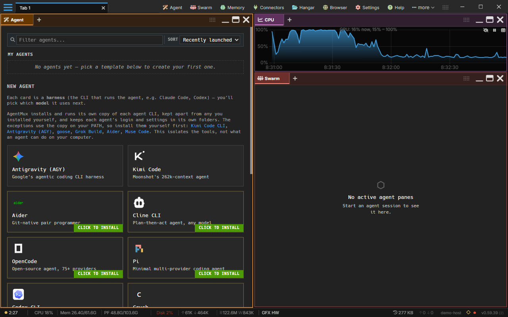

:::caution[Alpha Software]
AgentMux is **alpha software** and under heavy active development. Many features described in these docs may be incomplete, unstable, or not yet implemented. Expect breaking changes between releases. We welcome bug reports and feedback on [GitHub Issues](https://github.com/agentmuxai/agentmux/issues) or [Discord](https://discord.com/invite/96erama9Ar).
:::

Get AgentMux running with your first agent in a few minutes.

## 1. Install AgentMux

Download it from [GitHub Releases](https://github.com/agentmuxai/agentmux/releases) (or the buttons on [agentmux.ai](https://agentmux.ai)):

- **Windows (x64):** the [Microsoft Store](https://apps.microsoft.com/detail/9p9qcxnncrk3), the `.exe` installer, or the portable `.7z`
- **macOS:** the `.dmg`, Apple Silicon only
- **Linux (x86_64):** AppImage, `.deb`, `.rpm` or portable `.tar.xz`

See [Installation](/installation/) for the steps on each platform.

## 2. Launch and orient

AgentMux opens a starter layout of three panes:

- **Agent** (left): the agent picker.
- **Sysinfo** (top right): live system metrics. Right-click it to choose what it plots.
- **Swarm** (bottom right): a live tree of your agent panes, with their subagents, todos and running tools.

Around the panes:

- **Title bar**: tabs, the widget bar (pinned **Agent**, **Swarm**, **Memory**, **Connectors**, **Files**, **Browser**, **Settings** and **Help**, with the rest under **more**), and the hamburger menu (**≡**).
- **Status bar** (bottom): backend status, CPU, GPU, memory, disk and network stats, token usage, and the AgentMux version. Click the version for instance details and the list of your windows.

See [The window](/window/) for each part of the window and the panels the status bar opens.

Your windows, with their tabs and panes, are your **Default Workspace**. AgentMux saves it as you work, so they're all back at the next launch. See [Workspaces](/workspaces/).

## 3. Create your first agent

In the Agent pane, under **New Agent**, click a harness card, for example **Claude**. Each card is a harness, the CLI that runs the agent. A **Free** tag means the harness has a way to use it at no cost, and a **Local** tag that it can use a model on your computer; hover a tag for the details, and use the **Free**, **Local** and **Installed** chips above the cards to narrow the list. A panel opens under the card with the steps below; it shows only the ones that apply.

1. **Install the CLI.** If the harness's CLI isn't installed yet, its card shows **Click to install**, and the panel starts with the install. Click **Install now**. It needs an internet connection, and Node.js and npm (Claude Code also needs Git). If they're missing, the panel lists them first with an install option; click **Check again** once they're installed.
2. **Fill in the new agent's fields.** Give it a **Name**, for example Reviewer. For **Runtime**, choose **Native (runs on this computer)**; the Claude template preselects the container runtime when Docker is running. Leave **Bundles** empty for now. There's no account field: the agent takes your first Claude account, or signs in when it starts if you have none. Click **Create and start**.
3. **Sign in.** Claude Code only starts with an account bound to the agent. Without one, the pane shows **Not signed in** or **No account linked**. Click **Log in** and finish the login in your browser. For Claude Code, paste the authorization code back into the pane if it asks for one. AgentMux saves the login as an account in [Connectors → Accounts](/connectors/#accounts) and binds it to the agent. See [Auth flows](/auth/).

The agent then starts in the pane. Type a message and press `Enter` to send it; `Shift + Enter` adds a new line. You'll see the agent's reply stream in, each tool call as it runs, and diffs of the files it edits. Press `Esc` in an empty message box to interrupt a running turn. Start a message with `!` to run a shell command in the agent's working directory instead. Type `/quit` (or `/exit`) to end the agent and close its tab; the conversation is kept.

To start without paying, open the card of Antigravity, GitHub Copilot CLI, Grok Build, OpenCode, Kilo Code CLI or Cline CLI: a **Use *name* for free** guide links its sign-up page and lists the next steps (see [Using a provider with a free sign-in](/first-agent/#using-a-provider-with-a-free-sign-in)).

See [First Agent Setup](/first-agent/) for the details of every step.

## 4. Add more panes

macOS keys are in brackets.

| Action | Keys |
|---|---|
| Split right (opens a Shortcuts pane) | `Ctrl+Shift+D` (`⌘D`) |
| Split below | `Ctrl+Alt+Shift+D` (`⇧⌘D`) |
| Move focus between panes | `Ctrl+Shift+Arrow`, or `F6` |
| Open the command palette | `Ctrl+Shift+P` (`⇧⌘P`) |

A split opens a Shortcuts pane beside the one that has focus: a grid of tiles for every pane type, the ones you used last first. Pick Terminal, Agent or any other tile and the new pane takes its place (see [Splitting](/pane-types/#splitting)).

To start a second agent, click **Agent** in the widget bar (or run **Open Agent** from the command palette). The new Agent pane shows the picker again: create another agent, or pick one from **My Agents**. Agent names must be unique, so give a second agent from the same template a new name.

Each agent is independent. Agents don't share context unless they message each other (see [Interagent Comms](/internals/interagent-comms/)).

## 5. Add instructions with a bundle (optional)

A bundle is a reusable set of instructions, MCP servers, memory and skills. Create one from **Memory → Bundles → + New Bundle** (click **Memory** in the widget bar). Enter a **Name**, add **Instructions**, then click **Save**. A bundle works with any agent, whatever harness it runs. Add it under **Bundles** when you create an agent, or later from **Bundles…** in the agent's **My Agents** panel. See [Bundles](/bundles/).

## Next Steps

- [First Agent Setup](/first-agent/): every provider and option in detail
- [Auth flows](/auth/): how sign-in works per provider
- [Keybindings](/keybindings/): all keyboard shortcuts
- [Pane Types](/pane-types/): all available pane types
- [Configuration](/config/): customize settings
