:::caution[Alpha Software]
AgentMux is **alpha software** and under heavy active development. Many features described in these docs may be incomplete, unstable, or not yet implemented. Expect breaking changes between releases. We welcome bug reports and feedback on [GitHub Issues](https://github.com/agentmuxai/agentmux/issues) or [Discord](https://discord.com/invite/96erama9Ar).
:::

Complete reference for all AgentMux settings. Settings are stored in `settings.json` and edited directly in your default editor.

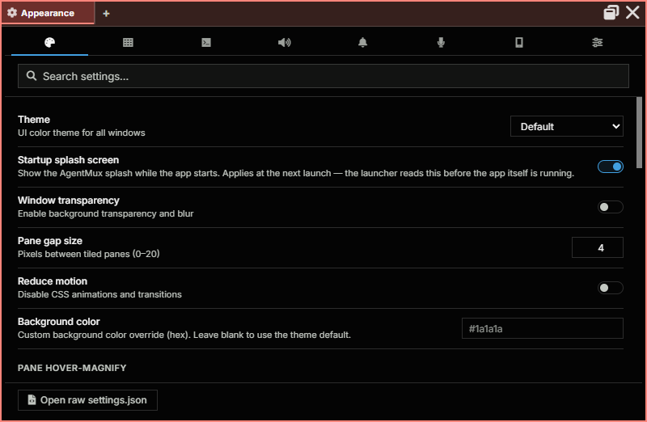

## Opening Settings

Settings is a **pane view** with ten tabs — Appearance, Window & Panes, Browser, Terminal, Sounds, Notifications & Tray, Recording, Paired devices, Widgets and Advanced (see [The Settings tabs](#the-settings-tabs)) — it's registered as `defwidget@settings` in the widget bar. Each of these opens (or focuses) the Settings pane:

- Click **Settings** in the widget bar. It is pinned by default.
- Press `Ctrl+,` (`⌘,` on macOS).
- Run **Settings** from the command palette.

Editing `settings.json` directly still works and is reflected in the pane — use the command palette ("Open Settings File"), or **Open raw settings.json** at the bottom of the pane, if you want the raw file instead of the UI.

Type in **Search settings…** at the top of the pane to find a setting on any tab:

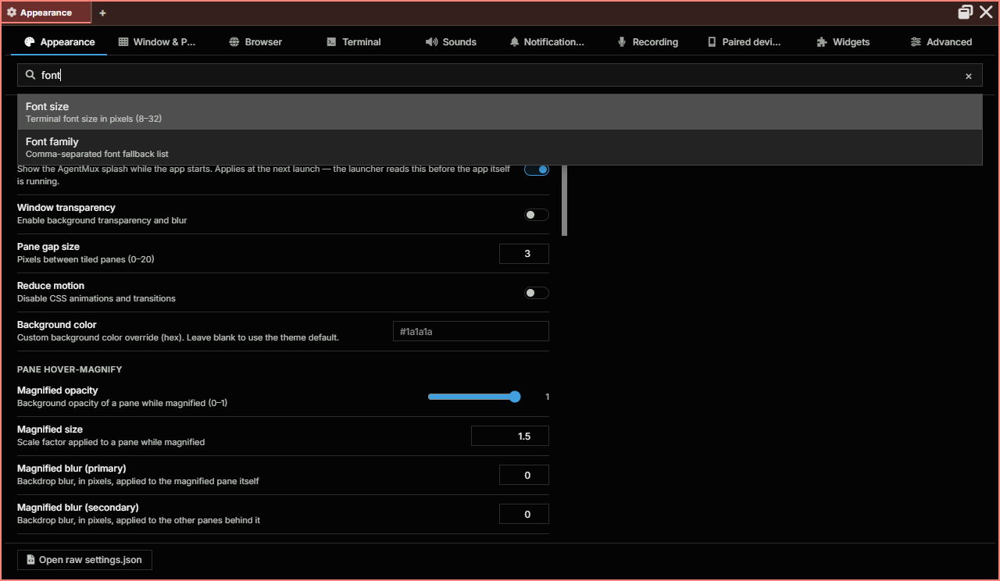

The hamburger menu also has submenus for the two things you change most, for the window you open it in:

- **Theme** ▸ Pick a dark theme (`Default`, `Midnight`, `High Contrast`, `Monokai`, `Nord`, `Dracula`, `Catppuccin`, `Tokyo Night`, `Gruvbox`) or a light one (`Light`, `Catppuccin Latte`, `Solarized Light`, `Gruvbox Light`). It changes only this window, and is saved with the window, not in `settings.json`.
- **Opacity** ▸ This window's translucency, from 100% down to 35% in 5% steps. It is the same value as the window's slider in the status bar's Instance Panel.

Settings ▸ Appearance holds the defaults for windows that have no theme or opacity of their own (`window:theme`, `window:opacity`). See [Window appearance](/window-appearance/).

Under `Midnight` specifically, the agent pane background is pure black; other panes use the theme's deep-navy `--main-bg-color`.

## The Settings tabs

### Appearance

The default theme and opacity for windows without their own, the startup splash screen, window transparency and blur, the gap between panes, reduced motion, a custom background colour, how a pane looks while it's hover-magnified, and the colour of each widget type's panes.

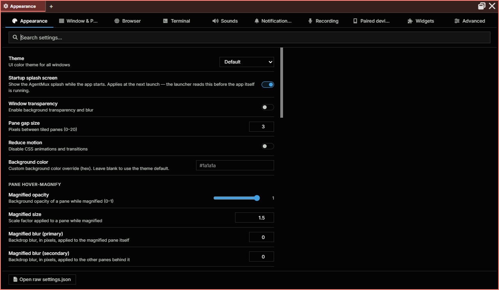

### Window & Panes

Pane block ids in headers (a debugging aid), the view a new tab or pane opens with, the numbered overlay for jumping to a pane, whether closing a tab asks first, and **Warn before closing a window with working agents** (see [Workspaces](/workspaces/#when-an-agent-is-working)).

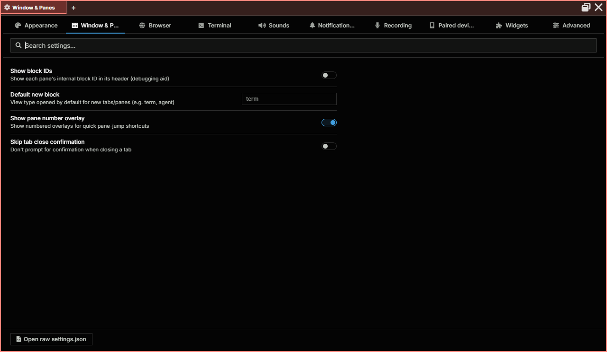

### Browser

Browser profiles: each keeps its own sign-ins, cookies and site data, so one site can be open as two accounts side by side. **Personal** is the profile every tab starts with and can't be removed; add others by name. An agent can browse as a profile only if you allow it for that profile. See [Browser pane](/browser-pane/#profiles-and-incognito).

**Search suggestions while typing** (`browser:searchsuggestions`, on by default): the address bar also asks your search engine for suggestions as you type, as Chrome does, which sends it what you type before you press Enter. Turn it off to keep suggestions to this computer (your history and the addresses you typed). Incognito tabs never ask, as in Chrome. See [Suggestions as you type](/browser-pane/#suggestions-as-you-type).

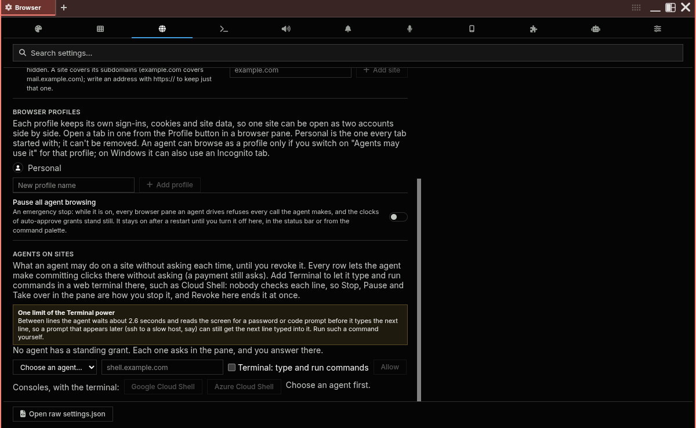

### Terminal

The default shell, font size and family, the terminal colour theme, scrollback, copy on select, Shift+Enter, keeping SSH sessions alive and installing AgentMux's helper on new SSH hosts, bracketed paste, transparency, scroll speed, the CPU/memory badge, predictive echo, and the agent pane watchdog limits. See [Terminal Settings](#terminal-settings) for the matching `settings.json` keys.

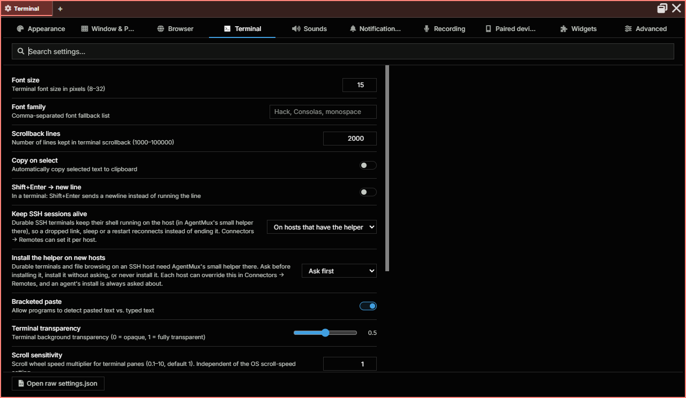

#### Default shell

The first row of the Terminal tab picks the shell new local terminals open with. Its list holds:

- **Automatic: *name***, the default, naming the shell it picks on this machine now: on Windows PowerShell 7 (`pwsh`) if it's installed, else Windows PowerShell, else Command Prompt; on macOS and Linux your `$SHELL`, else `/bin/bash`.
- **The shells installed on this machine**, each with its name and version, for example PowerShell, Command Prompt, Git Bash, zsh or fish.
- **Custom…**, for a full path or a name on your PATH (`nu`, `pwsh`), with an optional field for its arguments, separated by spaces.

The line under the list says which shell new terminals open with, and why. If the shell you chose can't be found, terminals open with the automatic one instead, and the line says so as a warning. **Open a terminal with it** opens a terminal in the current tab so you can try it.

The choice is saved as `term:localshellpath` (and `term:localshellopts` for Custom… arguments). It applies to new terminals; open ones keep their shell. It doesn't change agents' shells or SSH and WSL terminals, which keep their own.

### Sounds

Notification sounds and their volume, whether to stay quiet for a pane you're already looking at, flashing the tab and pane a sound came from, a switch for each event (turn complete, error or interrupted; a queued message accepted or rejected), tool-call tones, the looping tone while an agent waits for you (including browser hand-offs and approvals), and the shutdown warning chime.

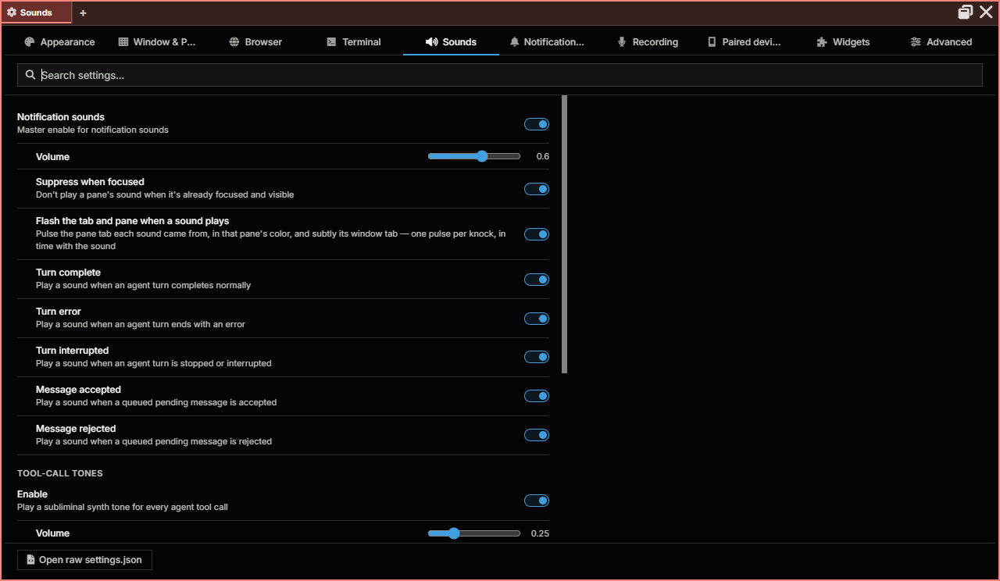

### Notifications & Tray

Desktop notifications: when to notify, and for which events (an agent has a question, finished, stopped with an error or unexpectedly, a message needs your review, signed out of MuxBus); alerts while notifications are paused, quiet hours, the taskbar badge, the agent's summary line, how much of a question a notification shows, and a test notification; and the system tray: the tray icon, staying in the tray after the last window closes, and starting at login. See [Desktop notification settings](#desktop-notification-settings) and [App Settings](#app-settings).

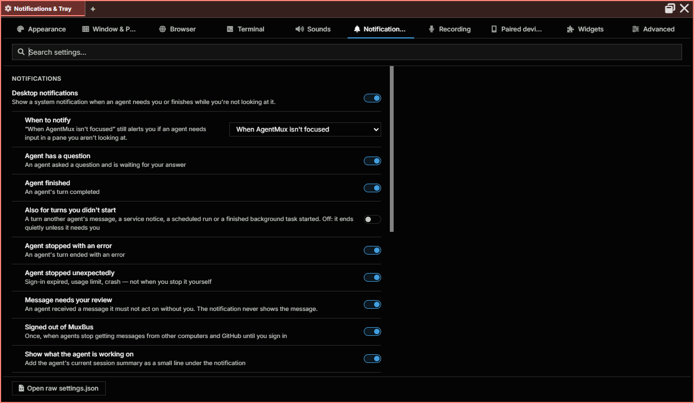

### Recording

Voice input: the microphone button on agent and terminal panes, the transcription engine (whisper.cpp runs offline; Groq sends audio to Groq's API, with your own API key), the input device, and a microphone test. See [Voice input](/pane-types/#voice-input).

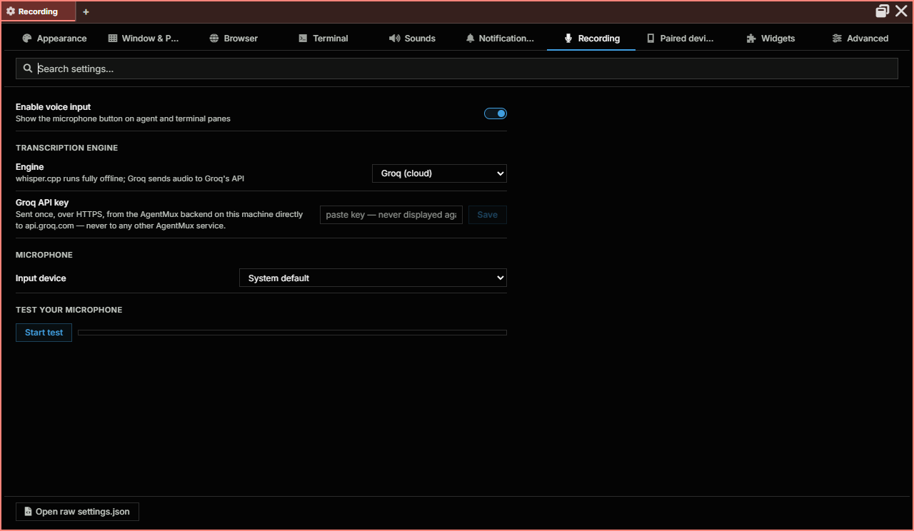

### Paired devices

Devices paired with this computer over your local network, each of which you can revoke; whether they can watch this computer's terminals; MuxBus sign-in; cloud presence, and whether to publish this computer to your devices; whether to share what your agents are working on; and whether the status bar shows MuxBus Cloud. See [What a paired device can see](/lan-discovery/#what-a-paired-device-can-see).

**Pinned senders** lists the keys and installs AgentMux has pinned to the names of agents that speak to it from elsewhere: the first key seen for a name on your network, and the first of your installs seen speaking for a name through your cloud account. A message from anything else for a pinned name still arrives, but it fails verification: it is marked sensitive and the receiving agent is told to stop and ask you. Beside each pin it shows what failed (a different key or install, how many times, when). **Accept the new one** pins that key or install instead, for when the agent really was recreated or moved; **Forget** drops the pin, so the next key or install shown is pinned. Both take two presses, only this window can change a pin without a vouch (below), and each change is logged in `logs/pin-changes.log`.

A key that changes for an ordinary reason (a new channel store, a recreated agent) doesn't have to wait for you. For a name pinned from your network, the new key is accepted and the pin moves by itself when the AgentMux install that hosts the agent vouches for it, and this computer already trusts that install: one it has pinned for some agent, or a live install of your signed-in account. The vouch is a short-lived certificate from the hosting install, so an old one can't move a pin back to a retired key, and a moved pin never makes a message count as verified by itself: the message's own signature must still verify under the new key. Both computers need this release; a host that doesn't send a certificate is refused until you accept as before. Each automatic move is logged in `logs/pin-changes.log` with the agent, the old and new key fingerprints and which install vouched. An agent can ask AgentMux to accept a key it was refused, and AgentMux does so only when the same vouch holds; **Forget** and the unconditional **Accept the new one** stay in this window.

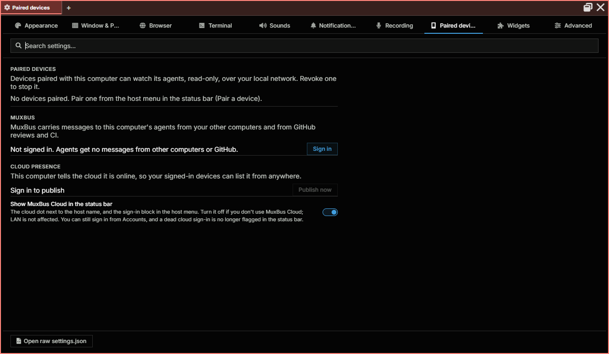

### Widgets

The **Widget bar** section: every widget, with a switch to pin it to the bar, keep it in **More**, or hide it everywhere; arrows to reorder pinned widgets; **Show icons only**; and **Reset widget bar**. See [Pin, keep in More, or hide](/pane-types/#pin-keep-in-more-or-hide).

Then your own widgets: install one from a `widget.json` or a `.zip`, rescan, open the widgets folder, or install one from the AgentMux widget catalog. A widget runs only after you approve it here. See [Your own widgets](/widgets/).

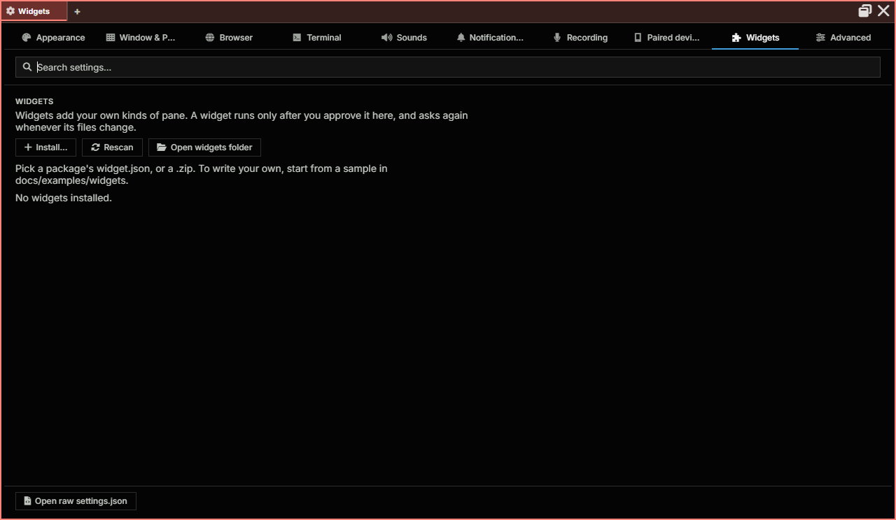

### Advanced

Power-user settings: WebGL terminal rendering, the agent pane's auto-answer timeout, overlap notes between agents, the Sysinfo sample interval and history, drag and drop, and environment variables for every shell.

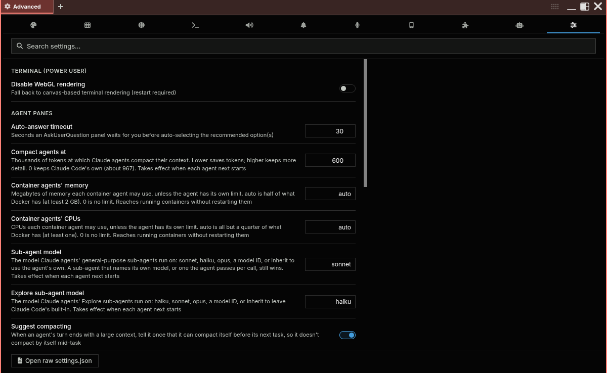

## Settings File Location

Settings live under the channel's data dir, so every version that binds to the same channel reads and writes the same `settings.json`:

| Mode | Path |
|---|---|
| Installed / Portable | `~/.agentmux/channels/<channel>/config/settings.json` (default channel: `stable`) |
| Dev (`task dev`) | `~/.agentmux/dev/<branch>/<clone-id>/config/settings.json` |

The `<channel>` segment is `stable` by default for Installed and downloaded Portable builds, `local-<branch>` for locally-packaged builds, or whatever `AGENTMUX_CHANNEL=<name>` overrides to. Dev mode keys on the git branch plus a per-clone hash so two checkouts of the same branch don't collide. Override the `~/.agentmux/` root with `AGENTMUX_HOME_OVERRIDE` for tests. See [Multi-instance & dev mode](/multi-instance/) for the full layout.

A key you don't set uses the default shown below. "Unset" in the Default column means the key has no single default value: the description says what happens when it isn't set.

## Terminal Settings

| Setting | Type | Default | Description |
|---------|------|---------|-------------|
| `term:localshellpath` | string | unset | The shell new local terminals open with: a full path, or a name on your PATH. Unset: chosen for the platform (on Windows `pwsh`, else `powershell`, else Command Prompt; on macOS and Linux `$SHELL`, else `/bin/bash`). A shell that can't be found falls back to that choice. See [Default shell](#default-shell). |
| `term:localshellopts` | array of strings | `[]` | Extra arguments for that shell. They are added to the ones AgentMux's shell integration uses, not put in their place. Picking a listed shell in Settings clears them. |
| `term:fontsize` | number | `15` | Font size in pixels (Settings allows 8–32) |
| `term:fontfamily` | string | `"Hack"` | Font family, as a CSS font list such as `"Hack, Consolas, monospace"`. When unset, a connection's own font comes first, then Hack. |
| `term:theme` | string | `"default-dark"` | Terminal color theme. Settings lists the installed themes. |
| `term:scrollback` | integer | `2000` | Scrollback buffer lines (Settings allows 1000–100000) |
| `term:copyonselect` | boolean | `false` | Copy selected text to the clipboard automatically |
| `term:transparency` | number | `0.5` | Terminal background transparency (0 = opaque, 1 = fully transparent) |
| `term:scrollsensitivity` | number | `1` | Scroll wheel speed multiplier, 0.1–10. Independent of the operating system's scroll speed. |
| `term:disablewebgl` | boolean | `false` | Draw terminals without WebGL, using the DOM renderer. Read when a terminal starts, so restart open terminals (or AgentMux) after changing it. |
| `term:allowbracketedpaste` | boolean | `true` | Let programs tell pasted text from typed text |
| `term:shiftenternewline` | boolean | `false` | Shift+Enter sends a newline instead of running the line |
| `term:showstatsbadge` | boolean | `true` | The live CPU and memory badge in the top-right corner of terminal panes. See [CPU and memory badge](/pane-types/#cpu-and-memory-badge). |
| `term:durable` | boolean | unset | Whether SSH terminals keep their shell on the host, in AgentMux's helper, so they survive a dropped link. Unset: durable, asking before installing the helper on a host without it, and a plain terminal there if it isn't installed. `true`: always durable (needs the helper). `false`: never. A host can override it in Connectors ▸ Remotes. See [SSH terminals that survive a dropped link](/connectors/#ssh-terminals-that-survive-a-dropped-link). |
| `term:predictiveecho` | boolean | `true` | Show typed characters locally before PTY echo confirms them. Disable for strict server-echo-only behavior. |
| `term:predictiveecho:thresholdms` | number | `0` | Only predict when rolling p50 round-trip ≥ this value (ms). `0` = always predict once armed. |
| `term:agentmaxruntimehours` | number | `0` | Max runtime for an agent pane in hours (`0` = unlimited) |
| `term:agentidletimeoutmins` | number | `0` | Minutes of PTY silence before the watchdog stops an idle agent pane (`0` = unlimited) |

## Browser Settings

| Setting | Type | Default | Description |
|---------|------|---------|-------------|
| `browser:searchsuggestions` | boolean | `true` | The address bar also asks your default search engine for suggestions while you type, sending it each edit before you press Enter, as Chrome does. Off: suggestions come only from this computer (history, typed addresses). Incognito tabs never ask. |
| `browser:hibernate` | boolean | `true` | A browser pane out of sight for a while hibernates: its page closes to free its memory (often 100 to 200 MB) and loads again when you're about to look at it, with a note while it restores. Never a pane an agent is using, one playing or capturing media, one with something typed into it, or a local dev server. Off: browser panes keep running while hidden. See [Windows, tabs, panes and renderers](/internals/renderers/#browser-panes). |
| `browser:hibernateafter` | number | `30` | Minutes a browser pane is hidden before it hibernates. Sooner when the computer is low on memory: 5 minutes, then 1. |
| `browser:keepawakesites` | array | `[]` | Sites whose browser panes never hibernate, by host (`example.com`) or origin (`https://example.com`). |

Browser profiles are managed in Settings ▸ Browser, not in `settings.json`.

## Window Settings

| Setting | Type | Default | Description |
|---------|------|---------|-------------|
| `window:theme` | string | `"default"` | Default UI color theme, for windows without one of their own (the hamburger menu's **Theme** sets one window's). One of `default`, `midnight`, `high-contrast`, `monokai`, `nord`, `dracula`, `catppuccin`, `tokyo-night`, `gruvbox`, or the light themes `light`, `catppuccin-latte`, `solarized-light`, `gruvbox-light`. |
| `window:transparent` | boolean | `false` | Make windows see-through by default (Settings: **Window transparency**). A window's own opacity, set from the hamburger menu, applies whether or not this is on. |
| `window:blur` | boolean | `false` | Shown in Settings as **Background blur**. It makes windows see-through by default, like `window:transparent`; AgentMux doesn't currently draw a blur behind the window itself. |
| `window:opacity` | number | `0.8` | Default opacity for windows without their own, used only while `window:transparent` or `window:blur` is on. Settings allows 0.35–1. A window's own opacity is saved with the window. See [Window appearance](/window-appearance/). |
| `window:bgcolor` | string | `""` | Custom background color (hex). Blank uses the theme's. |
| `window:tilegapsize` | integer | `3` | Gap between panes in pixels (Settings allows 0–20) |
| `window:reducedmotion` | boolean | `false` | Turn off CSS animations and transitions |
| `window:magnifiedblockopacity` | number | `1` | Background opacity of a pane while it's hover-magnified (0–1) |
| `window:magnifiedblocksize` | number | unset | Scale factor applied to a pane while it's hover-magnified. Unset, the layout uses its built-in size. |
| `window:magnifiedblockblurprimarypx` | integer | `0` | Backdrop blur, in pixels, applied to the magnified pane itself |
| `window:magnifiedblockblursecondarypx` | integer | `0` | Backdrop blur, in pixels, applied to the other panes behind it |
| `window:keepinactivetabslaidout` | boolean | `true` | Keep window tabs you aren't looking at laid out, so switching back to one has nothing to catch up on. `false` skips their layout while hidden. |
| `window:autorecycle` | boolean | `true` | Reload a window that has been idle for 10 minutes when its page uses much more memory than it did after loading (over 600 MB and twice its size after load), to give that memory back. Drafts, scroll positions and layout are kept, and it waits while anything would be lost. `false`: reload only on request (**Reload Window (Free Memory)** in the command palette). See [Windows, tabs, panes and renderers](/internals/renderers/#what-gives-memory-back). |
| `window:confirmcloseworking` | boolean | `true` | Ask before closing a window, or switching [workspace](/workspaces/), while an agent in it is mid-turn (Settings: **Warn before closing a window with working agents**). Closing stops its agents; the window stays in the workspace, to reopen from the instance panel. The warning's **Don't ask again** turns it off. |

## App Settings

| Setting | Type | Default | Description |
|---------|------|---------|-------------|
| `app:defaultnewblock` | string | `""` | View a new tab or pane opens with, for example `term`, `agent` or `shortcuts` (the [Shortcuts pane](/pane-types/#the-shortcuts-pane)). Blank opens a terminal. |
| `keybindings` | array | `[]` | Your own keyboard shortcuts, applied over the defaults. See [Keybindings](/keybindings/#your-own-shortcuts). |
| `app:showoverlayblocknums` | boolean | `true` | Show numbered overlays for the jump-to-pane shortcuts |
| `tab:confirmclose` | boolean | `false` | Ask before closing a window tab. Off: a tab closes at once. |
| `pane:colors` | object | `{}` | Color per widget type, keyed by view (`"term"`, `"agent"`, `"browser"`, …): a hue from 0 to 360 replaces that widget's built-in color, `null` gives it none. A pane's own **Pane Color** and an agent's color still win. Remove a key to return to the built-in color. Set it in Settings ▸ Appearance ▸ **Widget colors**. |
| `splash:disabled` | boolean | `false` | Don't show the startup splash screen. Applies at the next launch. For a single run, `AGENTMUX_SPLASH=0` or `AGENTMUX_NO_SPLASH=1` does the same. |
| `app:showtray` | boolean | `true` | Show the AgentMux icon in the system tray (menu bar on macOS). Applies at the next launch. See [System tray](/installation/#system-tray). |
| `app:runinbackground` | boolean | `false` | Keep AgentMux running in the tray after its last window closes, instead of quitting. Also shows the tray icon. Applies at the next launch. |
| `app:startatlogin` | boolean | `false` | Start AgentMux in the tray, without a window, when you log in. Applies immediately; the tray menu has the same switch. |

## Agent Settings

| Setting | Type | Default | Description |
|---------|------|---------|-------------|
| `agents:always_available` | boolean | `true` | Closing an agent's pane, its tab or its workspace parks the agent instead of stopping it: it keeps running, and a message or a Job starts a stopped one. `false`: closing a pane stops its agent, as before. See [Agents keep running without a pane](/first-agent/#agents-keep-running-without-a-pane). |
| `agents:idle_stop_minutes` | number | `60` | With `agents:always_available` on, minutes an agent with no pane may be idle before it is stopped (a message starts it again). `0`: never. |
| `agents:max_running` | number | `24` | With `agents:always_available` on, the most agent processes that run at once (the default was `12` in 0.60.5). A start over it stops the agent idle longest with no pane, or is refused if none can be. `0`: no limit. |
| `agents:commit_limit_pct` | number | `85` | On Windows, with `agents:always_available` on: a start is refused, or the agent idle longest with no pane stopped, when memory commitment is over this percentage of the limit. `0`: off. |
| `agent:askquestiontimeoutms` | integer | `30000` | How long an AskUserQuestion panel waits for you before choosing the recommended option(s) and submitting, in milliseconds (at least 1000). Settings shows it in seconds, as **Auto-answer timeout**. |
| `agent:overlapnotes` | boolean | `true` | When an agent edits a file that another agent on this computer has uncommitted, or edited in the last two hours (same repository and path, in any clone), AgentMux sends the editing agent a short `[AgentMux]` note naming the other agent, so it can message them first. At most one note per other agent and file every two hours, and three per agent every ten minutes. |
| `agent:mcpselfheal` | boolean | `true` | When an agent's AgentMux tools (its MCP server) don't connect, AgentMux reconnects them twice, then restarts the agent once without the shell prefix (the conversation continues), and otherwise tells the agent and shows it in the pane. `false`: only show and tell, with no automatic repair. |
| `agent:livefeed` | boolean | `true` | Agent panes keep the turn in flight plus about 1 MB of finished turns; older turns move to the pane's History tab, so long conversations don't slow the pane down. Applies to Claude, Codex, Kimi and Gemini agents. `false` keeps every turn in the pane and pages older ones in as you scroll up. Takes effect when a pane is next opened. |
| `agent:livefeedturns` | integer | unset | With `agent:livefeed` on, the most finished turns an agent pane keeps before older ones move to the History tab. Unset: no turn limit, only the 1 MB one. Takes effect when a pane is next opened. |
| `agent:turnscopedtail` | boolean | `true` | Agent panes keep only the turn in flight (and anything still running) always on the page; older messages are virtualized. `false` keeps the last 50 messages on the page. Takes effect when a pane is next opened. |
| `agent:onewayflow` | boolean | `true` | While an agent pane follows the conversation, text only moves up: nothing overshoots and scrolls back. `false` restores the earlier glide. Takes effect when a pane is next opened. |
| `agent:view` | string or object | `"full"` | What agent panes show. A preset name (`"full"`, `"standard"` or `"replies"`) or an object with any of `thinking`, `tools` and `jekts` (`"auto"`, `"expanded"`, `"collapsed"` or `"hidden"`), `notes` (`"shown"` or `"hidden"`) and `context` (`"auto"` or `"hidden"`); a missing or unknown switch takes Full's value. A pane that has its own view ignores it. Set from a pane's View popover with **Make this the default**. See [Choosing what the pane shows](/agent-pane-messages/#choosing-what-the-pane-shows). |
| `markdown:streamtailinplace` | boolean | `true` | While a message streams, update its last, still-open block (a code block, paragraph, list item or table cell) in place instead of rebuilding it on every update. |

## File drop and attachment settings

See [Dropping files onto panes](/pane-types/#dropping-files-onto-panes) and [Attaching files](/pane-types/#attaching-files).

| Setting | Type | Default | Description |
|---------|------|---------|-------------|
| `dnd:enabled` | boolean | `true` | File drops onto agent and terminal panes. Media and editor pane drops, and pasting, aren't affected. |
| `dnd:agentinserttoken` | boolean | `true` | When a drop copies files into an agent's working folder, insert an `@name` reference for each file into the message box. |
| `dnd:concurrency` | integer | unlimited | How many files of a multi-file drop are copied at once. |
| `attachments:enabled` | boolean | `true` | Files dropped on an agent pane are attached to the message. When `false`, they're copied into the agent's working folder instead. |
| `attachments:maxfiles` | integer | `128` | Most files one message can carry. |
| `attachments:maxtotalmb` | number | `1024` | Most megabytes (original sizes) one message can carry. |
| `attachments:sendmaxedge` | integer | `2000` | Long edge, in pixels, of the copy of each image the agent receives. |
| `attachments:claudeinlinemax` | integer | `20` | Images Claude receives inline in one message; the rest are listed by path. `0` sends paths only. |
| `attachments:claudesessioninlinemb` | number | `50` | Megabytes of inline images one Claude session may receive; after that, images go by path only. |
| `attachments:retentiondays` | number | `30` | Days an attachment's files are kept after last use. Files never sent are removed after 7 days. |

## Shell Environment

| Setting | Type | Default | Description |
|---------|------|---------|-------------|
| `cmd:env` | object | `{}` | Environment variables passed to all shell processes. Settings ▸ Advanced ▸ **Global environment variables** edits it. |

## Telemetry Settings

These drive the local Sysinfo pane. Nothing is sent off your computer. See [System Metrics](/system-metrics/).

| Setting | Type | Default | Description |
|---------|------|---------|-------------|
| `telemetry:interval` | number | `1` | Seconds between Sysinfo samples |
| `telemetry:numpoints` | integer | `120` | Number of samples the Sysinfo charts keep (30–1024) |

## Connection Settings

| Setting | Type | Default | Description |
|---------|------|---------|-------------|
| `conn:helper` | string | `"ask"` | Installing AgentMux's helper on an SSH host: `"ask"` first, `"always"` or `"never"`. A host can override it in Connectors ▸ Remotes, and an install an agent's pane needs is always asked about. See [SSH terminals that survive a dropped link](/connectors/#ssh-terminals-that-survive-a-dropped-link). |

## Network Settings

| Setting | Type | Default | Description |
|---------|------|---------|-------------|
| `network:lan_discovery` | boolean | `false` | Advertise this instance + browse for peer AgentMux instances via mDNS. Off by default — on Windows, flipping it on triggers the firewall prompt for UDP 5353. See [LAN discovery](/lan-discovery/) for the toggle in the HostPopover (preferred over editing this file directly, since the UI flips the daemon live without a restart). |

## Paired Devices and Cloud Settings

See [What a paired device can see](/lan-discovery/#what-a-paired-device-can-see).

| Setting | Type | Default | Description |
|---------|------|---------|-------------|
| `viewer:shareterminals` | boolean | `false` | Paired devices can watch this computer's terminals, read-only. Off by default, since terminal scrollback often holds secrets. The shell of an agent hidden from paired devices stays hidden. Turning it off closes feeds already open. |
| `cloud:publishpresence` | boolean | `true` | While you're signed in to MuxBus Cloud, tell the cloud this computer is online, so your signed-in devices can list it from anywhere. `false` stops it, and tells the cloud this computer went offline. Dev builds, headless installs and isolated homes never publish. |
| `swarm:sharesummaries` | boolean | `true` | Other AgentMux instances on this computer and on your local network show each of your agents' summary lines in their Swarm. `false` shares status only. |
| `statusbar:showmuxbuscloud` | boolean | `true` | Show MuxBus Cloud in the status bar: the dot after the host name and the sign-in block in the host menu. `false` hides both. LAN discovery isn't affected. |

## Sound Settings

| Setting | Type | Default | Description |
|---------|------|---------|-------------|
| `notify:sounds:enabled` | boolean | `true` | Master switch for notification sounds |
| `notify:sounds:volume` | number | `0.6` | Notification sound volume, 0 (silent) to 1 |
| `notify:sounds:suppresswhenfocused` | boolean | `true` | Stay quiet for a pane you're looking at (the pane is focused and its window is in front) |
| `notify:sound:agent.turn.complete` | boolean | `true` | Sound when an agent's turn completes |
| `notify:sound:agent.turn.error` | boolean | `true` | Sound when a turn ends with an error |
| `notify:sound:agent.turn.interrupted` | boolean | `true` | Sound when a turn is stopped or interrupted |
| `notify:sound:agent.message.accepted` | boolean | `true` | Sound when a queued message is accepted |
| `notify:sound:agent.message.rejected` | boolean | `true` | Sound when a queued message is rejected |
| `notify:sound:agent.waiting.for.input` | boolean | `true` | A looping tone while an agent waits for you: a question, a tool permission, a browser hand-off or approval, an SSH consent or a widget install. Quiet while you're looking at that pane. |
| `notify:sounds:waiting:volume` | number | `0.25` | Volume of the waiting tone, 0 to 1, under the master volume |
| `notify:waiting:browser` | boolean | `true` | Include browser hand-offs and approvals in the waiting tone, the tab flash and the notification |
| `notify:sound:agent.shutdown.pending` | boolean | `true` | A falling chime when something other than you asks to shut an agent down and you have 15 seconds to keep it running |
| `notify:tooltones:enabled` | boolean | `true` | A quiet tone for every agent tool call |
| `notify:tooltones:volume` | number | `0.25` | Volume of tool-call tones, 0 to 1, under the master volume |
| `notify:tooltones:scope` | string | `"all"` | Which panes play tool-call tones: `"all"`, or `"focused"` (only the focused pane in the focused window) |
| `notify:tooltones:flash` | boolean | `true` | Flash the pill in the pane header (and, more faintly, the window tab) of the pane a sound came from, with every sound, so you can tell where it came from. Despite its name, it covers every sound, not only tool-call tones. |

## Desktop Notification Settings

| Setting | Type | Default | Description |
|---------|------|---------|-------------|
| `notify:os:enabled` | boolean | `true` | Master switch for desktop notifications from agents |
| `notify:os:when` | string | `"unfocused"` | `"unfocused"`: only when no AgentMux window is focused (an agent needing input still alerts if you're looking at another pane). `"always"`: unless you're looking at that pane. `"never"`: off. |
| `notify:os:inputwaiting` | boolean | `true` | Notify when an agent asks a question and waits for your answer |
| `notify:os:turncompleted` | boolean | `true` | Notify when an agent's turn completes |
| `notify:os:turncompleted:external` | boolean | `false` | Also notify when a turn you didn't start finishes: one started by another agent's message, a service notice, a scheduled run or a finished background task |
| `notify:os:turnerrored` | boolean | `true` | Notify when a turn ends with an error |
| `notify:os:agentcrashed` | boolean | `true` | Notify when an agent stops unexpectedly (auth expired, usage limit, crash). Stops you make yourself never notify. |
| `notify:os:messageneedsreview` | boolean | `true` | Notify when an agent receives a message that needs your review before it acts. The notification never contains the message. |
| `notify:os:cloudsignedout` | boolean | `true` | Notify once when this AgentMux is signed out of MuxBus and agents stop getting messages from other computers and GitHub |
| `notify:os:summary` | boolean | `true` | Show the agent's current session summary as a small line under its notifications |
| `notify:os:preview` | string | `"redacted"` | How much of an agent's question the notification shows: `"redacted"`, `"full"` or `"none"`. Credential and destructive keywords always replace it with a generic message. |
| `notify:pause:until` | integer | `0` | Time until which notifications are paused, in epoch milliseconds. Set from the tray icon's menu; `0` means not paused. |
| `notify:pause:allowattention` | boolean | `false` | While paused, still notify when an agent needs your input or review |
| `notify:quiethours` | string | `""` | Daily quiet hours, local time, as `"HH:MM-HH:MM"` (it may span midnight, for example `"22:00-08:00"`). Works like a pause. Empty: none. |
| `notify:taskbar:attention` | boolean | `true` | Badge the AgentMux taskbar button, and flash it once, while an agent needs you. Windows only. |

## Voice Input Settings

See [Voice input](/pane-types/#voice-input).

| Setting | Type | Default | Description |
|---------|------|---------|-------------|
| `voice:enabled` | boolean | `true` | Show the microphone button on panes. `false` hides it everywhere. |
| `voice:engine` | string | `"groq"` | Speech-to-text engine: `"groq"` sends the recording to Groq's hosted Whisper; `"whisper-local"` runs a local whisper.cpp program; `"webspeech"` uses the browser's speech API and doesn't work in packaged builds. |
| `voice:groqApiKey` | string | — | Your Groq API key, for the `groq` engine. Read only by the AgentMux server, never sent to the window. The `AGENTMUX_GROQ_API_KEY` environment variable takes precedence. |
| `voice:whisperCliPath` | string | — | Path to the whisper.cpp command-line program, for `whisper-local`. `AGENTMUX_WHISPER_CLI` overrides it. |
| `voice:whisperModel` | string | `"base.en"` | The model `whisper-local` downloads on first use. Ignored when `voice:whisperModelPath` is set. |
| `voice:whisperModelPath` | string | — | A model file to use instead, skipping the download |
| `voice:inputDeviceId` | string | `"default"` | The microphone to record from. `"default"` (or unset) uses the system's default input. |

## Widget Bar Settings

See [Pin, keep in More, or hide](/pane-types/#pin-keep-in-more-or-hide).

| Setting | Type | Default | Description |
|---------|------|---------|-------------|
| `widget:pinned` | array of strings | unset | The widget bar's pinned icons, in order: a built-in widget's short name (`"agent"` for `defwidget@agent`) or an installed package widget's full key (`"ext@acme.board/main"`). Unset: the default pins. |
| `widget:hidden` | array of strings | unset | Widgets hidden from the bar, **more** and a pane's **+** menu, as full keys (`"defwidget@drone"`). Settings can't be hidden. |
| `widget:icononly` | boolean | `false` | Icon-only widget bar (no labels) |

## Old Version Settings

Every upgrade starts the new version on a copy of the old version's data, and the updater unpacks a new portable beside the running one, so old versions pile up on a machine that upgrades often. AgentMux lists what is left behind once a day (the plan is also at `GET /agentmux/old-versions`). It only removes anything on a computer that turns `oldversions:clean` on.

| Setting | Type | Default | Description |
|---------|------|---------|-------------|
| `oldversions:clean` | boolean | `false` | Remove the old version folders (`channels/<channel>/versions/<version>/`) of the running channel in the daily pass. Off: the pass only logs what it would remove |
| `oldversions:keep_previous` | number | `1` | How many of the newest older versions to keep as the way back; never fewer than one |
| `oldversions:idle_hours` | number | `24` | A folder written to within this many hours counts as in use |
| `oldversions:portables` | boolean | `false` | Also remove the unpacked portable folders (`agentmux-<version>-x64-portable`) the updater made for this channel |

A folder goes only when it is older than the running version, isn't one of the newest `keep_previous` older versions, is named by no running process (its command line, working folder, program path or environment), has nothing written to it within `oldversions:idle_hours`, and the machine's processes could be read at all: a scan that fails keeps everything. The running version and anything in use are always kept. Nothing follows a symlink, and a folder whose name isn't a plain `x.y.z` is left alone.

## Other Settings

| Setting | Type | Default | Description |
|---------|------|---------|-------------|
| `blockheader:showblockids` | boolean | `false` | Display pane IDs in pane headers |

## Keys AgentMux doesn't read

These keys are still accepted in `settings.json`, so an old file doesn't fail to load, but nothing in the current version reads them. Setting them has no effect.

| Setting | Note |
|---------|------|
| `telemetry:enabled` | The Sysinfo sampler runs regardless; see [Telemetry Settings](#telemetry-settings). |
| `conn:wshenabled`, `conn:askbeforewshinstall` | From the earlier `wsh` remote integration. Installing the remote helper is set with `conn:helper`. |
| `tab:skipcloseconfirm` | Replaced by `tab:confirmclose`. |
| `window:zoom`, `window:showmenubar`, `window:nativetitlebar`, `window:confirmclose`, `window:savelastwindow`, `window:dimensions`, `window:maxtabcachesize`, `window:disablehardwareacceleration` | Not read. |
| `preview:showhiddenfiles`, `tab:preset`, `app:dismissarchitecturewarning` | Not read. |

The keys `app:*`, `term:*`, `window:*`, `widget:*`, `blockheader:*`, `telemetry:*`, `conn:*` and `notify:*` are also accepted, as booleans.

## MCP Servers

MCP servers are configured **per-agent** in a [bundle](/bundles/), not via a global `settings.json` key. The agent runtime materializes the bundle's `mcp_servers` field into the agent's `.mcp.json` at launch and the AgentMux MCP server is auto-injected alongside any user-defined entries.

See [Bundles](/bundles/) for the bundle schema (including the `mcp_servers` field).

## Environment Variables

AgentMux respects these environment variables:

| Variable | Purpose |
|----------|---------|
| `AGENTMUX_HOME_OVERRIDE` | Override the `~/.agentmux/` root (intended for tests) |
| `AGENTMUX_RUNTIME_MODE` | Set by the launcher; consumers read it to know they're running installed/portable/dev |
| `AGENTMUX_DATA_DIR`, `AGENTMUX_CONFIG_DIR`, `AGENTMUX_LOG_DIR`, … | Per-instance paths exported by the launcher; never set these manually |
| `CLAUDE_CONFIG_DIR` | Per-instance Claude Code auth/config dir; AgentMux sets this automatically |
| `CODEX_HOME` | Per-instance Codex CLI auth dir |
| `GEMINI_CLI_HOME` | Per-instance Gemini CLI auth dir |
| `GEMINI_FORCE_FILE_STORAGE` | `true` — required for Gemini CLI auth-dir isolation |
| `OPENCLAW_HOME` | Per-instance OpenClaw auth dir |
| `KIMI_SHARE_DIR` | Per-instance Kimi Code CLI auth dir |
| `COPILOT_HOME` | Per-instance GitHub Copilot CLI auth dir |
| `QWEN_HOME` | Qwen Code auth dir |
| `MUXCODE_CONFIG_DIR` | Mux Code config dir |
| `PI_CODING_AGENT_DIR` | Pi auth and config dir |
| `XDG_DATA_HOME` | Kilo Code CLI and OpenCode: their data dir, which holds their sign-in |
| `CLINE_DIR` | Cline CLI config and data dir |
| `GOOSE_PATH_ROOT` | goose config, data and state dir |
| `GROK_HOME` | Grok Build config, sign-in and sessions dir |
| `DSH_HOME` | DeepSeek Harness profiles, sessions and credentials dir |
| `CRUSH_GLOBAL_DATA` | Crush data dir, which holds its sign-ins and keys |
| `XDG_CONFIG_HOME` | Muse Code: its config dir, which holds its sign-in |
| `CLAUDE_API_KEY` | Optional fallback for Claude agent panes (OAuth is the primary path) |
| `OPENAI_API_KEY` | Optional fallback for Codex agent panes (OAuth is the primary path) |
| `GEMINI_API_KEY` | Optional fallback for Gemini agent panes (OAuth is the primary path) |

The per-provider `*_HOME` / `*_CONFIG_DIR` variables are set automatically by AgentMux at launch (sourced from each provider's `authConfigDirEnvVar` field in `PROVIDERS`). Setting them manually is only useful when scripting an out-of-AgentMux workflow against the same auth dirs. `XDG_DATA_HOME` and `XDG_CONFIG_HOME` are set only for the agents of the providers named above, not for AgentMux itself. Antigravity and Aider have no such variable: `agy` signs in once per machine, and Aider keeps its state in `~/.aider`.

## Data Directories

For installed and portable release builds (v0.41.1+), state is split across **version-scoped** paths (one set per release, isolated so concurrent versions can't collide) and **channel-wide** paths (shared across all versions of the same channel, so they survive upgrades). Dev builds (`task dev`) skip the version-scoping and use a single per-(branch, clone) dir.

| Purpose | Path | Scope |
|---|---|---|
| Config (`settings.json`, per-provider auth-config-dir homes) | `~/.agentmux/channels/<channel>/config/` | Channel-wide |
| Agent definitions and registry | `~/.agentmux/shared/agents/` | Account-wide |
| Agent working folders | `~/.agentmux/agents/<slug>/` | Account-wide |
| SQLite stores (objects, filestore, sagas) | `~/.agentmux/channels/<channel>/versions/<v>/data/db/` | Version-scoped |
| Launcher event log (JSONL) | `~/.agentmux/channels/<channel>/versions/<v>/data/launcher-events.log` | Version-scoped |
| Logs — host (rotated daily, 7-day retention) | `~/.agentmux/channels/<channel>/versions/<v>/logs/` | Version-scoped |
| Logs — sidecar (rotated daily, 7-day retention) | `~/.agentmux/channels/<channel>/versions/<v>/logs/` | Version-scoped |
| CEF cache (cookies, local storage, IndexedDB) | `~/.agentmux/channels/<channel>/versions/<v>/cef-cache/` | Version-scoped |
| Account-wide state (shared databases, provider logins, backups) | `~/.agentmux/shared/` | Account-wide |
| Dev mode root | `~/.agentmux/dev/<branch>/<clone-id>/` | Per-(branch × clone), no version split |

See [Data layout](/internals/data-layout/) and [Multi-instance & dev mode](/multi-instance/) for the full layout and the historical migration from per-version → channels → channels-plus-version-scoped-runtime.

## See Also

- [Configuration](/config) — Settings overview with examples
- [Keybindings](/keybindings) — Keyboard shortcuts
- [Bundles](/bundles/) — Per-agent configuration
- [System Metrics](/system-metrics) — The Sysinfo settings explained
