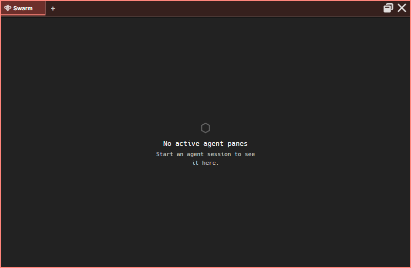

:::caution[Alpha Software]
AgentMux is **alpha software** and under heavy active development. Many features described in these docs may be incomplete, unstable, or not yet implemented. Expect breaking changes between releases. We welcome bug reports and feedback on [GitHub Issues](https://github.com/agentmuxai/agentmux/issues) or [Discord](https://discord.com/invite/96erama9Ar).
:::

The **Swarm** pane is the overview of what your agents are doing right now. It lists every running agent pane on this AgentMux instance as a tree: under each agent you see its todo list, subagents, workflow runs, shells, cron jobs, long-running commands and background commands. A fleet toolbar at the top lets you send one message to several agents, or stop them, in one action.



<figure class="docs-clip">
<video controls loop muted playsinline preload="metadata" width="800" height="500" poster="/recordings/swarm-follows-agent-poster.webp" aria-describedby="clip-swarm-follows-agent"><source src="/recordings/swarm-follows-agent.mp4" type="video/mp4" /></video>
<figcaption id="clip-swarm-follows-agent">A 13-second clip with no sound: sending an agent a message. Swarm turns it from idle to working, then shows its subagent task and the file it reads, while the reply streams in.</figcaption>
</figure>

:::note[This page used to be "Subagent Watcher"]
Earlier releases had a separate **Subagent** pane and a Swarm pane with Overview, History and Search tabs. Both are gone. The Swarm pane has no tabs, and subagent activity now expands inline in the tree instead of opening its own pane.
:::

## Opening Swarm

- Click **Swarm** (bee icon) in the widget bar. It is pinned by default (`crates/srv/src/config/widgets.json`, `defwidget@swarm`).
- Command palette (`Ctrl+P`): **Open Swarm**.
- Click **+** on any pane's tab strip and pick **Swarm** to add it as a tab in that pane.
- Right-click a pane header → **Replace With...** → **Swarm** replaces that pane with Swarm.
- In an agent pane, click a subagent or workflow dispatch card (it reads **View in Swarm →**; `Enter` or `Space` also work). Each click opens a new Swarm pane (`frontend/app/view/agent/components/tool-renderers/DispatchCard.tsx`).

With no agent panes open, Swarm shows **No active agent panes** and "Start an agent session to see it here." The fleet toolbar only appears once there is at least one agent, or once there are [stats](#stats) to show.

## Layout

From top to bottom (`frontend/app/view/swarm/swarm-view.tsx`, `SwarmView`):

1. The [fleet toolbar](#fleet-toolbar).
2. The [Stats](#stats) panel, shown while the toolbar's **Stats** button is on.
3. A result panel, shown only after a fleet action.
4. A **Clear completed (N)** button, shown only when there are finished rows to dismiss.
5. The agent tree.

Swarm supports per-pane zoom like other panes, from 50% to 200%: `Ctrl`+scroll, or `Ctrl` `+` / `-` / `0`.

## The agent tree

Each top-level row is a **running agent pane** on this AgentMux instance, across all of its windows and workspaces. Agents on other AgentMux instances or LAN peers are not listed.

An agent row shows:

| Element | What it shows |
|---|---|
| Checkbox | Selects the agent for a fleet action |
| Chevron (▸ / ▾) | Expands or collapses the row. Shown only when the agent has child rows. |
| Provider logo and name | The pane's agent name, or "Agent" if it has none |
| Child count | Number of child rows, shown while the row is collapsed |
| Context size | The context-window reading from the agent's last turn, e.g. `45.2k` |
| Status chip | **working** (red) while the agent is in a turn, including while it runs tools or stops; **idle** (green) otherwise |
| Activity line | A one-line summary of what the agent is doing, when available |
| Current tool | The tool the agent is running right now, while it is working |
| Supervisor chip | Claude agents only: the [Supervisor](#supervisor) mode and what it is doing. Click to change it. |

**Clicking an agent row focuses that agent** (`frontend/app/view/swarm/swarm-view.tsx`, `frontend/app/util/reveal-block.ts`): AgentMux switches to the agent's tab, brings its pane tab to the front if the pane has several tabs, and focuses its pane. If the agent is in another window, that window is brought forward. Only the chevron expands or collapses a row, and ticking the checkbox doesn't move focus. Rows start collapsed. Clicking empty space in Swarm focuses the Swarm pane itself.

Rows use the agent's own pane-tab color: the row of the currently focused agent pane has a thin border in that color, and hovering a row outlines it in a lighter shade of it. The color is the pane's **Pane Color** if you set one, otherwise the agent's assigned color.

Under an expanded agent, child rows are grouped in this order. A group is hidden when it is empty. A supervised agent's first group is the [Supervisor](#supervisor)'s recent decisions.

### Todos

The agent's current todo list, read from its transcript every few seconds (`crates/srv/src/backend/reactive/progress_watcher.rs`). AgentMux picks up `TodoWrite`, `TaskCreate` and `TaskUpdate` tool calls, and other tools whose name contains "Todo".

- The header reads **Todos** with a done/total count, e.g. `1/3`.
- Items keep the agent's own order and are marked ✓ (completed), ▸ (in progress) or ○ (pending).
- At most 24 items are shown, then **+N more**.
- **earlier items may be missing** appears when AgentMux started watching the agent partway through its session.

The last list stays visible after the agent goes idle.

### Agent Tool

One row per subagent the agent launched with its Agent/Task tool. Subagent tracking is **Claude Code only**: AgentMux reads the subagent transcripts Claude Code writes under its config directory (`crates/srv/src/backend/subagent_watcher/mod.rs`).

- The label is a short generated name for the subagent, falling back to its slug and ID.
- The status chip reads **working** or **idle**, like an agent's. A subagent whose agent went idle before the subagent finished is *interrupted*: its chip reads **idle**, and it has no countdown (see below).
- Click a row to expand its activity feed: text output, tool calls (click to see the input), results and errors (click for a preview), and progress. The feed keeps the latest 500 entries.

### Workflow

One row per Workflow tool run (not one per member), showing `{active}/{total} active` or `{total} retired` and an **Active** or **Retired** badge. Expand it for a live feed tagged with each member's short ID.

An Agent Tool row whose subagent finished, and a Workflow row whose members all completed, show **disappearing in Ns** and remove themselves after 60 seconds. Hovering a row pauses the countdown. These rows, and interrupted Agent Tool rows, have a **×** button ("Retire") to dismiss them now. An interrupted row has no countdown and stays until you dismiss it.

### Shell

Background jobs the agent started with the `Terminal` MCP tool (`run` with `background: true`): title, elapsed time and a **Stop** button.

### Cron

Cron jobs the agent created: name, cron expression, when it last fired, fire count and an **Active** or **Paused** badge. Read-only.

### Running

Long-running `Bash` tool calls (`frontend/app/view/swarm/swarm-longrunning.ts`):

- a call that has been running for more than 30 seconds;
- a bare `sleep`, from the start, with a "~Ns left" countdown.

Each row shows the command and elapsed time. This group only covers agent panes that are currently open in the same window as the Swarm pane. Commands started in the background are listed under [Background](#background) instead.

### Background

Commands the agent started in the background (a `Bash` call with `run_in_background`), with the description the agent gave the command, or `Bash` if it gave none (`frontend/app/view/swarm/swarm-background-tasks.tsx`, `crates/srv/src/backend/background_task_feed.rs`). A background command a subagent started is shown under that subagent's row in **Agent Tool**, whether or not the row is expanded; it moves to this group once the subagent's row is gone.

Each row shows `$`, the description, a status and the elapsed time, which stops when the command ends:

- **running**;
- **done**, removed after 8 seconds;
- **stopped**, removed after 3 seconds;
- **failed**, removed after 15 seconds.

AgentMux reads these statuses from the task reports Claude Code writes to the agent's output stream, including for commands a subagent started, so a finished command no longer stays **running**. Right-click a row for **Copy description**.

### Clear completed

**Clear completed (N)** dismisses every finished or interrupted Agent Tool row and every retired Workflow row. Dismissals are remembered in this machine's local storage, so they survive reopening Swarm. Nothing is deleted from the agent's own history, and a dismissed row comes back if it shows new activity. Todos, Shell, Cron, Running and Background rows are not affected.

## Copy menus

Right-click a row for a menu of values to copy (`frontend/app/view/swarm/swarm-view.tsx`). Entries with no value are left out.

| Row | Menu entries |
|---|---|
| Agent | **Copy agent name**, **Copy block ID** |
| Todo item | **Copy todo text** |
| Agent Tool | **Copy name**, **Copy slug** (when it differs from the name), **Copy agent ID** |
| Workflow | **Copy name**, **Copy workflow ID** |
| Shell | **Copy command**, **Copy title** (when it differs from the command), **Copy shell ID** |
| Cron | **Copy name**, **Copy schedule**, **Copy target agent**, **Copy cron ID** |
| Running | **Copy command** |
| Background | **Copy description** |

## Fleet toolbar

The toolbar acts on the agents whose checkboxes you tick (`frontend/app/view/swarm/swarm-fleet-toolbar.tsx`). There is no separate scope picker: the toolbar only sees agents in the tree, which are the agent panes on this instance.

| Control | What it does |
|---|---|
| **Select all** / **Select none** | Ticks or clears every agent. The toolbar shows **{N} selected**. |
| **Broadcast** | Opens an inline box ("Message to send to {N} agents…") with **Send** and **Cancel**. `Enter` sends, `Esc` cancels. The Stop button is hidden while the box is open. |
| **Stop {N}** | Stops the selected agents, after a confirmation dialog. |
| **Supervisor** | Sets the [Supervisor](#supervisor) mode (Off, Steady or Drive) for the selected agents of this AgentMux, with no confirmation step. |
| **Stats** | Opens or closes the [Stats](#stats) panel. Doesn't need a selection. |
| **Clear** | Clears the selection. |

**Broadcast** sends the same message to each selected agent with no confirmation step. Each agent receives it as a [jekt](/glossary/) from an unnamed sender (`TRUST=self-declared`), because a message you type in the UI is not signed by any agent. An agent that is not live and registered for messages fails with an error in the result panel.

**Stop** opens a dialog titled "Stop N agents?" (or "Stop 1 agent?") listing the selected panes' block IDs, with a **Stop {N}** button. With 5 or more agents selected you can tick **Staged rollout** to stop them in batches (**Batch size**, default 3) and abort if a batch's failure rate exceeds a percentage (default 50). Stopping ends each agent's CLI process; the pane stays open. Because you are the one stopping them, the agents stop right away, without the 15-second override window an agent-initiated stop gets (see below). The selection is cleared afterwards. If an agent belongs to another AgentMux instance on the same machine (for example, a different channel), the stop is forwarded to that instance. Every stop is recorded in the [Warden](/warden/) audit feed.

After either action, the result panel shows a summary such as "Broadcast — 3 succeeded, 1 failed" or "Bulk stop — 3 succeeded, 1 failed" (with "— staged rollout aborted early" if that happened), and one row per agent with its error, if any. Dismiss it with **×**.

### From an agent

Agents can do the same through MuxAPI (`crates/mcp/src/tool_schemas.rs`; backend `crates/srv/src/server/app_api/fleet.rs`):

- **`Agents` `list`** lists every agent reachable from the calling agent, with the IDs the other two calls expect.
- **`Message` `broadcast`** sends one message to many targets. Each message is signed and delivered exactly like `Message` `send`, so it reaches agents on this machine by block ID and agents on LAN peers or the cloud relay by name. Large broadcasts go out in chunks of 10, about a second apart.
- **`Stop` `agents`** stops agent panes by block ID, on this instance or another instance on the same machine. Each target running on this instance first gets its user's 15-second override window, all in parallel, so the call takes at least 15 seconds; a target the user chooses to keep running is reported as kept and failed. The optional staged rollout applies only to the other targets (`crates/srv/src/sagas/pending_shutdown.rs`).

See [MuxAPI](/internals/muxapi/) for the full tool reference.

## Supervisor

The **Supervisor** keeps an agent working until it is done or needs you. Agents often end a turn with "shall I continue?", or stop short of work they had planned, and then sit idle until you notice. With the Supervisor on, each time the agent ends a turn AgentMux reads the end of its conversation, asks a small model (Haiku) whether it should go on, and either sends the agent a message to continue or stops and tells you why. You set it and watch it in Swarm (`frontend/app/view/swarm/`); the decisions are made by AgentMux's server. It used to be a section of the [Warden](/warden/).

### Turning it on

The Supervisor is set per agent, and every agent starts **Off**. Each Claude agent's row has a Supervisor chip (a shield icon). Click it and pick a mode:

| Mode | What the menu says |
|---|---|
| **Off** | "Leave the agent to stop when it stops." |
| **Steady** | "Keep it going when it stops only to check in. Pause for real questions." |
| **Drive** | "Keep it going through open questions on its own best judgement. Pause for what only you can provide." |

To set several agents at once, tick their rows and use the fleet toolbar's **Supervisor** button, which offers the same three modes (for example "Supervisor: Drive for 3 agents"). There is no confirmation step; the result panel reports each agent, as for Broadcast and Stop.

- **Claude agents only.** Other providers' rows have no chip. If AgentMux can't supervise a pane, the chip's tooltip says "the Supervisor works with Claude agents only for now".
- **This AgentMux's own agents only.** Each AgentMux supervises its own agents, so the toolbar leaves out selected agents of another instance.
- **Only you set it.** No MuxAPI tool sets the mode, so an agent can't put itself, or another agent, in Drive.

Setting a mode starts a new run and is recorded in the agent's history. If the agent is idle at that moment, its last turn is judged at once: turning on Drive for an agent that just asked "shall I continue?" gets it going without waiting for another turn.

### What it does when an agent stops

When a supervised agent ends a turn, the Supervisor checks these in order:

1. **You pressed Stop** in the agent's pane (within the last 15 seconds): nothing is judged or sent. It records "You stopped it; it waits for your next message."
2. **The turn ended in a question tool** (`AskUserQuestion`, or `ExitPlanMode`'s plan approval): it pauses for you without asking the model, with "It asked you a question."
3. **Your last message has no answer yet:** nothing is judged.
4. **The agent has background commands still running:** it waits. Those commands wake the agent when they finish, and that turn is judged instead.
5. **Otherwise** the judge reads the end of the conversation and answers **continue**, **done**, **needs you** or **blocked**, with a one-sentence reason.

AgentMux's own hidden turns are never judged. A turn started by another agent's message, a service or a schedule is judged like any other.

The judge follows the mode:

- **Steady** continues an agent that stopped only to check in, or stopped short of work it had already planned or been asked to do. A real question, a choice only you can make, or an open question it can't settle from the conversation pauses it.
- **Drive** also continues through open questions the agent can research or decide itself, and suggests a next step. It pauses only for what only you can provide: a credential, a sign-in, a payment, or a product decision with no sensible default.
- **In both modes**, done needs evidence in the conversation: tests passing, a pull request opened or merged, the result shown. A bare claim is not enough: Drive asks the agent to show the evidence, and Steady pauses for you. A turn that ends by asking you to approve, choose or decide something is never done.
- **In both modes**, a risky, irreversible or outward-facing next step pauses for you, even when the agent proposes it: deleting data, force-pushing, deploying, spending money, publishing, or messaging people outside the team. When the judge is unsure whether to continue, it pauses.

The judge runs on the agent's own CLI and sign-in, and has 90 seconds per verdict. A call that fails or times out is tried once more, while the turn is still the latest and the agent still idle. If there is still no usable answer, nothing is sent and you get the ordinary "finished" notification: the Supervisor never continues on a guess. If the agent starts a new turn while the judge is working (you reply, or a message arrives), that judgement is dropped.

### The continuation

To keep an agent going, the Supervisor sends it a message like this one:

```
[SUPERVISOR:MODE=drive N=3 OF=15]
Keep going without waiting for confirmation. Research open questions thoroughly, choose the best option on your own judgement, and say what you assumed. Stop and ask only for something irreversible or outward-facing, for something only the user can provide, or if you are blocked. If the work is done, say so and show the evidence.
Why: <the judge's reason>
Suggested next step: <the judge's next step>
```

In Steady the instruction is "Continue the task you were already doing. Ask the user only if something truly needs them. If the work is done, say so and show the evidence.", with no suggested next step.

- **In the agent pane** the header is replaced by a label, **Supervisor · Drive · 3 of 15**, and the turn's footer reads "Worked on a Supervisor continuation".
- **Only AgentMux writes the header.** A `[SUPERVISOR:` header inside a jekt or a broadcast is quoted, so one can't be forged. The judge's reason and next step are flattened to one line and cut at 300 characters.
- **It is not your message.** It arrives as automated input, so it can't authorize anything that needs your own word, such as an agent quitting itself or an AgentMux upgrade.
- **It goes only to a running agent.** If the agent's process isn't running, the Supervisor doesn't start it; it pauses with "Couldn't continue it: the agent isn't running".

### Limits

| Limit | Steady | Drive |
|---|---|---|
| Continuations in a row since you last sent the agent a message | 5 | 15 |
| Time since the run's first continuation | none | 2 hours |
| Continued turns in a row in which the agent used no tool | 2 | 2 |
| The same final message twice in a row after a continuation | pause | pause |

Reaching a limit pauses the agent for you, with the reason, for example "5 continuations in a row; over to you." A message you send, typed in the pane or broadcast from Swarm, starts a new run and resets the counts, and so does changing the mode. A message from another agent doesn't.

The Supervisor never:

- answers an `AskUserQuestion` or approves a permission prompt;
- gives an agent new work: it only continues the task the agent already has;
- starts an agent that isn't running;
- continues a turn you stopped.

### Watching and stopping it

- **The chip** shows the mode and what the Supervisor is doing: **judging**, **waiting** (for background work), the count so far such as **3/15**, and, while the agent is idle, **paused** or **done**. A paused chip is highlighted. Hover it for the mode, what the mode does and the last reason.
- **The row's line** reads **Needs you:** and the reason while a paused agent is idle, and the row ranks like one with a pending question. When the agent starts a turn again, the pause is over.
- **The Supervisor group**, first under an expanded row, lists the last 10 decisions, newest first: the time, what it did (**continued**, **paused**, **done**, **waiting**, **no verdict**, **set**, **stopped by you**) and the reason. They are kept in the pane's metadata (`supervisor:state`), so they survive a restart of AgentMux's server. The group is hidden while the mode is Off.
- **Notifications:** when it pauses, you get a notification that the agent needs you, "Supervisor paused:" and the reason. When the judge finds the work done, or can't judge, you get the usual "finished" notification. A continuation, and a turn you stopped, send none. A supervised agent never gets the generic "finished" notification on top of these.
- **Stats:** each verdict is a small model request, counted under **Supervisor verdicts** in the [Stats](#stats) panel.

To turn it off, set the chip, or the toolbar for a selection, to **Off**. To halt a single run, press Stop in the agent's pane: the Supervisor waits for your next message, which starts a fresh run.

## Stats

The toolbar's **Stats** button (`frontend/app/view/swarm/swarm-stats.tsx`) opens a panel under the toolbar headed "AgentMux's own model requests since its server started", with the total. These are the requests AgentMux makes on its own, not your agents' turns: session titles, subagent and workflow names, prompt suggestions, agent previews and narration. The counts start again when AgentMux's server restarts. The button appears once at least one such request has ended.

The panel has one row per purpose:

| Row | What the requests are for |
|---|---|
| **Session titles** | The title and activity line of an agent's session |
| **Session titles (recovery)** | Titles from a periodic background pass that fills in missing ones |
| **Prompt suggestions** | The ghost-text suggestion for your next message |
| **Subagent names** | Names for subagent rows in the tree |
| **Workflow names** | Names for workflow rows in the tree |
| **Agent previews** | The conversation preview for an agent under **My Agents** in the agent picker |
| **Narration** | Messages in an agent's pane describing something AgentMux did on its own |
| **Supervisor verdicts** | The [Supervisor](#supervisor)'s judgements of supervised agents' turns |

Each row counts how its requests ended, for example "12 accepted · 30 kept · 2 refused · 1 failed". Refused, skipped and failed appear only when they aren't zero.

| Count | Meaning |
|---|---|
| **accepted** | The model's answer passed AgentMux's checks and was taken. The pane can still keep the old title if the new one only rewords it. |
| **kept** | The model chose to leave things as they were. This is a normal answer, not a failure. |
| **refused** | The answer was rejected: blank, the wrong shape (several lines, too long, no letters), a non-answer such as "none" or "untitled", or a refusal. |
| **skipped** | No answer was needed: there was nothing to send, or a newer request replaced this one. |
| **failed** | The model's CLI couldn't run, failed, timed out, or the request was dropped before it ran. |

Hover a row for every outcome and its count. A row is shown as a warning when refused and failed requests together outnumber accepted and kept ones, and the **Stats** button then reads **N failing**, the number of such rows. An older AgentMux server without these counts leaves the panel empty.

## Tokens and cost per agent

Swarm shows each agent's context size, not its spend. Per-agent token counts and cost are in the status bar's **Token Usage** popover (`frontend/app/statusbar/TokenBreakdownPopover.tsx`), and in an agent pane, clicking the context reading in the composer strip (e.g. `104k / 200k`) opens a popover with that session's cost, turns, duration and token totals (`frontend/app/view/agent/components/AgentSessionStats.tsx`).

Swarm itself spends a small number of tokens: when you open it, AgentMux asks a small model to name up to 20 unnamed subagent rows.

## What Swarm doesn't do

- **No history or search.** Swarm shows live state only. Subagent activity is held in memory; when an agent pane is reopened, AgentMux reloads that session's subagent activity from Claude Code's transcript files.
- **No other instances or LAN peers.** For those, see the [Warden](/warden/).
- **No subagent tracking for providers other than Claude Code.**

## See also

- [Pane Types](/pane-types/) — every pane type, including the agent pane's dispatch cards
- [Warden](/warden/) — the Kanban of agents' tasks, the Vault, agents across Host, LAN and Internet, the audit feed and agents' history
- [Interagent Communication](/internals/interagent-comms/) — how jekts are delivered
