:::caution[Alpha Software]
AgentMux is **alpha software** and under heavy active development. Many features described in these docs may be incomplete, unstable, or not yet implemented. Expect breaking changes between releases. We welcome bug reports and feedback on [GitHub Issues](https://github.com/agentmuxai/agentmux/issues) or [Discord](https://discord.com/invite/96erama9Ar).
:::

The Sysinfo pane displays live system metrics for the machine AgentMux runs on, as time-series line plots.

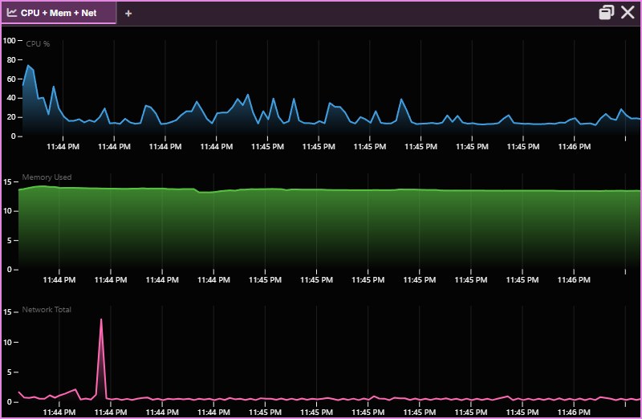

## Opening Sysinfo

- Click **more** at the end of the widget bar and choose **Sysinfo** (chart icon). Right-click it there and choose **Pin to bar** to keep it on the bar.
- Command palette (`Ctrl+P`): **Open System Info**.
- Click **+** on any pane's tab strip and pick **Sysinfo**.
- Press `Ctrl+Shift+K` to turn the focused pane into the widget launcher, then choose **Sysinfo**.

The starter layout on first launch, and in each new window, includes a Sysinfo pane above Swarm, next to the Agent pane.

## Available Metrics

The backend collects these values on every sample (`crates/srv-core/src/backend/sysinfo.rs`). Memory values are in GB (1024³ bytes) and throughput in MB/s (1024² bytes per second).

### CPU metrics

| Metric Key | Description |
|-----------|-------------|
| `cpu` | Overall CPU usage, the average across all cores (0–100%) |
| `cpu:0`, `cpu:1`, … | Usage of each core |

### Memory metrics

| Metric Key | Description |
|-----------|-------------|
| `mem:used` | Memory in use (GB) |
| `mem:free` | Free memory (GB) |
| `mem:available` | Available memory (GB) |
| `mem:total` | Total system memory (GB), used as the ceiling of the memory plots |

### Network metrics

| Metric Key | Description |
|-----------|-------------|
| `net:bytessent` | Network bytes sent (MB/s) |
| `net:bytesrecv` | Network bytes received (MB/s) |
| `net:bytestotal` | Total network throughput (MB/s) |

### Disk metrics

| Metric Key | Description |
|-----------|-------------|
| `disk:read` | Disk read throughput (MB/s) |
| `disk:write` | Disk write throughput (MB/s) |
| `disk:total` | Total disk I/O throughput (MB/s) |

## Plot Types

Each Sysinfo pane shows one plot at a time, from **Simple** (one plain chart per measure) or **Advanced** (the figures for one part of the machine, or all of it). The default is the simple **CPU** plot.

To switch, either click a button in the row over the top of the pane, or right-click the pane header, open **Plot Type** and choose from **Simple** or **Advanced**. The pane's title shows the current plot, and the choice is saved with the pane.

| Plot | Group | Shows |
|------|-------|-------|
| [CPU](#cpu) | Simple | Overall CPU use |
| [All cores](#all-cores) | Simple | One plot per core |
| [Memory](#memory) | Simple | Memory in use |
| [Network](#network) | Simple | Total network throughput |
| [Network sent and received](#network-sent-and-received) | Simple | Sent and received, each in its own plot |
| [Disk](#disk) | Simple | Total disk throughput |
| [Disk read and write](#disk-read-and-write) | Simple | Read and write, each in its own plot |
| [CPU and memory](#cpu-and-memory) | Simple | CPU and memory, one above the other |
| [CPU, memory and network](#cpu-memory-and-network) | Simple | All three, one above another |
| [CPU (Advanced)](#cpu-advanced) | Advanced | CPU, the busiest core and a heatmap of every core |
| [Memory (Advanced)](#memory-advanced) | Advanced | Used, available and committed memory |
| [Disk (Advanced)](#disk-advanced) | Advanced | Read above and write below, each alone, and each volume's free space |
| [Network (Advanced)](#network-advanced) | Advanced | In above and out below, each alone |
| [Everything](#everything) | Advanced | Every part of the machine at once |

The Y-axis depends on the metric. CPU is fixed at 0–100%. Memory scales with usage up to total memory, with a floor of 1 GB. Network and disk scale with the data, with a floor of 1 MB/s. Rates read as KB/s, MB/s or GB/s.

### Simple

#### CPU

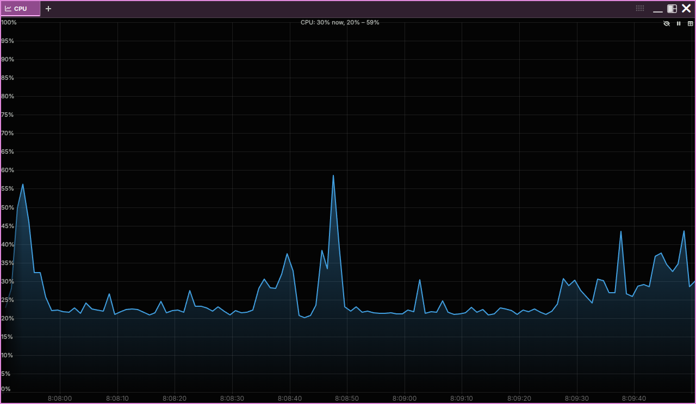

The average use across all cores, from 0 to 100%. Pick it for a quick answer to "is this machine busy?".

#### All cores

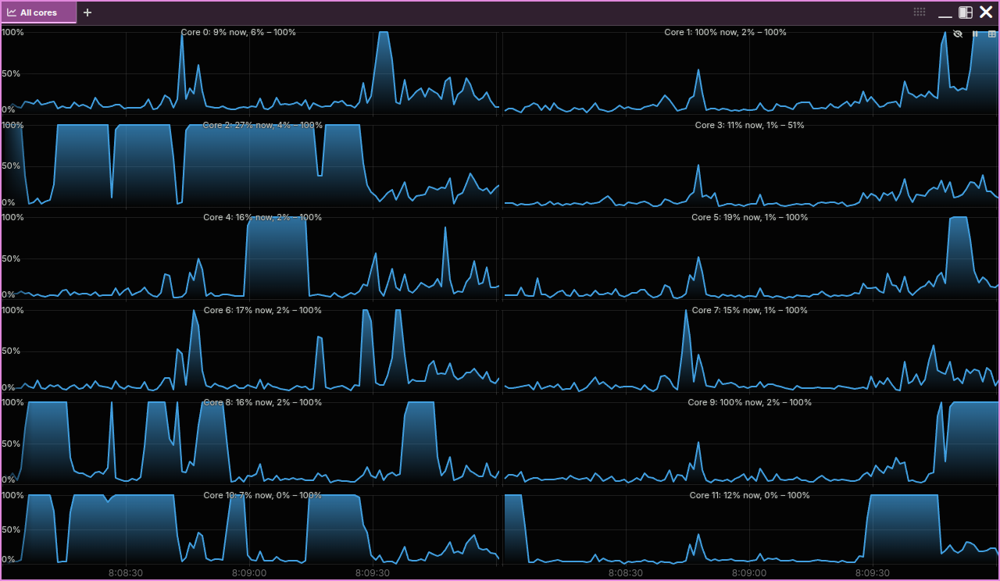

One plot per core, in a 2-column grid, each from 0 to 100%. The first 32 cores are labelled; further cores are plotted without a label. Pick it to see one core pinned while the average stays low.

#### Memory

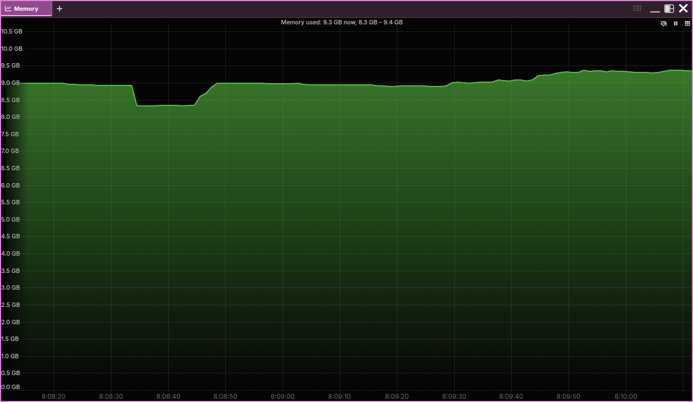

Memory in use, in GB. The top of the plot follows your usage, never above the machine's total memory and never below 1 GB.

#### Network

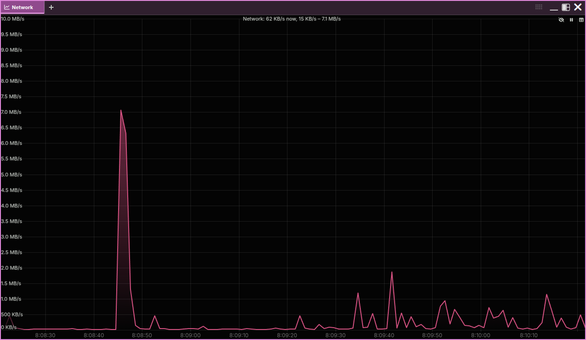

Total network throughput in both directions, in MB/s. Pick it when you only care how much the network is used.

#### Network sent and received

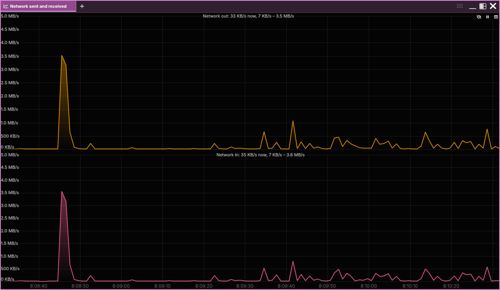

Two plots: what the machine sends and what it receives. Pick it to tell an upload from a download.

#### Disk

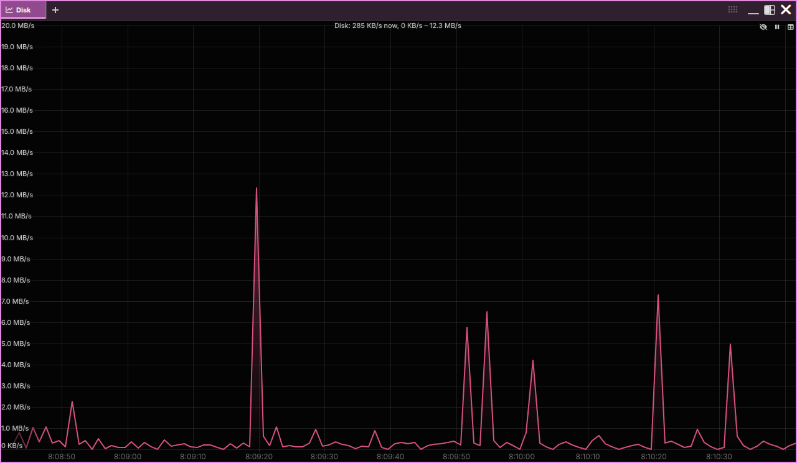

Total disk throughput (read plus write), in MB/s.

#### Disk read and write

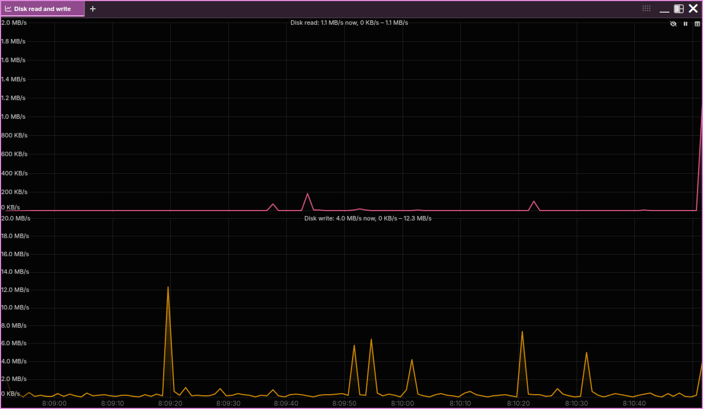

Two plots: what the disks read and what they write. Pick it to tell a build writing files from a program loading them.

#### CPU and memory

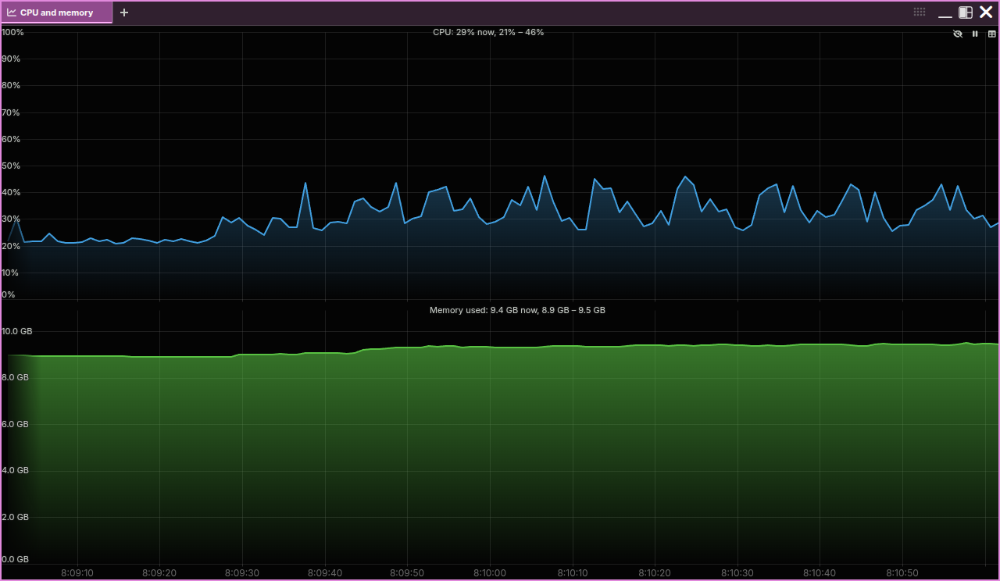

The CPU and memory plots, one above the other, on the same time axis.

#### CPU, memory and network

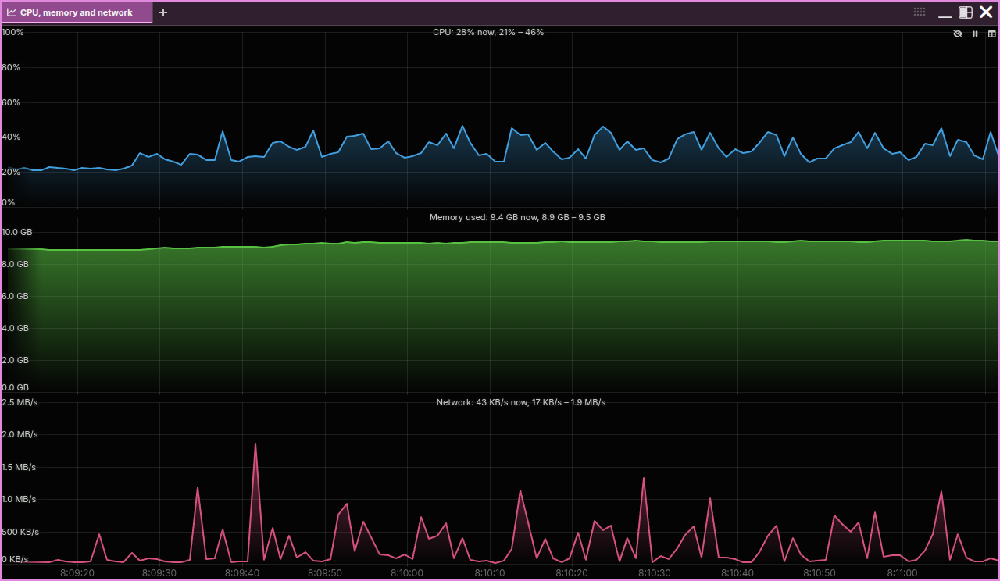

CPU, memory and network stacked in one column. Pick it for a small overview in a pane that is wide but short.

### Advanced

The Advanced plots title each chart with its figure now and its low and high over the window, and share one crosshair across the charts of a plot. They can also show the same figures as a table.

#### CPU (Advanced)

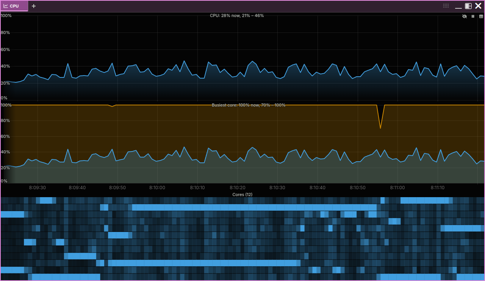

The overall CPU chart, a **Busiest core** chart with the average drawn over it, and a **Cores** heatmap with one row per core. A single thread maxing out a core shows in the busiest-core chart while the average stays low.

#### Memory (Advanced)

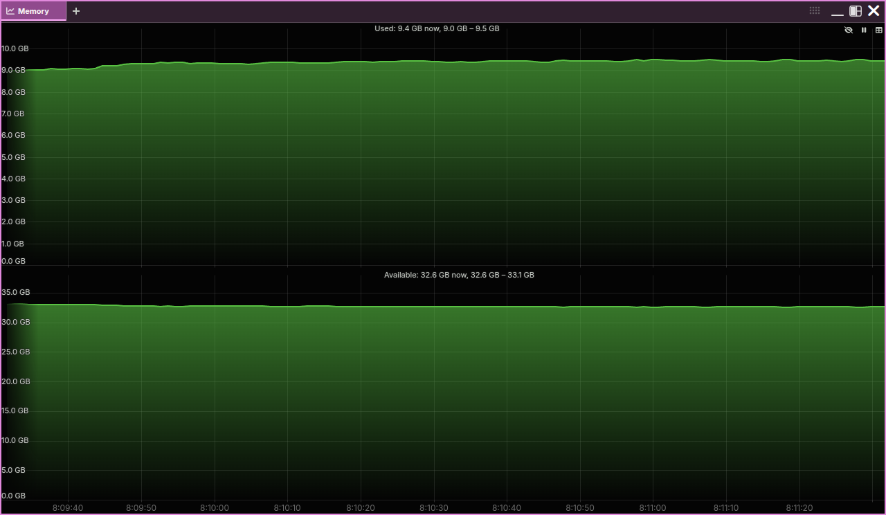

**Used** and **Available** memory in GB, and **Committed** memory on a system that reports it.

#### Disk (Advanced)

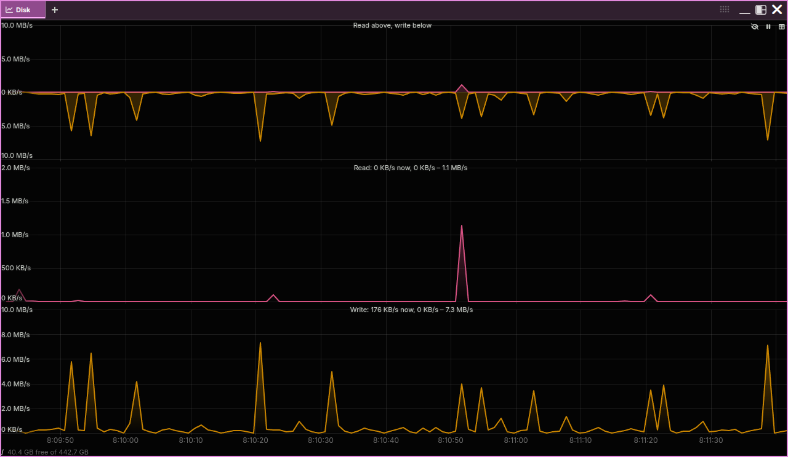

One chart with reads above the axis and writes below, then **Read** and **Write** each alone, and a list of each mounted volume with its free space.

#### Network (Advanced)

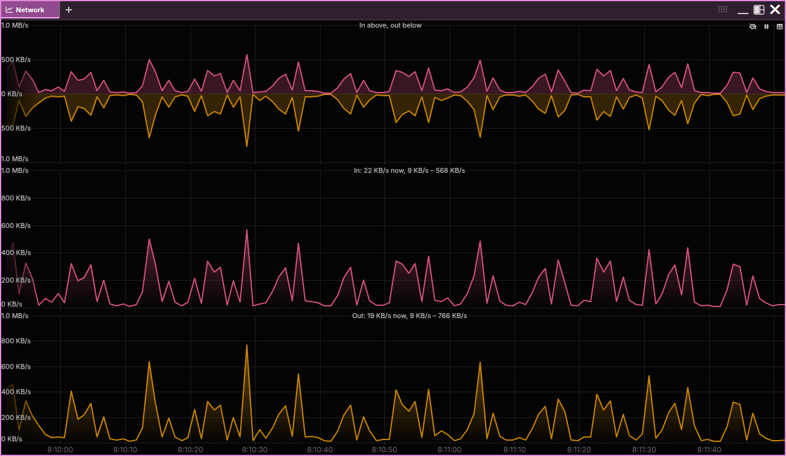

One chart with what comes in above the axis and what goes out below, then **In** and **Out** each alone.

#### Everything

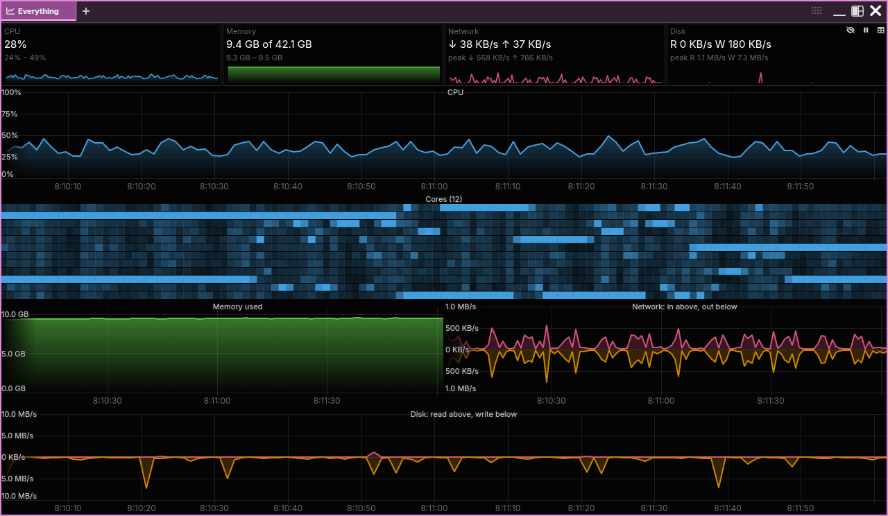

A tile for CPU, memory, network and disk (its value now, its low and high over the window, and a sparkline) above charts that share one time axis: CPU, every core as a heatmap, memory, network (in above, out below) and disk (read above, write below). Pick it when you want the whole machine in one glance.

### Controls

A row of buttons floats over the top of the pane, the same in the Simple and the Advanced plots:

- A button per plot of the group you are in, to switch in one click.
- The time window: **1m**, **2m**, **5m** or **15m** (a window longer than the history the backend keeps is left out). It is saved with the pane.
- On the right, an eye to hide or show the plot and window buttons, **Pause** to hold the charts while samples keep arriving, and a table icon to show the figures as a table instead of the charts.

## Data Collection

- The backend samples once per second by default. Change this in **Settings → Advanced → Sysinfo widget → Sample interval** (`telemetry:interval`). The settings field accepts 1 second or more; the backend clamps the value to 0.2–2 seconds, so values below 1 second can only be set in the settings file, and anything above 2 samples every 2 seconds.
- Samples are streamed to the frontend as `sysinfo` events over the app's WebSocket. The backend keeps the latest 1024 samples so a newly opened pane can fill in its history.
- A plot shows the latest **120** samples by default (2 minutes at the default interval). Pick another window with the pane's time buttons (**1m** to **15m**), or change the default for panes that have not chosen one with **History length** (`telemetry:numpoints`, 30 to 1024) in the same settings section.
- If one to three samples are missed, the plot repeats the last value. A longer gap, such as after sleep/wake, leaves a break in the line.

## Plot Colors

Each metric type has a CSS variable for theming (`frontend/app/theme.scss`):

| Metric | CSS Variable |
|--------|-------------|
| CPU | `--sysinfo-cpu-color` (the theme's accent colour) |
| Memory | `--sysinfo-mem-color` |
| Network (total or received), disk (total or read) | `--sysinfo-in-color` |
| Network sent, disk write | `--sysinfo-out-color` |

## Local machine only

Sysinfo monitors only the machine AgentMux runs on: the backend runs a single, local collector. Remote-host monitoring is not supported.

The pane header still shows a connection selector. Leave it on the local connection: choosing any other connection leaves the pane blank.

## Per-pane CPU and memory badges

The same collector also measures the CPU and memory used by each pane's processes, shown as a small badge on the pane header. For terminal panes you can hide it with **Settings → Terminal → Show CPU/mem badge** (`term:showstatsbadge`).

## See Also

- [Pane Types](/pane-types/) — every pane type
- [The window](/window/#status-bar) — the status bar's CPU, memory and disk figures, and the panels they open
- [Settings reference](/settings/) — where settings live
