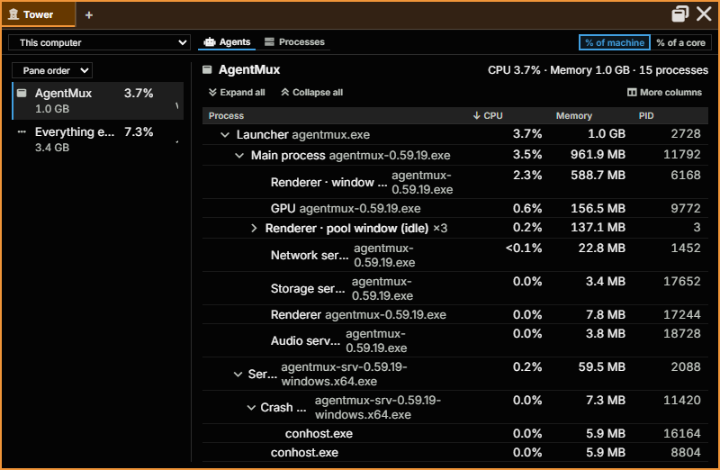

:::caution[Alpha Software]
AgentMux is **alpha software** and under heavy active development. Many features described in these docs may be incomplete, unstable, or not yet implemented. Expect breaking changes between releases. We welcome bug reports and feedback on [GitHub Issues](https://github.com/agentmuxai/agentmux/issues) or [Discord](https://discord.com/invite/96erama9Ar).
:::

**Tower** is a read-only task manager pane (`frontend/app/view/tower/`). It answers three questions: how much memory AgentMux itself is using, and on what; what is each agent or pane running, and what is it costing in CPU and memory; and what is using this machine, and whose is it. It never ends or changes a process, never shows command lines, and needs no administrator rights.

## Opening Tower

- **Widget bar:** **more** → **Tower**. It isn't pinned by default; right-click it to pin it.
- **Command palette:** **Open Tower**.
- Any pane's **+** menu → **Tower**, to add it as a tab in that pane.

## The toolbar

- **Machine:** **This computer**, your SSH and WSL remotes, and AgentMux computers you've paired. **Pair another AgentMux computer…** takes a pairing link (`agentmux://pair?…`); **Forget this computer** removes a paired one.
- **Tower view:** **Memory** (AgentMux's own memory), **Agents** (each agent and what it runs), **Processes** (every process on the machine) or **Panes** (each window, tab and pane with what it costs). Tower opens on **Memory**. **Memory** and **Panes** show this computer's AgentMux only.
- **Show CPU as:** **% of machine**, the share of the whole machine, as Windows Task Manager shows it; or **% of a core**, the share of one core, as `top` shows it, which can pass 100%.

## Memory

AgentMux's total memory is always on screen: the headline figure, with how it changed over the last hour. Below it the total is split into four parts, each opening to the processes in it, with its share of the whole and a line for the last hour:

| Part | What is in it |
|---|---|
| **Core** | AgentMux's own programs: the launcher, the server, the browser host and its GPU and service processes |
| **Panes** | What draws and hosts the panes: the window renderers, and each terminal with what runs in it |
| **Agents** | Each agent: its CLI, what runs for it (MCP servers, helpers) and what it started |
| **Not placed** | Processes AgentMux started that no pane claims |

Select a part or a row to chart it over **10 min** or **1 hour**. Memory is the first column in every table and the last to go when the pane is narrow, and tables sort by memory. Tower keeps the last hour, and notes in amber what grows unusually.

## Agents

A rail on the left lists each agent running here, in the agent's colour, with its CPU and memory totals and a short CPU sparkline. Below the agents come **Terminals** (panes with no agent), **AgentMux** (the app itself) and **Everything else** (processes no pane started), so the entries add up to the whole machine. **Order agents by** sets the order: **Pane order**, **CPU**, **Memory** or **Name**. With no agents, the rail reads "No agents running."

Select an entry to see its processes on the right as a tree, so you can see what started what, for example `claude → bash → cargo → rustc`. Processes with the same name under one parent collapse into a single line with their totals (`rustc.exe ×6`); expand it to see each one. An agent's support processes, such as its MCP servers, are shown dimmer than the work it started.

Below the entry's totals, two small charts show its CPU and memory over the last 10 minutes.

This is the view for questions like "which agent is driving this `rustc.exe`, and how much is that agent using overall?"

## Panes

Each window of this computer's AgentMux, its tabs and its panes, with the pane's state, memory and CPU. Open a window to see its tabs and a tab to see its panes. An agent or terminal pane shows its processes, a browser pane every renderer its page runs in (a renderer shared across sites is counted once), a pane asleep to save memory says so, and a pane drawn in its window's own renderer shows a dash, with that renderer on the window's row. **Show this pane** brings a pane to the front.

## Processes

Every process on the machine that AgentMux can read, in one list:

- **Group by:** **Agent**, under the agent or terminal that started each process; **App**, processes of the same app together, as Task Manager does; **Type**, by what kind of process it is; or **None**, one flat list. Grouped by agent, processes that no pane started are under **Other processes**, grouped by app.
- **Filter by name, PID or task.** Matches stay under their group, so you can still see whose each one is.
- Click a column header to sort by it.
- Every process has a type, with an icon and a colour from your theme: **Agents & AI**, **AgentMux**, **Shells & commands**, **Builds & tools**, **Runtimes & servers**, **Browsers & web views**, **Containers & VMs**, **Editors & IDEs**, **Apps** and **System**. A breakdown of the machine by type, with a chip for each, filters the list.
- On a busy machine the list shows the busiest and largest processes, and says so. Processes owned by other users are counted but can't be measured without administrator rights, which Tower never asks for.

## Other machines

Pick another machine in **Machine**:

- An **SSH or WSL remote** runs no AgentMux agents, so Tower shows its processes. SSH hosts must run Linux or macOS; others are listed greyed out as not supported.
- A **paired AgentMux computer** has agents of its own: Tower shows that computer's agents and processes.

## What Tower doesn't do

- It's read-only: it can't end, suspend or reprioritise a process.
- It never shows a process's command line.
- It never asks for administrator rights, so other users' processes can't be measured.
- It looks back only a little. The Memory view keeps the last hour. In the Agents view, the selected entry's CPU and memory are charted over the last 10 minutes; those charts are kept in the pane and start empty when you reopen it. The Processes and Panes views show current values.

## See also

- [System Metrics](/system-metrics/): Sysinfo's machine-wide graphs and the per-pane CPU and memory badges
- [Swarm](/subagent-watcher/): what each agent is doing, rather than what it costs
- [Pane Types](/pane-types/): every pane type
