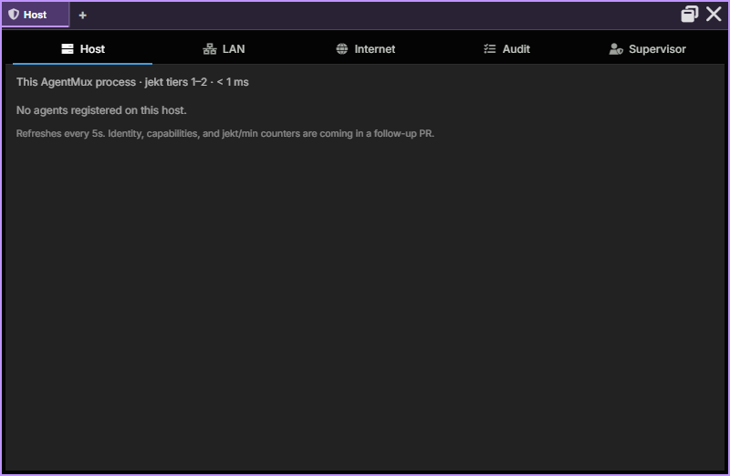

:::caution[Alpha Software]
AgentMux is **alpha software** and under heavy active development. Many features described in these docs may be incomplete, unstable, or not yet implemented. Expect breaking changes between releases. We welcome bug reports and feedback on [GitHub Issues](https://github.com/agentmuxai/agentmux/issues) or [Discord](https://discord.com/invite/96erama9Ar).
:::

The **Warden** is the pane for overseeing agents. It holds the [Vault](/vault/) of secrets agents use without seeing, which agents are registered to receive messages on this AgentMux instance, which AgentMux instances are on your local network, a feed of recent message deliveries, fleet actions and uses of your secrets, and the history agents keep.

## Where to find it

The Warden widget (icon: `shield-halved`) is **not pinned** to the widget bar by default (`crates/srv/src/config/widgets.json`, `defwidget@warden`). Open it in any of these ways:

- Click **more** at the end of the widget bar and choose **Warden**. Right-click it there and choose **Pin to bar** to keep it in the bar.
- Right-click a pane header → **Replace With...** → **Warden**.
- Press `Ctrl+Shift+K` to turn the focused pane into the widget launcher, then choose **Warden**.

One of its sections has its own way in:

- **Vault** is in the widget bar's **more** menu, and is **Open Vault** (`open:vault`) in the command palette.

It opens Warden on that section. A tab holds one Warden: that entry, and the Warden entry itself, switch the Warden already in the tab instead of opening a second one. There is no keyboard shortcut for the Warden, and no command-palette entry for its other sections.

Any section can get a widget-bar button of its own: right-click the Warden's header and choose **Pin “LAN” to bar** (named after the section it shows). See [Sections](/widgets/#sections).

## The sections

The Warden is a pane view with its sections as tabs along the top, the same layout the [Connectors](/connectors/) and [Memory](/memory/) panes use (`frontend/app/view/warden/warden-view.tsx`). In a narrow pane the tabs show only their icons; in a wide one they stop growing and sit at the left. The selected section is saved with the pane, under `warden:section` in its settings; the default is Host.

| Section | Icon | What it covers |
|---|---|---|
| **Vault** | `lock` | Your secrets, which agents use by name without seeing them, with its own sections |
| **Host** | `server` | Agents registered with this instance's message handler, plus soft deregister |
| **LAN** | `network-wired` | Other AgentMux instances found on the local network (read-only) |
| **Internet** | `globe` | Placeholder; no functionality yet |
| **Audit** | `list-check` | Recent jekt deliveries and fleet actions, and agents' uses of your secrets |
| **History** | `clock-rotate-left` | Every agent's kept conversation history, and where it is kept |
| **Ambient** | `wand-magic-sparkles` | How AgentMux's own model requests (session titles, names, prompt suggestions, summaries) have gone since its server started |

Each section is mounted the first time you show it and then stays mounted, so switching back to it is instant. Host, LAN, Audit and Ambient refresh every 5 seconds, but only while they are shown; Internet is static. History loads while it is shown. Because the Vault section too is mounted only when you first show it, a Warden opened on another section never reads your secrets. If the Warden is a background tab in a pane with several tabs, it is unmounted and stops refreshing until you switch back to it. The pane title shows the selected section's name (**Ambient · 2 failing** when requests fail, **Vault · Cards and banks** on the Vault), and `Ctrl`+scroll zooms the Warden.

## The Kanban is its own pane

The [Kanban](/kanban/) used to be Warden's first section. It is now a pane of its own. Warden keeps no stub of it, and a Warden saved on its old Kanban section opens on Host.

## Vault section

The [Vault](/vault/) keeps your ID numbers, cards and bank accounts, API keys, logins and secret notes. It has its own row of sections: **Personal data**, **Cards and banks**, **API keys**, **Logins**, **Notes**, **Kept by AgentMux** and **Activity**. Values are never shown in the list; Reveal and Copy confirm it's you each time. Agents fill form fields and run commands with an entry by its name, and never see its value. While the Vault section is on screen, agents' window captures of AgentMux are refused. The [Vault page](/vault/) covers it.

The Vault used to be a pane of its own. Saved Vault panes, pins and layouts now open Warden on its Vault section.

## Host section

The Host section lists every agent currently registered with this instance's message handler, the component that delivers [jekts](/glossary/#jekt) (`frontend/app/view/warden-host/warden-host-manager.tsx`).

| Column | What |
|---|---|
| `agent` | Agent ID |
| `block` | First 8 characters of the pane's block ID |
| `last seen` | Time since the agent last registered |
| `state` | `active` if it registered less than 30 seconds ago, otherwise `idle` |

An agent registers when its pane's agent process starts, and again each time you send it a message from its pane (`crates/srv/src/server/agent_handlers/input.rs`). A turn started by a jekt doesn't re-register it, and there is no periodic heartbeat. So `last seen` counts from the process start or your last message, and `state` changes to `idle` about 30 seconds later even if the agent is still busy. It does not tell you whether the agent is working; use [Swarm](/subagent-watcher/) for that.

An agent's row disappears when it is unregistered: its pane closes, its process exits, its agent ID changes, or you deregister it here. An agent that is already live in another AgentMux instance, on this machine or elsewhere, is refused registration, so its pane never appears here (`crates/srv/src/backend/agent_admission.rs`).

### Soft deregister

Each row has a **×** button ("Deregister (soft kill — removes from jekt routing, leaves process running)"). After you confirm, AgentMux removes the agent's routing entry on this instance and its entries in the registries other AgentMux instances on this machine read, stops its MuxBus cloud subscription, and drops its Swarm subagent tracking (`crates/srv/src/server/reactive.rs`).

- The agent's process and pane keep running. Its conversation and data are untouched.
- Jekts are no longer delivered to that pane, whether sent from this machine, the LAN or the cloud relay. If the agent has a saved definition, a jekt sent to it can be held for up to 24 hours and delivered when the agent registers again.
- The agent registers again when its agent process restarts or when you next send it a message from its pane. (The confirmation dialog says it "may re-register on its next heartbeat"; there is no heartbeat, these two events are what re-register it.)

Use this to stop an agent receiving messages while you investigate, without killing it. To stop agent processes, use the [Swarm fleet toolbar](/subagent-watcher/#fleet-toolbar).

## LAN section

The LAN section lists other AgentMux instances on your network. It fills in once LAN discovery is on: open the host popover in the status bar and tick **LAN discovery** (setting `network:lan_discovery`, off by default). Each instance must have it on. See [LAN discovery](/lan-discovery/).

| Column | What |
|---|---|
| `peer` | The peer's hostname, or its instance ID |
| `version` | The peer's AgentMux version |
| `address` | The peer's IP address and port |
| `agents` | Number of agents registered on the peer |
| `last seen` | Time since the peer was last seen |

The section is read-only. Agents can already send jekts to agents on LAN peers with the `Message` MCP tool (action `send`); the Warden has no controls for LAN peers.

## Internet section

The Internet section is a placeholder. It shows one line: "Closed by default. Cross-network governance ships behind lan-awareness Phase 4 (cloud fallback)."

Jekt delivery through AgentMux's MuxBus cloud relay does exist, for instances logged in to MuxBus, but the Warden doesn't show it.

## Audit section

The Audit section shows recent entries from the message handler's audit log, most recent first (`frontend/app/view/warden-audit/`):

- jekt deliveries, with sender and recipient, size in bytes, and success or failure (failed rows are tinted red and show the error);
- agent stops from the [Swarm fleet toolbar](/subagent-watcher/#fleet-toolbar) or `Stop` `agents`, and `Stop` `pane` calls in which one agent closed another's pane;
- agents quitting themselves (`/quit`, `/exit` or `Stop` `self`), including a self-quit that has to wait for your 15-second override;
- the 15-second override window that an agent's `Stop` `agents` or its `Stop` `pane` on another agent's pane opens for you: one row when it is requested ("pending user override…") and one with the outcome (shut down, superseded, failed, or kept by the user) (`crates/srv/src/sagas/pending_shutdown.rs`).

Each row shows the time, `sender → recipient`, the status, a size in bytes and the reason. Rows for stops, pane closes and quits don't name the action; tell them apart by the reason text. Their byte size is the length of the internal action name, not of a message. A stop from the Swarm toolbar shows `—` as the sender.

The Warden requests the latest 50 entries and hides registration events, so it often shows fewer than 50 rows. The log holds the last 100 entries in memory and is cleared when AgentMux restarts.

### Secrets

The Audit section ends with **Secrets**: every use of a [Vault](/vault/) entry by an agent (filling a web form, running a command), with the entry, where it went and the outcome, and every standing permission ("may be used without asking") with a × to stop it. It never shows a value, and it doesn't list your own saves, reveals or copies; those are in the Vault's own Activity. **Open the Vault** goes to the Vault's Activity, which links back here. Showing this list doesn't read the Vault's entries, so it never makes the OS ask for the Vault key.

## History section

The History section is the record of what agents did, beside Audit (`frontend/app/view/warden-history/`). **Agents** lists every agent's kept conversation history and opens it; **Storage** shows where it is kept, how much, and for how long. It loads when you first show it.

The Supervisor section is gone. The Supervisor, which keeps agents working until they are done or need you, is now set per agent from its row in Swarm: see [Supervisor](/subagent-watcher/#supervisor).

## Ambient section

The Ambient section counts the model requests AgentMux makes on its own, not your agents' turns: session titles, subagent and workflow names, prompt suggestions, agent previews, narration, running summaries and Supervisor verdicts (`frontend/app/view/warden-ambient/warden-ambient-manager.tsx`). These requests write the line under each agent in [Swarm](/subagent-watcher/) and in the pane tab's tooltip, so this is where you see whether that line is working. It was the Swarm toolbar's **Stats** panel until agentmux #5317. The counts start again when AgentMux's server restarts; until a request has ended it shows "No calls have ended since AgentMux's server started."

It has one row per purpose:

| Purpose | What the requests are for |
|---|---|
| **Session titles** | The title and activity line of an agent's session |
| **Session titles (recovery)** | Titles from a periodic background pass that fills in missing ones |
| **Prompt suggestions** | The ghost-text suggestion for your next message |
| **Subagent names** | Names for subagent rows in Swarm's tree |
| **Workflow names** | Names for workflow rows in Swarm's tree |
| **Agent previews** | The conversation preview for an agent under **My Agents** in the agent picker |
| **Narration** | Messages in an agent's pane describing something AgentMux did on its own |
| **Running summaries** | A running summary of each agent's conversation: its goal, what is done, what is pending and what you prefer. A fresh session that can't resume the old one (after an account switch, say) starts from it. Updated after a turn, once there are three new turns since the last update or the last update is 10 minutes old (`crates/srv/src/backend/continuity_state.rs`) |
| **Supervisor verdicts** | The [Supervisor](/subagent-watcher/#supervisor)'s judgements of supervised agents' turns |

The columns count how each purpose's requests ended. **Requests** is the total, including requests that never reached the model, and the **All** row at the bottom adds up every purpose.

| Column | Meaning |
|---|---|
| **Accepted** | The model's answer passed AgentMux's checks and was taken. The pane can still keep the old title if the new one only rewords it. |
| **Kept** | The model chose to leave things as they were. This is a normal answer, not a failure. |
| **Refused** | The answer was rejected: blank, the wrong shape (several lines, too long, no letters), a non-answer such as "none" or "untitled", or a refusal. |
| **Skipped** | No answer was needed: there was nothing to send, or a newer request replaced this one. |
| **Failed** | The model's CLI couldn't run, failed, timed out, or the request was dropped before it ran. |

Hover over a row for every outcome and its count. A row is marked **failing** when refused and failed requests together outnumber accepted and kept ones, and the pane title then reads **Ambient · N failing**, the number of such rows.

## What the Warden is *not*

- **[Swarm](/subagent-watcher/)** shows what agents are doing: turn status, subagents, todos, running commands. It also has the fleet toolbar that broadcasts to or stops several agents. The Warden shows who is registered for messages, who is on the network, and the delivery record. The [Kanban](/kanban/), the work itself, is a pane of its own; a Swarm row links to the task its agent is on.
- The **host popover** in the status bar shows this instance's own details and the LAN discovery toggle. The Warden doesn't repeat the host details.

## Status today

| Capability | Status |
|---|---|
| See agents registered on this instance | ✅ Live |
| The Vault, and agents' uses of it in Audit | ✅ Live (Reveal and Copy on Windows only) |
| Recent jekts and fleet actions (audit) | ✅ Live |
| Agents' kept history (History) | ✅ Live |
| AgentMux's own model requests (Ambient) | ✅ Live |
| Soft-deregister an agent | ✅ Live |
| See LAN peers | ✅ Live (turn on LAN discovery) |
| Supervisor (keep agents working) | Not in the Warden. Set per agent in [Swarm](/subagent-watcher/#supervisor). |
| Stop agent processes | Not in the Warden. Use the Swarm fleet toolbar or `Stop` `agents` (an agent's `Stop` `agents` waits for your 15-second override). |
| Pause host / kill all | ❌ Not built |
| `governance.json` policy file | ❌ Not built |
| Approval queue (human in the loop) | ❌ Not built |
| Jekt to or quarantine a LAN peer from the Warden | ❌ Not built |
| Internet (cloud) section | ❌ Placeholder only |

## See also

- [Kanban](/kanban/) — which used to be Warden's first section
- [The Vault](/vault/) — the Vault section
- [Swarm](/subagent-watcher/) — live agent activity, the Supervisor and the fleet toolbar
- [Sections](/widgets/#sections) — pinning a Warden section to the widget bar
- [Connectors](/connectors/) and [Memory](/memory/) — the panes whose section tabs the Warden shares
- [LAN discovery](/lan-discovery/) — the substrate the LAN section reads from
- [Warden architecture (internals)](/internals/warden/) — design, layers, RPC contracts
- [Interagent communication](/internals/interagent-comms/) — how jekts are delivered
- `docs/specs/SPEC_WARDEN_WIDGET_2026-05-25.md` in the main repo — the original Host/LAN/Internet design (predates the Vault, Audit and History sections)
