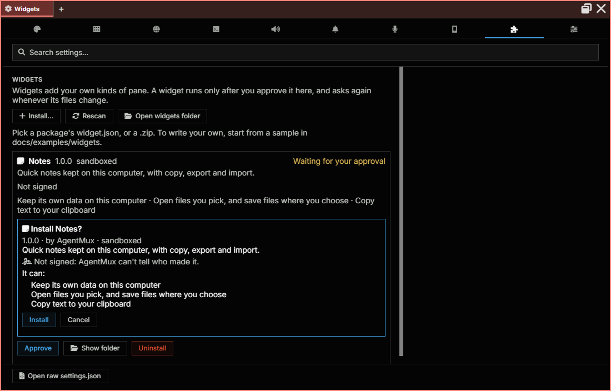

:::caution[Alpha Software]
AgentMux is **alpha software** and under heavy active development. Many features described in these docs may be incomplete, unstable, or not yet implemented. Expect breaking changes between releases. We welcome bug reports and feedback on [GitHub Issues](https://github.com/agentmuxai/agentmux/issues) or [Discord](https://discord.com/invite/96erama9Ar).
:::

A **widget** adds a kind of pane of your own to AgentMux: a dashboard for your project, a small tool, a view of some data you care about. It sits in the widget bar next to the built-in ones, opens in any pane, and can be pinned, split and moved like any other.

You can write one yourself (see [Build a widget](/build-a-widget/)), install one someone gave you, or ask one of your agents to build it for you.

## A widget runs only after you approve it

Installing a widget copies it in; it doesn't run yet. AgentMux first shows you what it is and what it asks for:

- its name, version, author and kind;
- **who signed it**, if anyone (below);
- each **permission** it asks for, in plain words (the table below);
- for a **trusted** widget, instead of permissions, a warning that it runs as part of AgentMux with full access.



It runs once you approve it, and only the version you approved. If any of its files change later (an update, an edit), it stops running and asks you again, showing the new version.

Only you can approve a widget, in AgentMux's own window. An agent can install one, but can't approve it; neither can any program that only talks to AgentMux's server.

## Who made it: signed widgets

A widget's author can sign it. The prompt then shows the key it was signed with as a short fingerprint, like `K7Q2-MZ4D-PX3A-9TWE`. Authors who want their widgets recognised publish their fingerprint, so you can compare.

AgentMux remembers, for each publisher (the part of the widget's id before the dot, `acme` in `acme.pr-dashboard`), the key of the first signed widget of theirs you approve. After that:

- another widget of theirs signed with the same key says so;
- one signed with **another key**, or not signed at all, gets a warning: "Not signed by the key that signed your other acme widgets. It may not be from the same author." Its button reads **Install anyway**, and **Don't install** is the default.

Approving a widget like that doesn't change the key AgentMux remembers. If an author tells you they really changed keys, forget the old one in **Settings → Widgets → Publisher keys**, and the next signed widget of theirs is remembered instead.

A signature tells you who published a widget, not what it does: its permissions are still all a sandboxed widget can do. An unsigned widget isn't unsafe; AgentMux just can't tell who made it.

## Sandboxed and trusted widgets

Most widgets are **sandboxed**. A sandboxed widget is a web page running in an isolated frame in its pane. It can't read the rest of AgentMux, your other panes, or your files, and it can't load code from the internet. It reaches anything outside its pane only through the widget API, and only for the permissions you approved:

| Permission | What the prompt says |
|---|---|
| (none) | It uses its own pane: title, buttons, menu, notifications, the theme, and the pane's own state |
| `storage` | Keep its own data on this computer |
| `net:<origin>` | Connect to that address, for example `https://api.github.com`, and nothing else |
| `files` | Open files you pick, and save files where you choose |
| `clipboard:write` | Copy text to your clipboard |
| `panes` | Open other kinds of panes |
| `agents:read` | See your agents' names and whether they're working |
| `tasks:read` | See the Kanban's tasks: their titles, who is on them and where they stand |
| `agents:send` | **Send messages to your agents.** An agent acts on what it's told, so only allow this for a widget you trust |

A **trusted** widget runs as part of AgentMux itself, with full access to everything AgentMux can do. Install one only if you trust its author.

## Install a widget

1. Open **Settings → Widgets** and click **Install…**.
2. Pick the widget's `widget.json`, its folder, or a `.zip` of it.
3. Read the prompt and click **Install** to approve it, or **Cancel**.

Installed widgets live in `~/.agentmux/widgets/`, one folder each. Every AgentMux installation on your computer sees the same widgets, but each asks for its own approval.

Once approved, the widget appears in the widget bar's **more** menu and in any pane's **+** menu. Pin it to the bar from there.

## From the catalog

**Settings → Widgets → Browse the catalog** lists the widgets in the [AgentMux widget catalog](https://github.com/agentmuxai/widgets): sandboxed widgets, each signed by its publisher and reviewed before it's listed. Each shows its version, author, the key it was signed with, and what it may do, with **Install**, or **Update** when you have an older version.

Installing one copies it in, and its approval prompt opens at once, with a line saying it's exactly what the catalog lists. It runs only once you approve it, like any widget: the catalog is a second check, never an approval. AgentMux checks the catalog's own signature, downloads only from the catalog's site, and checks each widget's files and its author's signature against the catalog before it asks you.

## From a bundle

An [agent bundle](/abf/#widgets-in-a-bundle) can carry the sandboxed widgets its agents use. Importing it lists them with who signed each and what it may do; each one you keep asks for your approval, as "The bundle "…" wants to install …". A bundle never approves a widget for you.

## When an agent builds one for you

Ask an agent for a widget ("make me a pane that shows my open pull requests") and it can build one in its workspace and install it with its `Widget` tool (action `install`). You then see a prompt naming the agent and showing exactly what the widget asks for:

- **Install** approves it, and the agent can open it next to its own pane.
- **Don't install** leaves it in Settings → Widgets, not approved; the agent hears that you declined.

Each new version the agent installs asks you again.

## Manage your widgets

Settings → Widgets lists every widget and its state:

| State | Meaning |
|---|---|
| **Approved** | It runs. |
| **Needs approval** | Installed, never approved. Click **Approve** to see the prompt. |
| **Changed since you approved it** | Its files changed. It doesn't run until you approve the new version (**Review and approve**). |
| **Off** | You turned it off. Its panes show that it's off until you turn it on again. |
| **Can't be loaded** | Its `widget.json` has an error, shown in the list. |

From the same list you can **Turn off** a widget or **Turn on** again, **Show folder** to see its files, and **Uninstall** it. **Open widgets folder** shows where they all are. Uninstalling deletes its folder, its approval, and any data it kept (AgentMux asks first).

## Commands and status bar items

A widget can add entries to the command palette (under **Widgets**) and small items to the status bar. They come with the widget and leave when you turn it off or uninstall it. A widget's status bar item always names the widget in its tooltip; running one of its commands, or clicking its item, opens or focuses the widget's pane.

## Widgets from widgets.json

A widget added with a `module` entry in `widgets.json`, the way it was done before widget packages, is listed as a trusted widget and asks for approval like any other. It keeps working as it did once you approve it.

An entry in `widgets.json` that should appear only inside its group's flyout (not on the bar, in **more** or in a pane's **+** menu) sets `"display:grouponly": true`. The older name, `display:hidden`, still works. It is not the same as hiding a widget yourself in Settings ▸ Widgets, which is saved in `settings.json` as `widget:hidden`.

### Sections

Some panes have a row of sections: Swarm, Connectors, Memory, Settings and the Vault. Each pane declares its sections on its manifest (`frontend/app/block/pane-sections.ts`; the Swarm's in `frontend/app/view/swarm/swarm-section.ts`). The section a pane shows is kept with the pane, under `<view>:section` (`vault:section`, for example). A `widgets.json` entry can open its pane on a section with `"section"` next to `blockdef`. Your `widgets.json` is next to `settings.json`; an entry with a new key adds one to **more** (pin it from there), and one with a built-in key replaces that one. This entry adds **Cards**, which opens the Vault on its Cards and banks section:

```json
{
  "section@vault-cards": {
    "label": "Cards",
    "icon": "credit-card",
    "section": "cards",
    "blockdef": { "meta": { "view": "vault" } }
  }
}
```

An entry from before the Warden pane was split up, with `"view": "warden"` and a `"section"` of `vault`, `history` or `audit`, still opens that pane (see [Warden](/warden/)). AgentMux turns `section` into the pane's section key (`"vault:section": "cards"`), and you can also write that key in `blockdef.meta` yourself.

Clicking an entry for a management pane (Vault, History, Audit, Connectors, Memory, Settings, Swarm and the others listed under [Opening a widget again](/pane-types/#opening-a-widget-again)) brings back the pane you already have, on the entry's section, instead of opening a second one; Shift-click opens another. An entry says so with `"singleton": true` (it opens a new pane each time without it, or with `false`). Your own entry for one of these views keeps the behaviour of the view when it leaves `singleton` out.

**Settings ▸ Widgets** flags an entry whose section its pane doesn't have (it would quietly open the pane's default section; the note lists the sections the pane has), a `section` with no `view`, and one that names a pane by an old name (`"view": "warden"`: use the pane the section moved to, see [Warden](/warden/)).

**Pin a section from the pane** (`frontend/app/window/section-pins.ts`). Right-click the header of a pane with sections and choose **Pin “Cards and banks” to bar**, named after the section it shows. If an entry already opens exactly that section (like the built-in Kanban), AgentMux pins it. Otherwise it adds an entry keyed `section@<view>-<section>` (`section@vault-cards`, `section@connectors-mcp`) to your `widgets.json` and pins that. On a section that is pinned, the menu offers **Unpin “Cards and banks” from bar** instead; the entry stays in **more**.

| Pane | View | Section key | Sections (default first) |
|---|---|---|---|
| Swarm | `swarm` | `swarm:section` | `supervisor` (default), `broadcast`, `kanban` |
| The Vault | `vault` | `vault:section` | `personal` (default), `cards`, `api-keys`, `logins`, `notes`, `kept`, `activity` |
| Connectors | `connectors` | `connectors:section` | `accounts` (default), `mcp`, `remotes` |
| Memory | `memory` | `memory:section` | `global` (default), `personal`, `skills`, `bundles` |
| Settings | `settings` | `settings:section` | `appearance` (default), `window`, `browser`, `terminal`, `sounds`, `notifications`, `recording`, `devices`, `widgets`, `advanced` |

A widget can open these sections too: see [`am.panes.open`](/widget-api/#opening-a-section).

## See also

- [Build a widget](/build-a-widget/): your first widget in five minutes.
- [Widget API reference](/widget-api/): the manifest, the SDK and every method.
- [Widget security](/security/widgets/): what the sandbox and the approval protect, and how.
