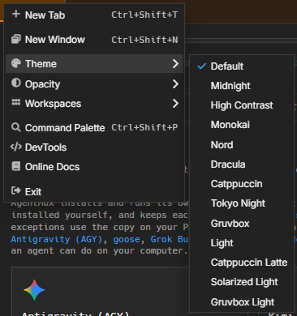
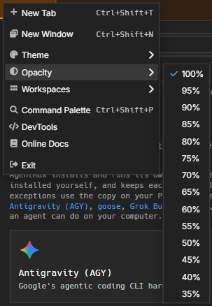
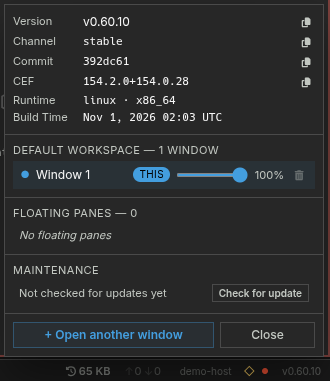

:::caution[Alpha Software]
AgentMux is **alpha software** and under heavy active development. Many features described in these docs may be incomplete, unstable, or not yet implemented. Expect breaking changes between releases. We welcome bug reports and feedback on [GitHub Issues](https://github.com/agentmuxai/agentmux/issues) or [Discord](https://discord.com/invite/96erama9Ar).
:::

Each AgentMux window has its own **theme** and its own **opacity**. Changing them in one window leaves your other windows as they are. Settings ▸ Appearance holds the **defaults**: what a window shows until you give it a theme or opacity of its own.

## Theme

Open the hamburger menu (≡) → **Theme** and pick a theme. Only the window you opened the menu in changes. The menu checks the theme that window is on.

The choice is saved with the window, as `window:theme` in the window's own meta, so it comes back when you restart AgentMux.

A window without a theme of its own uses **Settings ▸ Appearance ▸ Theme**, the `window:theme` key in `settings.json`. Changing that default changes every window that has no theme of its own, and leaves the others alone. With neither set, the theme is `default`.

## Opacity

There is one opacity per window. You can set it from two places, and they show the same value:

- **The hamburger menu (≡) → Opacity:** 100% down to 35%, in 5% steps.
- **The window list in the status bar:** click the version chip in the bottom status bar to open the Instance Panel, then drag the **Opacity** slider on a window's row. The window changes as you drag, and the value is saved when you let go.

A choice in the menu moves the slider, and dragging the slider moves the menu's checkmark. A value between two steps, such as 72%, checks the nearest step (70%). The Instance Panel lists every open window, so you can also set another window's opacity from there.

The value is saved as `window:opacity` in the window's own meta. 100% is saved as `1`, so a window you set to fully opaque stays opaque even when the default is see-through. It survives a reload, a restart and a crash.

Both controls stop at **35%**, because text becomes hard to read below that.

### The default opacity

A window without an opacity of its own uses the channel default:

- If **Settings ▸ Appearance ▸ Window transparency** (`window:transparent`) or **Background blur** (`window:blur`) is on, the default is **Settings ▸ Appearance ▸ Opacity** (`window:opacity`), or 80% when that isn't set.
- Otherwise the default is 100%, fully opaque.

The Opacity row in Settings shows only while Window transparency is on. Changing a default never overrides a window that has its own value.

## New windows

A new window starts with the theme and opacity of the window it came from. That covers **New Window** (from the hamburger menu, the keyboard shortcut, the command palette or the title bar menu), a tab or pane you drag out of a window, and **Open in New Window** on a widget. The copy is taken once: changing the first window later doesn't change the new one.

A window that doesn't come from another window, such as the first window when you start AgentMux from your desktop, uses the defaults from Settings ▸ Appearance. Windows restored when you restart AgentMux keep their own saved values.

Floating panes have no hamburger menu. Their opacity is set from the Instance Panel and lasts only for the session. They show the default theme.

## Platform support

Theme and opacity work on Windows, macOS and Linux:

- **Windows:** a layered window (`SetLayeredWindowAttributes`).
- **macOS:** the window's alpha value.
- **Linux:** `_NET_WM_WINDOW_OPACITY` on X11 and XWayland. A native Wayland session has no protocol for this, so AgentMux fades the page itself.

The Opacity menu and slider appear only in the desktop app, where the window can be made see-through.

## See Also

- [Settings reference](/settings/#window-settings): `window:theme`, `window:opacity`, `window:transparent`, `window:blur`
- [Main menu](/main-menu/): the hamburger menu
- [Keybindings](/keybindings/): keyboard shortcuts
