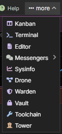
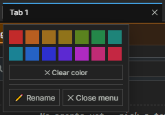
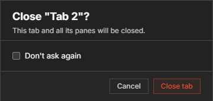
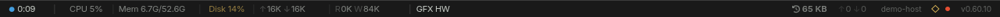
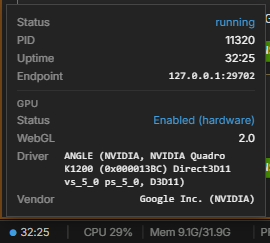
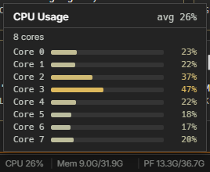
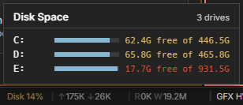
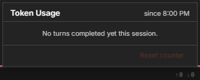
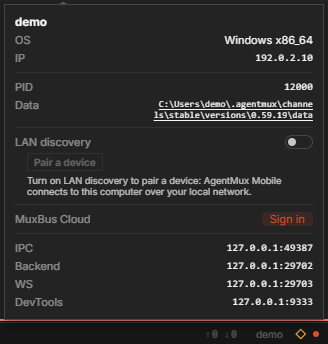

:::caution[Alpha Software]
AgentMux is **alpha software** and under heavy active development. Many features described in these docs may be incomplete, unstable, or not yet implemented. Expect breaking changes between releases. We welcome bug reports and feedback on [GitHub Issues](https://github.com/agentmuxai/agentmux/issues) or [Discord](https://discord.com/invite/96erama9Ar).
:::

An AgentMux window has three parts: the **top bar**, the **panes** of the current tab, and the **status bar** along the bottom.

## Top bar

From left to right:

- **Hamburger menu (≡):** global actions and preferences. See [Main menu & command palette](/main-menu/).
- **Window tabs:** each tab holds its own layout of panes. **New Tab** (`Ctrl+Shift+T` / `⌘T`) adds one; drag a tab below the tab bar to [tear it off](/pane-types/#tab-tear-off) into a new window.
- **Widget bar:** one icon per pinned widget; click one to open it. Widgets that aren't pinned are under **more** at the end of the bar. Right-click a pinned icon to unpin it.
- **Window buttons:** minimize, maximize and close.

The main window reopens where you left it, and maximized if it was, after a quit, a crash or an upgrade, on Windows, macOS and Linux. A window saved on a display that has since been unplugged isn't placed there. On Linux under native Wayland only the size and the maximized state come back, because the compositor decides where windows go.

### The widget bar's More list

Hover **more** (or click it) to list the widgets that aren't pinned to the bar. Click one to open it.

### A tab's menu

Right-click a window tab to colour it or rename it: pick one of 14 colours, **Clear color** to remove it, or **Rename**. The colour is stored with the tab (`tab:color`).

No two tabs in a window share a name, ignoring case. A new, renamed or moved tab whose name is taken gets a counter: "Tab 4 (2)", "Report (2)". A new tab is named with the next free "Tab N". A name that ends in a year, such as "Report (2024)", keeps it, and the counter goes after it: "Report (2024) (2)".

### Closing a tab

A tab's close button (×) asks first, because the tab's panes close with it. Tick **Don't ask again** (or turn on **Skip tab close confirmation** in [Settings → Window & Panes](/settings/#window--panes)) to close tabs straight away from then on.

## Panes

Each pane has a header that is also its tab strip: a pane can hold several tabs of any widget type. The buttons at the right of the header minimize the pane, maximize it to fill the tab, and close it. Minimizing a pane in a split puts its tabs into a neighbouring pane as background tabs (hold `Shift` to keep a header chip instead); right-click the tab's pill and choose **Open in Its Own Pane** to bring it back. Right-click the header for the pane's menu. See [Pane Management](/pane-types/#pane-management) for splitting, pane tabs, moving panes and floating them.

The mouse's Back and Forward side buttons re-select the panes you had selected before and after, in any tab (see [Pane selection history](/pane-types/#pane-selection-history)).

**Hover tooltips** show once the pointer has rested on a button, pill or truncated label for 40 ms, and at once when you move along a row of them. Labels that used to be the browser's slow native hover text use the same tooltip.

**Zoom.** `Ctrl`+scroll over a pane zooms that pane; over the title bar, the status bar or a pane header it zooms the interface itself, which starts again at 100% when AgentMux restarts. `Ctrl+Shift`+scroll zooms every pane in the window. See [Keybindings](/keybindings/#find--zoom) and [Zoom system](/internals/zoom/).

## Status bar

From left to right:

| Item | Shows | Click it for |
|------|-------|--------------|
| Backend status | A status dot and how long the backend has been up | The backend panel |
| **CPU** | Total CPU use | The load on each core |
| **GPU** | GPU use, where the platform reports it | — |
| **Mem** | Memory used and total | — |
| **PF** | Commit charge used and total: RAM plus the page file budget (Windows) | — |
| **Disk** | How much of the system drive is free (its colour warns as it fills) | Free space on each drive |
| ↑ ↓ | Network upload and download | — |
| **R** **W** | Disk reads and writes | — |
| **GFX** | Whether the window is drawn by the GPU (`HW`), in software (`SW`), or without WebGL | — |
| Agent count | A robot icon with **N running**, and **N waiting on you** in the warning colour when some of them wait for your answer. Shown only while an agent runs. An agent counts as running when it has a process, with or without a pane | The [Swarm](/subagent-watcher/) |
| **History** (clock icon) | How much agent history is kept on this computer. It sits just left of the token count | Where the history is kept |
| ↑ ↓ (right) | Tokens your agents have sent and received this session | Token usage by service |
| **Offline** or **Connection issues** | Shown only when a service AgentMux needs can't be reached. **Offline** (red): MuxBus or a model provider's API can't be reached at all. **Connection issues** (amber): some requests to one have kept failing for more than 30 seconds. Hover it for each service and since when. It clears when the service answers | — |
| Host name | This computer's name, with the LAN discovery indicator (◇) and the MuxBus Cloud dot | The host panel |
| Version | The AgentMux version | The instance panel |

Hover an item for a short description. Each panel closes with `Esc` or a click outside it.

AgentMux watches MuxBus and the model API of each provider your agents use: the **Anthropic API** (Claude), the **OpenAI API** (Codex) and the **Google AI API** (Gemini). Codex and Gemini join once one of their turns has reported. If an agent's CLI is pointed at a proxy or gateway, that address is watched as a service of its own, named with its host. On Windows, a change of network (a Wi-Fi switch, a VPN) is checked at once. Messages you type to an agent while its model API is out are held and sent when it answers; the agent's row in the [Swarm](/subagent-watcher/) says how many are held.

### Backend

The backend's status, process id, uptime and endpoint, and how the window is drawn: whether graphics are hardware accelerated, the WebGL version, and the graphics driver.

### CPU cores

The load on each CPU core, and the average.

### Disk space

Each drive's free space and size. The **Disk** figure in the bar is the system drive's free share.

### Token usage

Tokens sent and received since the time shown, by service. **Reset counter** starts the count again.

### History size

The figure in the status bar is the total of agent history on this computer. Click it to see where that history is kept: the CLI's own session files, the shared pane history, archived sessions and the jekt audit trail, each with its size, and the largest pane histories. The total counts the data the pane history holds, not the free space inside its file. That free space shows on its own **Reclaimable (not in the total)** line when there is some, and the copies of the pane history that older versions kept are listed as **Old copies, per version (not in the total)**. AgentMux keeps history forever, so the total only grows. The panel says when it was measured. **Measure again** measures anew, and **Open History** opens the [History](/history/) pane, where **Storage** can give the free space back.

### Host

This computer: its OS, address, the backend's process id, and the version's data folder (click the path to open it in your file manager). Below that: the [LAN discovery](/lan-discovery/) switch and **Pair a device**, [MuxBus Cloud](/auth/) sign-in, and the local endpoints (IPC, backend, WebSocket, DevTools).

### Instance panel

This AgentMux instance: its version, channel, commit, CEF version, runtime and build time (each with a copy button), the windows of the open [workspace](/workspaces/), its floating panes, and maintenance (whether this version is up to date, with **Check for update**). **Open another window** opens a new window in the workspace.

The window list is headed by the workspace's name and how many windows it has ("Default Workspace — 3 windows"); double-click the heading, or press `F2` on it, to rename the workspace. Below it:

- **Open windows** (● this window, ○ the others): click one to focus it, double-click (or `F2`) to rename it. Each has an opacity slider and **Remove from workspace**, which closes the window and deletes its tabs and panes (disabled on the only open window).
- **Closed windows**, greyed (◌), with when they closed: click one, or its **Reopen** button, to open it where it was, its agents resuming. Right-click one for **Remove from workspace**.

#### Maintenance and updating

The **Maintenance** part of the panel shows whether a newer release is out. Nothing checks on its own: **Check for update** (or **Check again**) asks. When one is out, the row reads "v*x* is out" with **What's new**, which opens that release's page on GitHub in your browser (the list of releases when the version isn't known), and **Download**. **Download** works for the Windows installer and portable builds, the AppImage, the Linux portable build, a `.deb` or `.rpm`, and the macOS app when it sits in a folder you can write to. For any other install it opens the release page, and you install the release yourself. On the Microsoft Store build the button reads **Update in the Store** and asks the Store to install the update, or opens the Store page when it can't; the Store gets each release after GitHub does, so it may not be there yet. When your version is older than the oldest one a release upgrades from, the row says to install that version first.

After **Download** the row shows the progress ("Downloading v*x*… 40%", then "Unpacking"). AgentMux checks the file against the release's signed manifest before it keeps it, and refuses a file that doesn't match. Then the row reads "v*x* is ready" with **Show folder** or **Show installer** (**Show file** for an AppImage) and **Upgrade & restart**. The first only reveals the file in your file manager and never runs it; **Upgrade & restart** is what installs it. A failed download says why, with **Try again** and **Release page**.

**Upgrade & restart** doesn't interrupt an agent. The row reads "Waiting for 3 agents to finish…" and keeps waiting for as long as it takes, reading the count again each time; an agent whose process has ended doesn't count. It lists what the restart would also stop, such as commands agents left running. **Restart now** skips the wait, and **Cancel** stops the upgrade. When the agents are done, the launcher asks you in a dialog: "Restarting: answer the AgentMux dialog (No cancels)". Your agents resume after the restart, and an agent whose turn was cut off is told to carry on. The cut-off turn ends with "This turn was cut off mid-tool, so it didn't finish." instead of an error.

A `.deb` or `.rpm` upgrade asks for your password in your desktop's own prompt. If the new version can't be kept running, AgentMux offers, for 7 days after the upgrade, to go back to the version before it; that asks for your password too.

An agent can ask for an upgrade through the `App` tool, on this computer or, with `host`, on another one on your network. It goes to the super agent as a sensitive request, and the person at that computer sees a banner with a countdown that they can veto (see [Interagent communication](/internals/interagent-comms/) and [MuxAPI](/internals/muxapi/)).

Closing a window keeps it in the workspace as a closed window (see [Workspaces](/workspaces/#windows-in-a-workspace)). See [Window appearance](/window-appearance/) for the opacity slider and [Report issues](/report-issues/) for what to copy into a bug report.

## See also

- [Main menu & command palette](/main-menu/)
- [Pane Types](/pane-types/) and [Pane Management](/pane-types/#pane-management)
- [Settings reference](/settings/)
- [System Metrics](/system-metrics/): the Sysinfo widget's graphs
